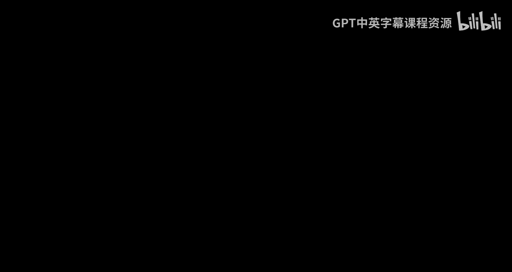
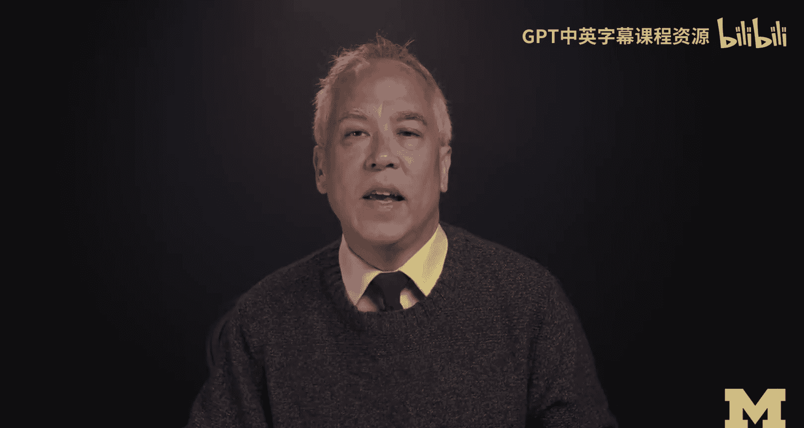
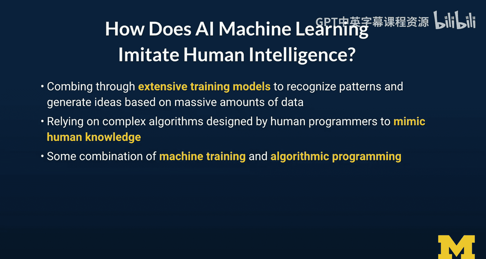
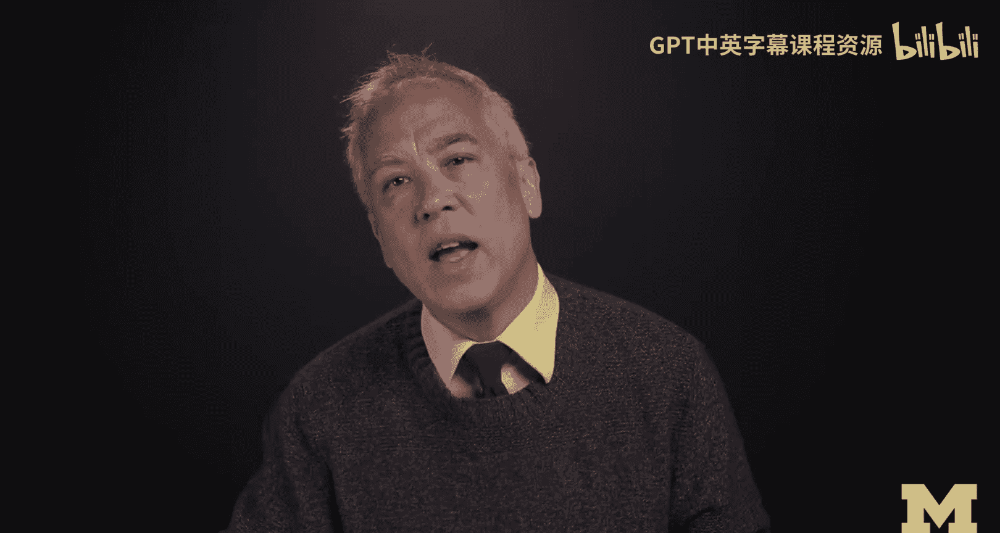
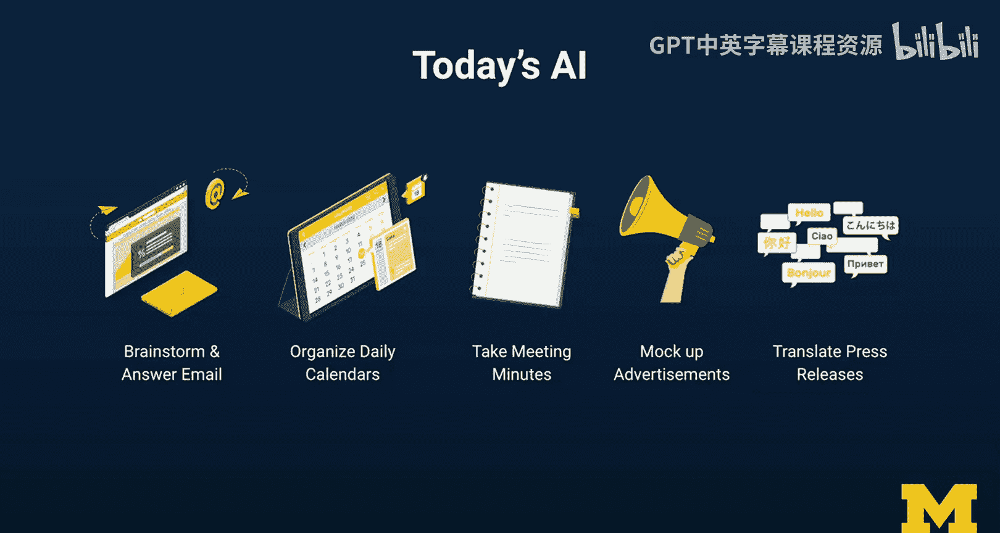
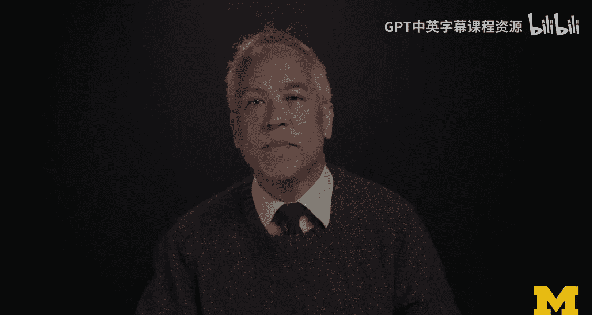
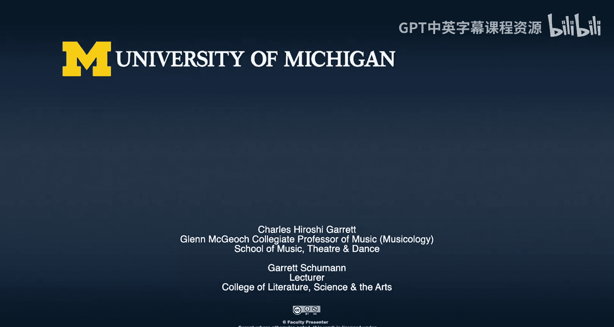

# AI用于创意工作：P2：1_人工智能在创意领域的应用概览

在本节课中，我们将要学习生成式人工智能（AI）如何改变创意领域，了解其背后的核心技术原理，并探讨其在商业世界中的广泛应用。

---

生成式AI工具正以前所未有的速度改变我们的生活、工作和学习方式。人工智能领域的重大进展重塑了我们所熟知的商业世界，专业的AI工具正逐渐成为全球创意专业人士日常工作的一部分。

如今流行的生成式AI工具融合了复杂的机器学习技术，能够响应用户的指令、提示和命令。

---

上一节我们提到了AI的广泛应用，本节中我们来看看人工智能与机器学习的核心目标。AI与机器学习旨在模仿人类智能，其实现路径主要有以下三种：

1.  **基于海量数据的模式识别**：通过分析广泛的训练模型来识别模式，并基于海量数据生成想法。
2.  **基于复杂算法的知识模拟**：依靠人类程序员设计的复杂算法来模拟人类知识。
3.  **混合方法**：结合机器训练和算法编程两种方式。

---

理解了AI的基本原理后，我们可以通过具体例子来区分两种不同的实现方式。例如，一个旨在创作西方古典音乐的、基于机器训练的生成式AI工具，可能会通过学习巴赫、莫扎特和贝多芬的全部作品来进行训练。

而一个基于算法的音乐创作生成式AI工具，则可能依赖于编码一套关于音乐的特定规则，这些规则捕捉了音乐理论家和历史学家对传统古典音乐内在运作方式的概念化理解。

目前，创意领域的先进AI软件通常融合了机器学习和算法方法的元素，以获得更细致入微的结果。

---

近年来，生成式AI的进步开始渗透到商业世界的各个角落。AI工具不仅能够协助信息技术工作组，还能影响产品开发、销售、财务、市场营销、产品测试、公关等当今几乎所有的行业领域。

具体而言，如今的AI可以帮助用户进行头脑风暴、回复邮件、整理日程、记录会议纪要、制作广告原型、翻译新闻稿等等。

---

因此，对于创意专业人士而言，现在正是探索这些新技术可能性与潜在风险的恰当时机，以便学习如何在AI时代负责任地前行。

---

本节课中我们一起学习了生成式AI对创意领域的变革性影响，了解了其通过数据训练和算法规则模仿人类智能的核心原理，并看到了AI在商业与日常工作中的广泛应用。认识到这些，将帮助我们更好地迎接并驾驭AI带来的机遇与挑战。