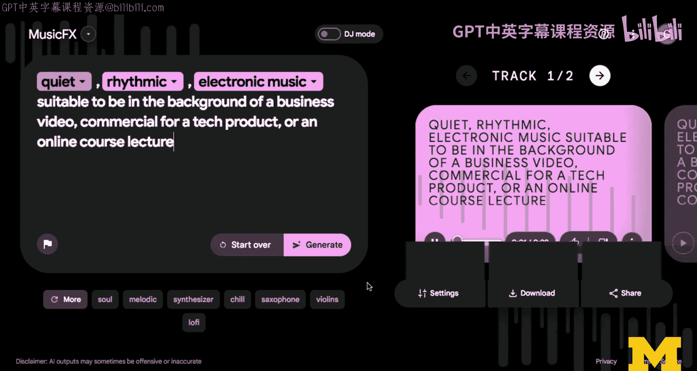
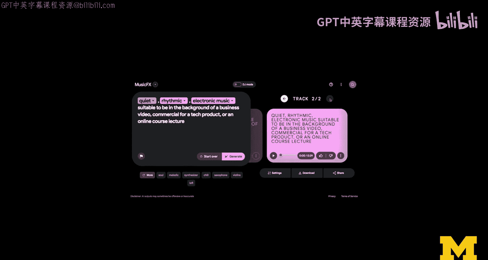
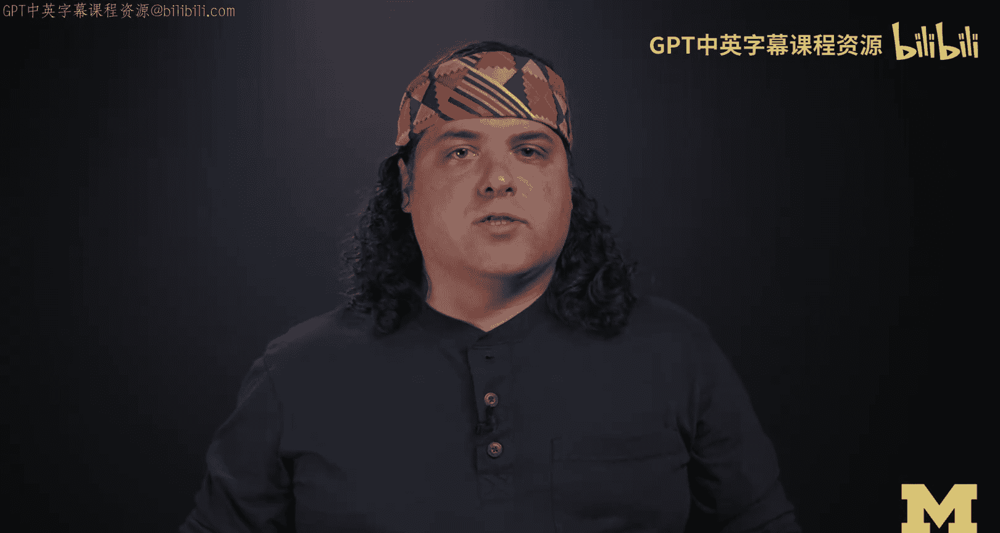
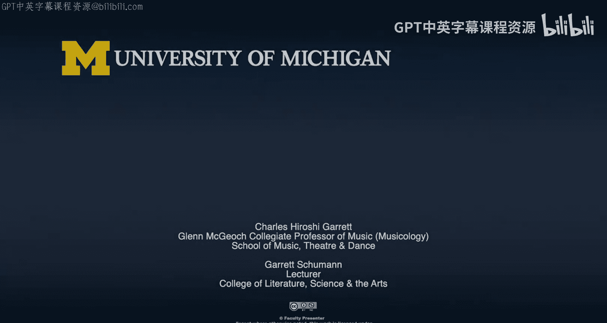

# AI用于创意工作:3：AI音乐生成工具对比与演示 🎵

在本节课中，我们将通过一位音乐家的实际体验，对比两款AI音乐生成工具：Google的Music FX和BandLab的Songstarter。我们将了解它们如何辅助创意工作，分析各自的优势与局限，并探讨如何将AI工具有效融入专业创作流程。

---

## 概述：从零开始的AI音乐探索 🎹

我是一名音乐家，希望了解AI音乐生成工具如何能辅助我的工作。Google的Music FX是一款免费且备受关注的工具，因此我选择从这里开始尝试。

我输入了一个非常具体的提示词，其中包含了我所寻找音乐的风格和声音特征的一些线索。这个工具的潜在益处是巨大的，因为尽管我有能力创作原创音乐，但直接创作远比为一个AI工具编写提示词更耗费心思和时间。

你可以看到，我决定生成的提示是：“适合作为商业视频、科技产品广告或在线课程讲座背景音乐的、安静的、有节奏感的电子音乐”。

---

## Music FX 初体验：生成与聆听 🎧

我要求它开始生成示例。片刻之后，程序将根据我的要求创建两条音轨。完成后，第一条音轨会自动开始播放。

（此处为音乐播放图示）

现在，我们来听听第二条音轨。

（此处为音乐播放图示）

---

## Music FX 的优势与核心局限 ⚖️

Music FX允许我下载这些音轨，这对我来说至关重要，因为我可以在创意项目中灵活地使用它们。然而，该软件存在一些重要的局限性，这些局限性让我作为一名专业音乐家，会想去寻找其他工具。

以下是Music FX的主要限制：

1.  **时长固定**：Music FX生成的片段长度均为30秒，这非常短暂。
2.  **格式单一**：我只能以MP3这一种文件格式下载音频。我希望能有更多选择，尤其是更高保真度的选项，但Music FX（至少在免费版本中）并未提供。
3.  **缺乏编辑性**：我无法在不依赖其他软件的情况下，对Music FX根据我的提示生成的音轨进行任何定制或修改。

（此处为工作流程图示）

如此复杂的工作流程，对我来说，并不比从零开始构思自己的音乐创意更有用。并且，从我导出的Music FX音轨中，几乎听不到我个人独特的创作风格，这令人沮丧。

---

## 转向 BandLab：更强大的AI创作伙伴 🚀

不过，确实存在一些我更可能觉得有用、并更愿意引入工作中的AI音乐工具。例如，我们现在听到的正是AI生成的音乐。

它来自免费、基于浏览器的数字音频工作站（DAW）——BandLab。该平台有一个名为“Songstarter”的AI驱动功能，能根据我选择的风格建议，生成长约一分钟的音乐。

（此处为Songstarter界面图示）

---

## Songstarter 的核心优势：可编辑性与工作流整合 ✨

与Music FX不同，Songstarter允许我在BandLab常规的录音室工作区中，进一步编辑它生成的音乐。除了让我有机会在生成式AI的支持下表达自我之外，这个扩展功能意味着使用AI工具不会对我的工作流程造成重大改变。

（此处为BandLab编辑界面图示）

此外，BandLab自带一套全面的软件乐器和效果器。与Music FX及其他从互联网各个角落采集音频进行训练的简易AI音乐生成器不同，BandLab使用其自带的音源库来演奏Songstarter生成的音轨。

（此处为音源库图示）

这增加了编辑的便利性，也让我更放心地在创意项目中使用AI生成的材料。

---

## 总结：在AI时代保持创意独特性 🌟

我对比Music FX和Songstarter的经验表明，借助合适的工具，创意专业人士仍然可以展示他们独特的技能和个人视角，同时利用生成式AI来增强创作效率与可能性。

本节课中，我们一起探索了两款AI音乐生成工具的实际应用。我们了解到，**Music FX** 虽然能快速生成音乐，但在**时长、格式和可编辑性**上限制较多。而 **BandLab的Songstarter** 则通过与专业DAW环境深度整合，提供了**可编辑的、更长篇幅的音乐片段**，并能无缝融入现有工作流，更好地服务于音乐家的个性化创作。关键在于选择那些能补充而非取代你独特创意声音的工具。