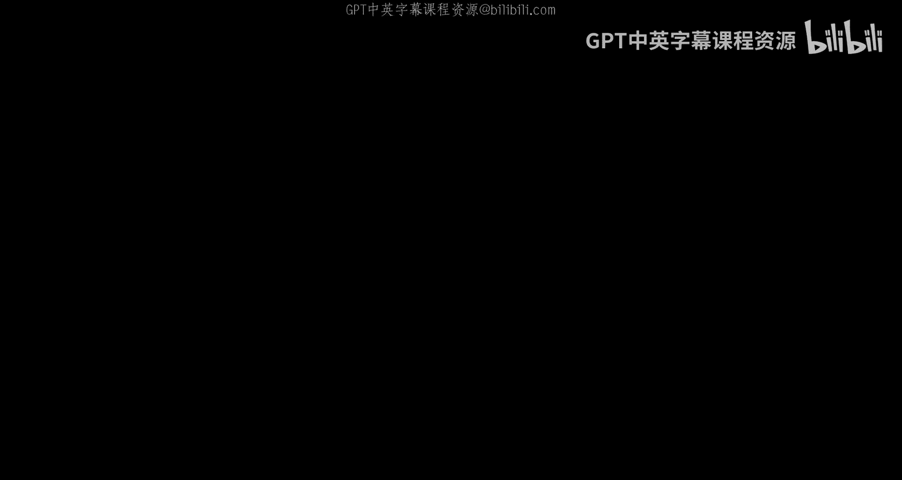
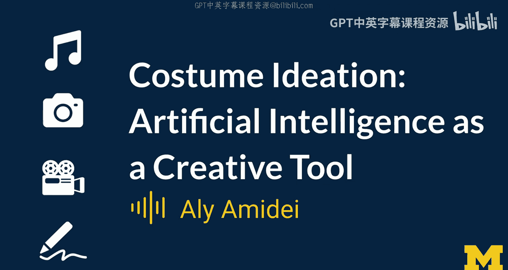
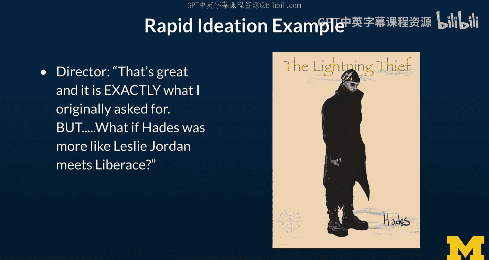
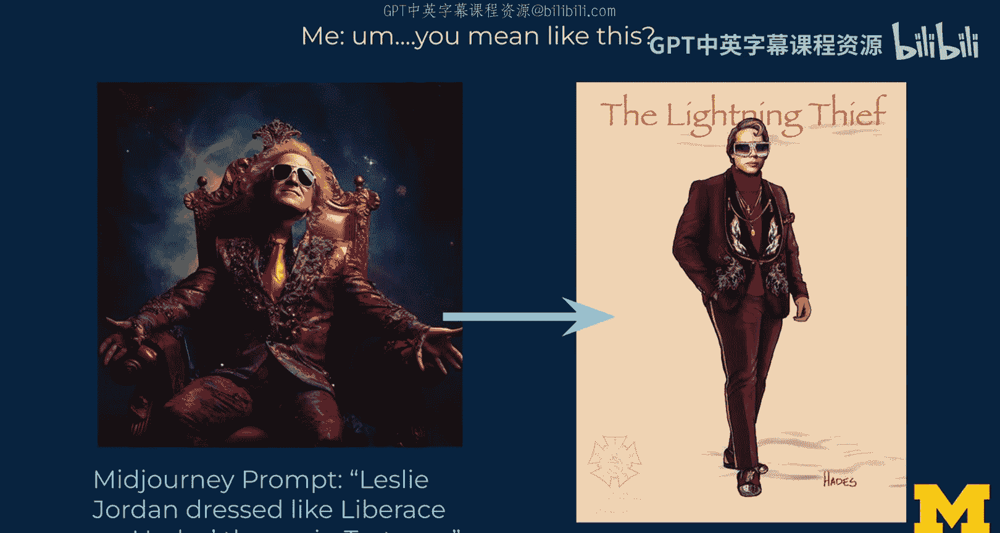
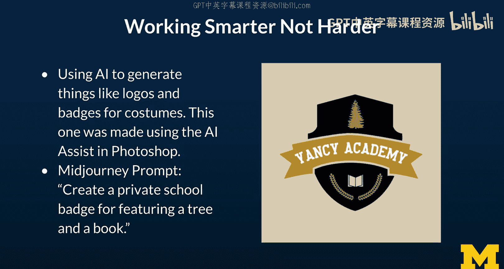
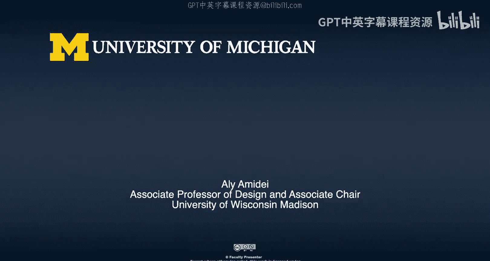

# AI用于创意工作：P4：艾丽·阿米迪的专题讲座 🎭

在本节课中，我们将学习戏剧服装设计师艾丽·阿米迪如何将人工智能作为创意工具，融入她的设计工作流程。她将分享AI在激发创意、辅助研究和提升效率方面的具体应用，以及使用过程中的挑战与思考。

大家好，我是艾丽·阿米迪，我将分享关于人工智能作为创意工具在服装构思中的应用。

我是一名戏剧服装设计师。服装设计师负责创造演员在舞台上穿着的服装。这些服装更具体地被称为戏服。戏服为我们提供了穿着角色的信息，并支撑着剧本的故事。

我的工作涉及大量的研究、问题解决、原型制作、沟通以及亲自动手的创意和技术劳动，目的是将纸上的想法变成舞台上的服装。服装设计是团队协作的一部分，这个团队包括设计师、导演、演员、技术人员等，所有人共同努力，为观众呈现一出鲜活的戏剧或演出。

现在，我在工作中会使用许多数字和模拟工具。我直到2023年才开始将像ChatGPT和Midjourney这样的AI工具融入我的教学和艺术创作实践中。

目前，当我需要做三件事时，我会转向像Midjourney这样的图像生成工具：**激发创意**、**辅助研究**以及**更聪明地工作，而非更辛苦**。

## 激发创意 💡

对于激发创意，像Midjourney这样的工具非常适合进行实验。我可以在短时间内用一个精心设计的提示词来“路测”一个古怪的想法，并立即从合作者那里获得反馈，判断我的方向是否正确。

**AI生成的图像成为了第一个概念验证**，之后我可以在此基础上，运用我作为设计师更传统的非AI艺术实践继续推进。这极大地减少了在没有AI辅助的情况下达到相同阶段所需的时间和精力。

## 辅助研究 🔍

上一节我们探讨了AI如何激发创意，本节中我们来看看它在研究方面的辅助作用。

作为一名服装设计师，我既为角色设计服装，也需要在创作时同时考虑到角色和演员的身份。我非常重视寻找能代表演员和角色身份的研究图像。根据戏剧的性质，找到具有代表性的研究资料可能具有挑战性。

以下是一个例子：我当时很难找到一张描绘一位现代、时尚、带有戏剧性舞台灯光的、有行动障碍的非裔青少年图像。因此，我在Midjourney上使用提示词创建了一张。

**提示词示例**：`a young black teenager with a mobility disability in modern stylish clothing, dramatic theatrical lighting`

在服装研究演示中，将这样的图像作为实际主要图像资源的补充，可以作为一个强有力的视觉辅助，帮助更好地讲述故事。它也能更好地传达我的设计意图，并可以确保我呈现的研究图像是以一种文化敏感的方式，考虑到了角色和演员的交叉身份。

然而，AI作为一种工具远非完美。尽管进行了多次提示尝试，我仍然无法为这个关于一个痴迷于AO3、Jared Leto的眼睛和罗马帝国的青春期女孩的绝妙又傻气的设计概念，获得哪怕一张可用的图像。

在这里，AI的局限性显而易见。经过一次尝试后，最好的选择是手动快速制作一个拼贴画，而不是继续徒劳地使用AI。我了解到，当需要奇思妙想、幽默感以及设计眼光时，Midjourney的帮助有限。

## 更聪明地工作 ⚙️

我们看到了AI在研究和创意中的潜力与局限，现在让我们看看它如何帮助我们提升效率。

尽管如此，对于每一个失败案例，总有一些时候需求非常大，值得尝试看看Midjourney是否能减少原型制作时间，从而产生一个团队都认可的成功想法草案。

当被问及音乐剧中所有合唱团成员都穿着相似的粉色西装时，与其在Photoshop中重新着色和制作，我能够快速生成这个图像，当场获得对“粉色西装合唱团”的肯定或否定答复。

作为一个实际案例，我最近为麦迪逊儿童剧院设计的音乐剧《闪电窃贼》设计了服装。导演布莱恩·考辛最初要求哈迪斯是一个赛博朋克哥特悲伤情绪摇滚风格的角色。然而，在与演员排练一周后，他回来告诉我这个方向完全错了，我们需要转向不同的方向。

原来的服装已经采购完毕，而我们距离带妆彩排只有三周时间。因此，为这样一个主要角色更换服装是一个大问题。他问，如果哈迪斯更像莱斯利·乔丹遇见利伯拉奇会怎样？

这感觉正是Midjourney大显身手的时刻。使用这个提示词，我能够创建出你们在这里看到的图像，而导演的反应是：“是的，这太完美了。” 然后，我利用这张图像进行了新的初步研究，并为该角色创作了新的服装效果图。我采购了服装，瞧，大功告成。

这套服装取得了巨大成功，并允许在最小化对项目创意流程负面影响的前提下，进行实时的协作和问题解决。

最后，AI可以帮助我更聪明地工作，而非更辛苦。这是《闪电窃贼》制作中的另一个例子。我需要为扬西学院校服设计徽章。利用Photoshop中的AI工具，我能够快速生成这个符合我们需求的图像，并且创建时间不到五分钟。

## 总结与思考 🤔

本节课中我们一起学习了艾丽·阿米迪将AI应用于创意实践的三种主要方式。

总而言之，这些是我在创意实践中使用AI生成的三种方式。考虑到我所意识到的负面影响，特别是对环境和版权侵权的担忧，我仍然感到矛盾。但最终，我尝试负责任地使用它，以一种有助于我维持工作与生活平衡的方式。

谢谢。

