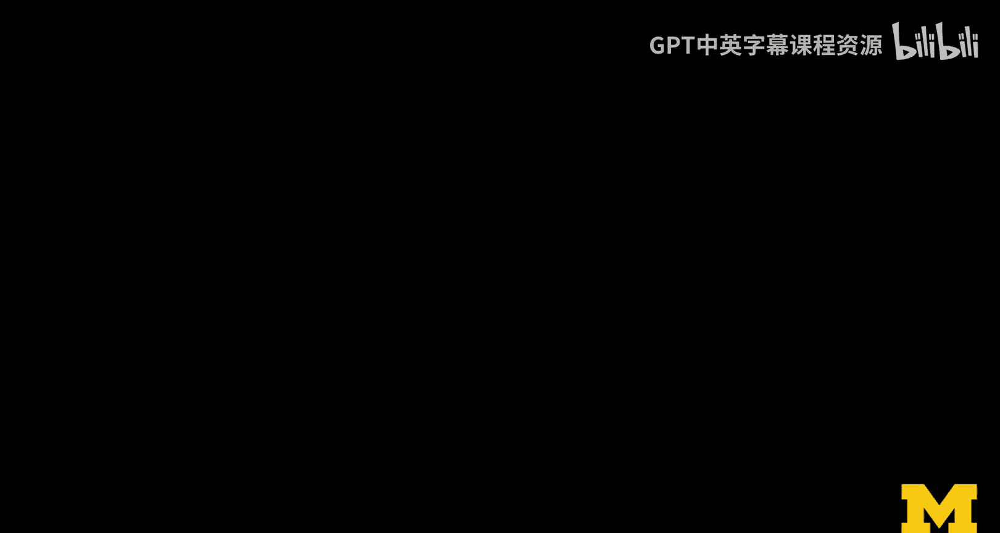
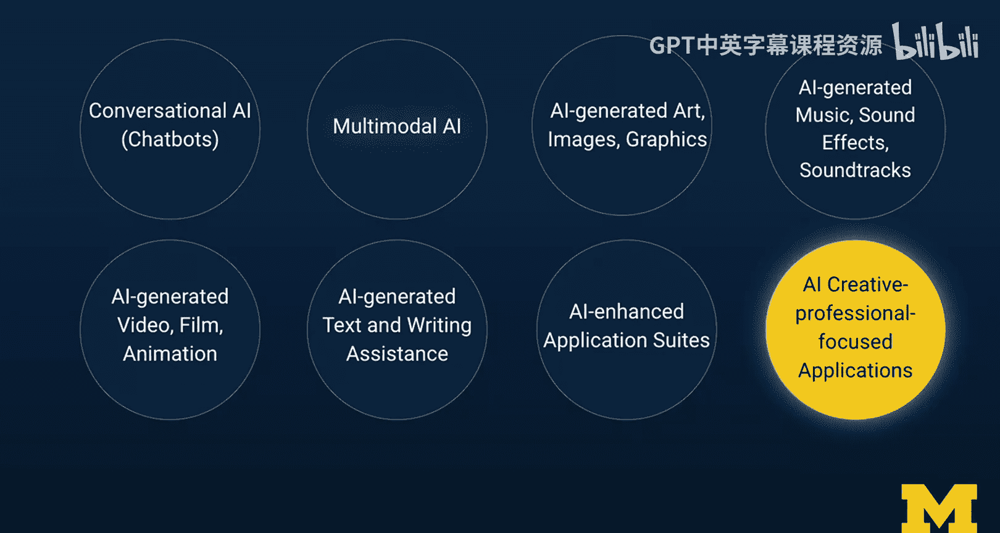
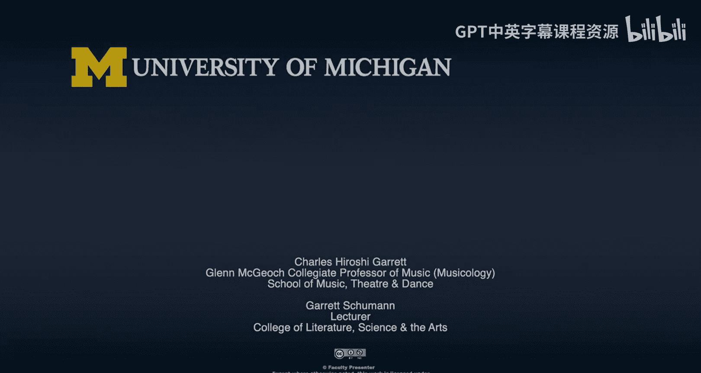
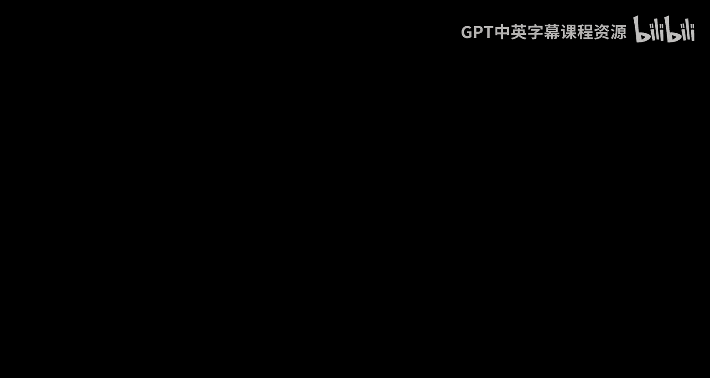

# AI用于创意工作：P5：生成式AI工具综述

在本节课中，我们将要学习生成式AI工具如何辅助创意工作，并对当前流行的各类工具进行系统性梳理。

由于AI产业投入了大量精力开发旨在模仿、替代或增强创造力的应用，生成式AI工具正变得越来越普及，可用于辅助创意工作。一些工具承诺通过自动化任务来帮助我们更高效地工作。另一些工具则旨在帮助我们进行头脑风暴、探索想法并激发好奇心。

流行的生成式AI工具使用基于大量数据训练的模型，因此能够生成多种内容，包括文本、视觉图像、引人注目的插图和平面设计、音乐、高清视频、3D动画以及许多其他类型的媒体。

现在，许多创意工作者正通过各种软件程序和应用程序套件来使用生成式AI。

## 生成式AI的八种应用方式

以下是AI已经在创意工作中产生影响的八种方式。请注意，这些类别可能存在重叠。

### 1. 对话式AI与多模态AI

上一节我们介绍了生成式AI的广泛应用，本节中我们来看看具体的工具类别。对话式AI以生成式AI聊天机器人的形式，自2022年11月OpenAI推出ChatGPT-3.5以来，便开始重塑我们的世界。如今，许多行业的创意工作者都利用聊天机器人先进的自然语言处理和机器学习能力，来辅助他们的专业工作和日常生活，例如进行头脑风暴、学习、研究、分析和管理。

到2023年，包括ChatGPT和谷歌的Gemini在内的大多数先进聊天机器人已发展为多模态。这意味着它们不仅能通过交换文字进行书面对话，还能做更多事情。多模态AI不仅能生成文本、图像、音频和视频等多种形式的内容，还能接受语音命令、分析图像并理解声音和视频。换句话说，多模态AI不仅能写，还能听、看和说。

一些多模态AI工具可以免费使用，但最先进的多模态平台通常需要个人或团队付费订阅，才能访问其最先进的功能。

### 2. AI图像生成

AI生成艺术和其他类型视觉图像的能力，正在改变许多职业的创意工作方式。

以下是几款流行的AI图像生成工具：
*   **Midjourney**、**Stable Diffusion** 和 **OpenAI的DALL-E** 等应用程序能响应用户的提示词，按照您指定的尺寸、分辨率、风格和视角生成高质量的视觉图像。
*   许多图库服务，如 **Shutterstock** 和 **Getty Images**，现在也加入了AI增强功能，允许您仅基于其庞大的图像库来生成新的AI图像。

### 3. AI音乐生成

AI生成音乐正在创意产业中快速发展。

以下是AI音乐生成的应用方式：
*   **Bandlab**、**Aiva**、**Amper Music** 和 **Soundraw** 等AI应用程序允许用户创作各种类型的音乐，且无需支付版税。
*   有些程序特别擅长根据文字提示创作歌曲。例如，您可以输入提示：“创作一首融合民谣和乡村元素、表达对乡村故乡怀念之情的歌曲。”
*   而其他程序则允许用户微调请求，指定确切的流派、乐器和节奏。

### 4. AI视频与动画生成

大多数多模态AI套件都能够生成AI视频片段、电影、动画和其他视觉图像。

此外，也存在许多专门用于生成特定类型媒体的针对性软件包：
*   例如 **Pictory** 等应用程序可以生成带有木偶的AI卡通。
*   **D-ID** 等工具可以将数字肖像变成会说话的动画头像。

### 5. AI文本生成与写作辅助

对话式AI聊天机器人和多模态AI应用程序在商业世界中获得了广泛关注，因为它们能够生成新文本并协助写作任务，例如起草电子邮件、总结会议记录，或调整写作语气以适应不同的消费者群体。

AI写作软件也可用于协助专业任务：
*   **Copy.ai** 旨在创建广告文案和其他类型的营销内容。
*   而文本补全应用程序 **Bloom**，则旨在完善书面短语和填充句子。

### 6. 集成于主流软件的AI工具

如果您是微软或Adobe应用程序的长期用户，您可能已经在使用生成式AI功能。

以下是集成AI的主流软件：
*   **Microsoft Copilot** 是一个集成在其商业软件平台中的AI工具，旨在提升创造力，可帮助生成书面内容、安排日程、总结会议记录等。
*   Adobe的创意应用程序套件现在包含了自动化的生成式AI功能，使用户能够生成、修图、重新着色和变换图像。
*   **Adobe Audition** 软件通过生成式AI增强了其音频混音能力。
*   **Adobe Premiere** 使用AI为视频同步字幕。
*   **Adobe Acrobat** 中的AI功能现在可以帮助分析、总结或从冗长的PDF文档中提取特定信息。

### 7. 特定用途的专用AI工具

虽然创意专业人士可以探索许多流行的生成式AI应用程序，但AI软件行业已经发展到为非常特定的目的开发专用应用程序的程度。

以下是几个专用AI工具的例子：
*   **Synthesia** 致力于使用AI头像创建培训教程和操作视频。
*   **Murf AI** 工具可为演示文稿和视频生成画外音。
*   文本创作应用程序 **Jasper** 旨在帮助营销人员生成网页文案、博客、销售宣传稿和社交媒体帖子。

### 8. 探索与选择

作为创意专业人士，您可以探索各种各样的生成式AI工具，它们旨在帮助您增强、扩展和改变工作方式。

---

本节课中我们一起学习了生成式AI在创意工作中的八种主要应用方式，涵盖了从对话交互、内容生成（图像、音乐、视频、文本）到集成于专业软件和特定场景工具的全面图景。理解这些工具的分类和功能，将帮助您根据自身需求，在广阔的AI工具生态中做出明智的选择。