# AI用于创意工作:6：AI工具极限测试演示 🧪

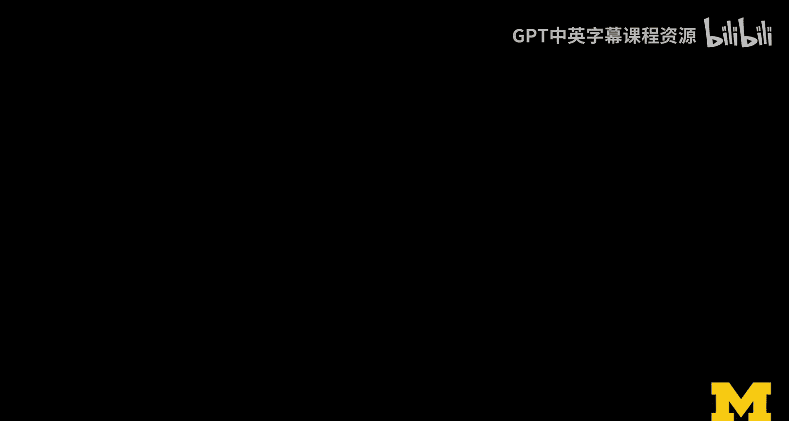

在本节课中，我们将探讨生成式AI工具在提升职场创造力方面的局限性。我们将通过直接询问AI工具其自身的能力与不足，并结合具体案例测试，来理解如何评估和有效利用这些工具。

---

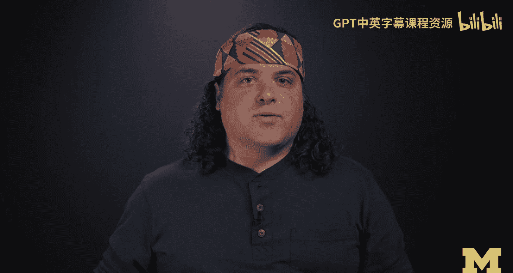

## 评估AI工具的局限性

生成式AI工具在职场创造力方面的极限取决于您的创意领域、目标以及您对AI生成内容的来源和方式的偏好。

每个AI工具都有其优势和弱点。一个有效的评估方法是直接询问程序它擅长什么、在哪些方面存在困难，以及它如何协助特定类型的工作。

---

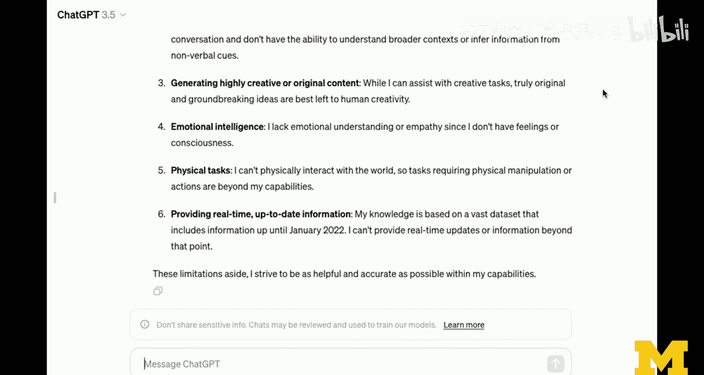

## 直接询问AI：以ChatGPT为例

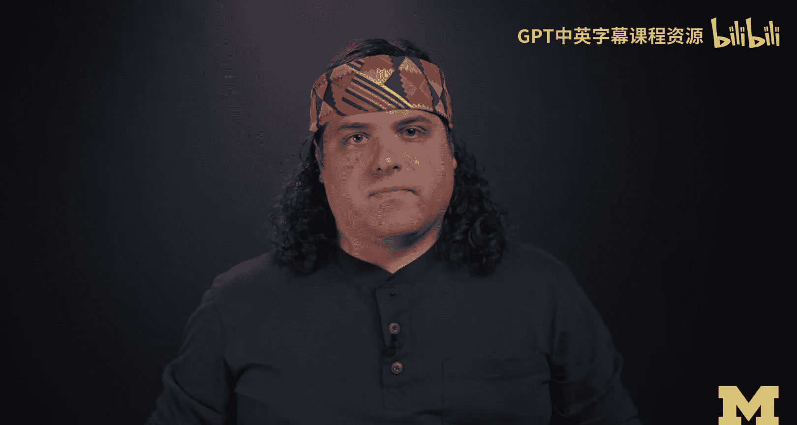

让我们通过询问ChatGPT它不擅长做什么来测试这个方法。有趣的是，在回应中，ChatGPT将生成高度创意或原创内容列为其弱点之一。

程序的回应明确指出，真正原创和突破性的想法最好留给人类的创造力。这告诉我们，寻求创意工作的专业人士或企业不应完全依赖生成式AI，创意工作者的个人声音和判断力仍然至关重要。

如果我们用更具体的问题评估另一个面向公众的生成式AI工具，也会看到类似的结果。

---

## 聚焦具体领域：以Microsoft Copilot为例

假设您是一名平面设计师，想了解Copilot如何协助您的工作。您可以简单地提问：“平面设计师如何使用生成式AI？”

除了生成文本和图像内容，Copilot还推荐使用生成式AI进行以下操作：

以下是Copilot推荐的具体应用方向：
*   **定制艺术风格**：它建议您尝试不同的提示词。
*   **概念探索**：它建议您使用生成式AI帮助进行头脑风暴。
*   **自动生成变体**：例如，如果您在设计一个标志，它建议使用生成式AI根据您的输入创建许多不同的版本。

如果您担心生成的图像基于受版权保护的材料，Copilot建议：
*   **使用抽象描述进行图像生成**：如果您描述得过于具体或想要过于逼真的东西，生成式AI可能会侵犯版权。
*   **审查和筛选输出结果**：这要求您，作为创意工作者，承担起确保不侵犯版权的责任。

在不进行额外提示和优化的情况下，Copilot的建议就到此为止。需要注意的是，它没有解释如何在特定程序中执行这些建议。此外，与ChatGPT一样，Microsoft Copilot也强调了人类判断力和辨别力在创意过程中的重要性。

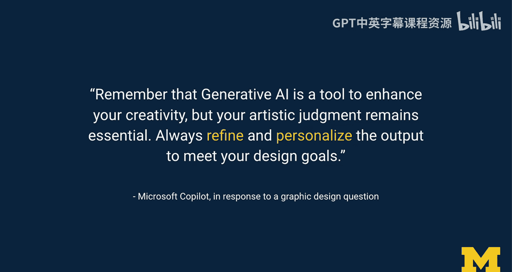

以下是来自Microsoft Copilot的几段引述：
> 请记住，虽然生成式AI可以协助内容创作，但人工筛选和质量控制仍然至关重要。
> 请记住，虽然生成式AI可以是一个强大的工具，但筛选和完善输出以符合您的设计愿景至关重要。作为设计师，您的创意判断力对于塑造最终结果仍然至关重要。
> 请记住，生成式AI是增强您创造力的工具，但您的艺术判断力仍然必不可少。始终要完善和个性化输出，以实现您的设计目标。

---

## 动手测试：以实际营销任务为例

考虑到这一点，并且因为您可能无法总是直接询问生成式AI工具其优缺点，亲自试验工具以测试其极限并判断其如何满足您的需求始终很重要。

在这里，我计划向ChatGPT提出一个基本的营销问题，以支持我领导一个古典音乐非营利组织的工作。我从之前与Microsoft Copilot的交流中了解到，制作详细的提示词会产生更具体、更有用的结果。

因此，我花了一些时间，尽可能清晰地提出我的新口号请求。这个提示词的灵感来源于Copilot关于让生成式AI协助进行营销材料A/B测试的建议。

我的提示词是：“我经营一家古典音乐非营利组织。我们专注于呈现鲜少演出且未被充分代表的20世纪和21世纪作曲家的作品。我们目前的口号是‘Here, different.’。您能帮我想出一些符合我们品牌标识、简洁（像‘Here, different.’一样）的额外营销口号吗？”

ChatGPT工作非常迅速，并提供了许多结果，可能太多了。我需要处理这些建议，才能找到一个既符合组织需求，又符合我作为营销人员个人声音的口号。可能ChatGPT更适合其他营销任务，例如在需要集思广益一堆想法但尚未准备好交付最终产品时，提供一个起点。

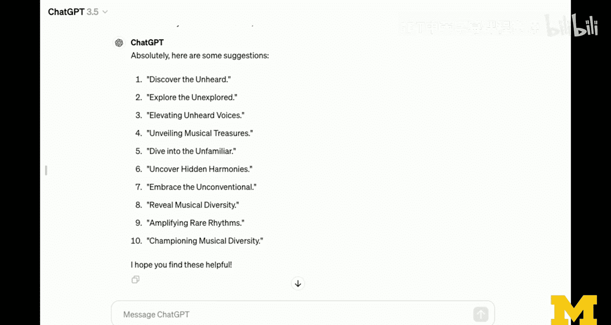

---

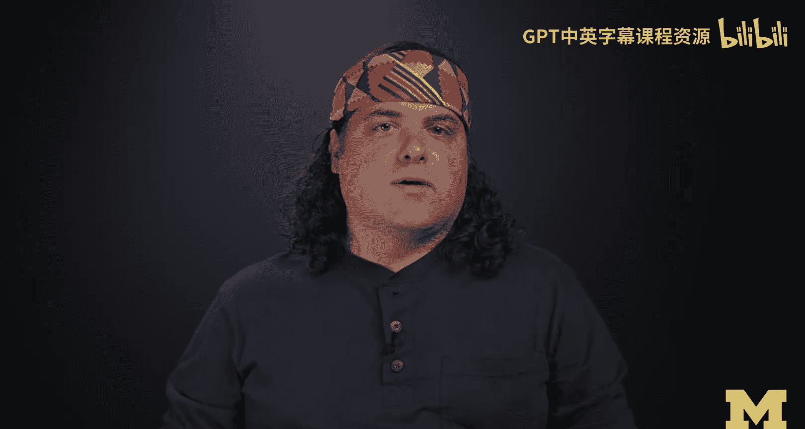

## 工具对比：ChatGPT与Microsoft Copilot

在结束之前，我想指出ChatGPT和Microsoft Copilot之间的一个重要区别。

两款程序都是免费的、广为人知，并且定位为对初学者友好且可供使用。我在此使用的基本版ChatGPT是一个简单的文本生成器。更高级版本的ChatGPT可以看、听和说。而Microsoft Copilot是多模态的，可以生成文本和图像，并协助完成其他生成式AI任务。在本系列课程后面，您将有机会观看一个更长的演示视频，了解Copilot的高级功能。

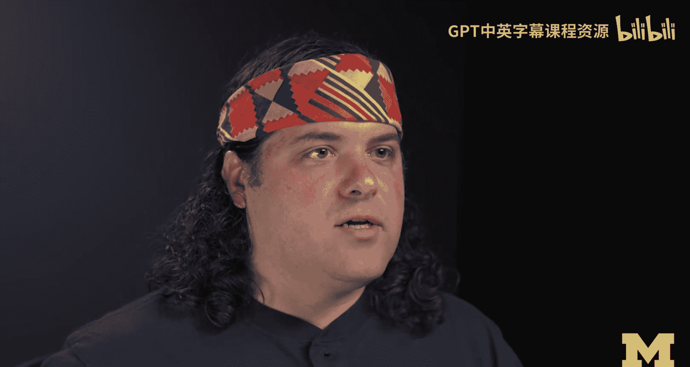

与许多其他早期AI引擎相比，Microsoft Copilot的另一个显著特点是，它在生成对您提示的回应时，会分享它所访问的任何网站的链接。这种来源处理方式比我们在基本版ChatGPT中看到的更加透明，其来源列表为您提供了自行进一步探索的选项。

以下是Microsoft Copilot在回应我关于营销人员和平面设计师在工作中使用AI（特别是以避免侵犯版权材料为目标）的问题时，引用的一些网站示例。

需要注意的是，与任何生成式AI输出一样，生成来源列表中偶尔可能会出现错误。例如，有些来源可能被遗漏或过度引用。

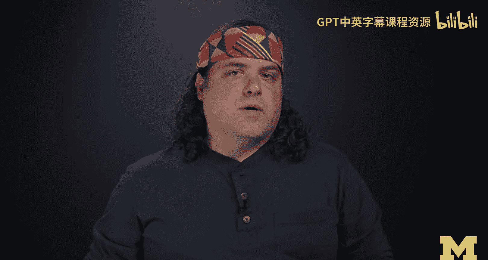

---

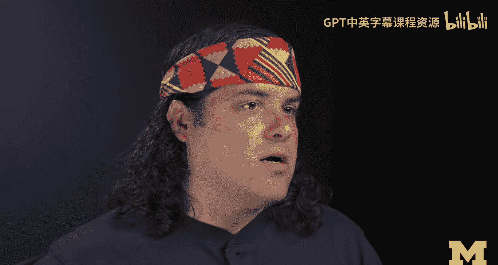

## 总结

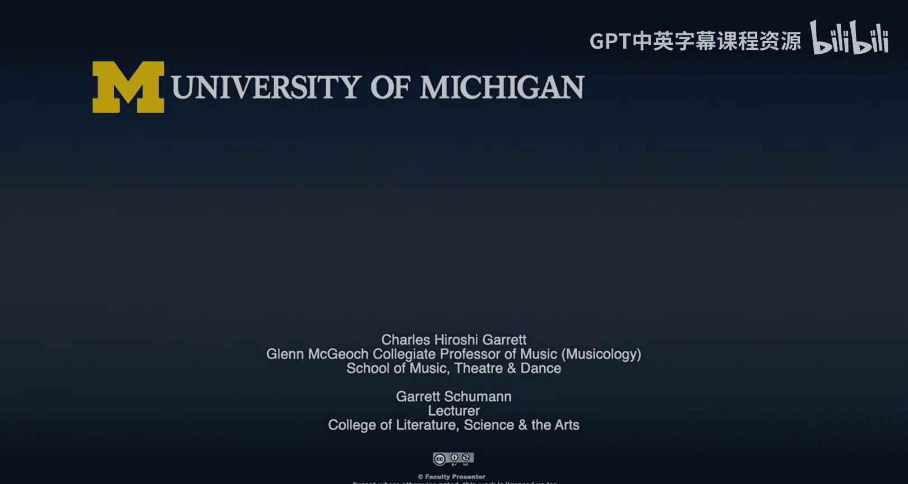

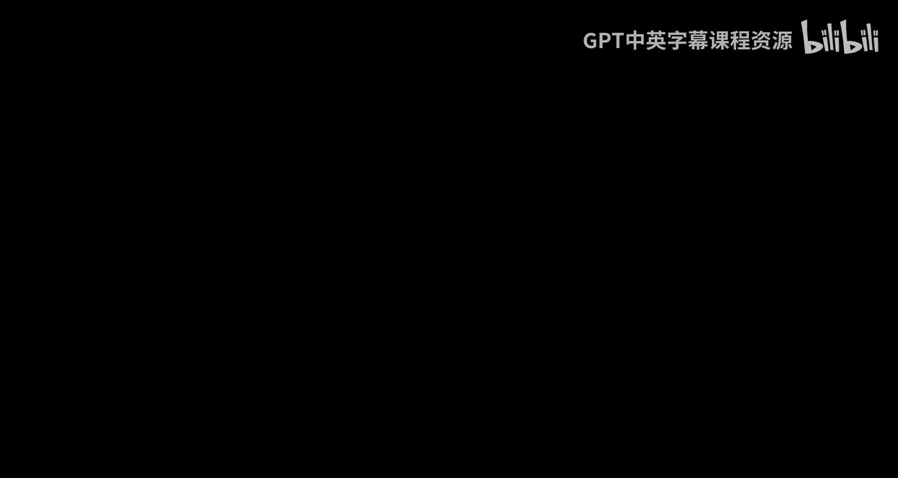

本节课中，我们一起学习了如何评估生成式AI工具的局限性。关键方法是直接询问工具自身的能力与不足，并结合具体工作场景进行实际测试。我们了解到，无论是ChatGPT还是Microsoft Copilot，都强调人类判断力在创意过程中的核心作用。AI是强大的辅助工具，可以激发灵感、提供变体和处理基础任务，但最终的创意决策、质量把控和版权责任仍需由人类工作者承担。选择工具时，需考虑其功能特点（如是否多模态、是否提供来源引用），并通过实践找到最适合您工作流程的协作方式。