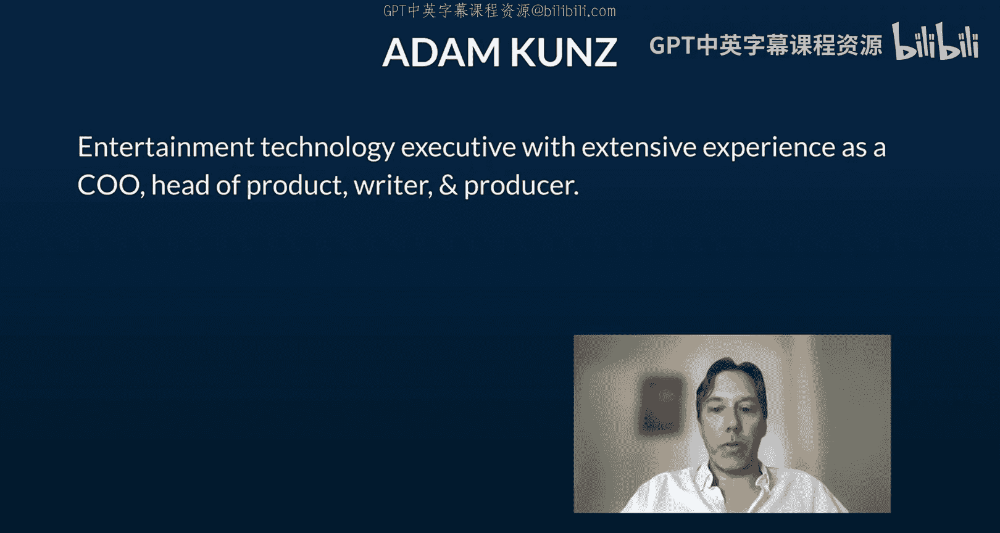
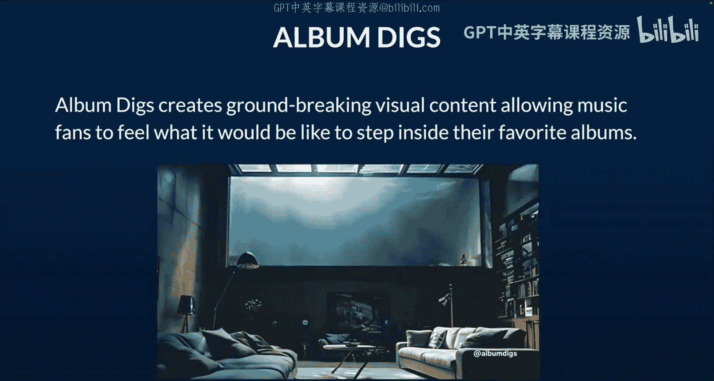
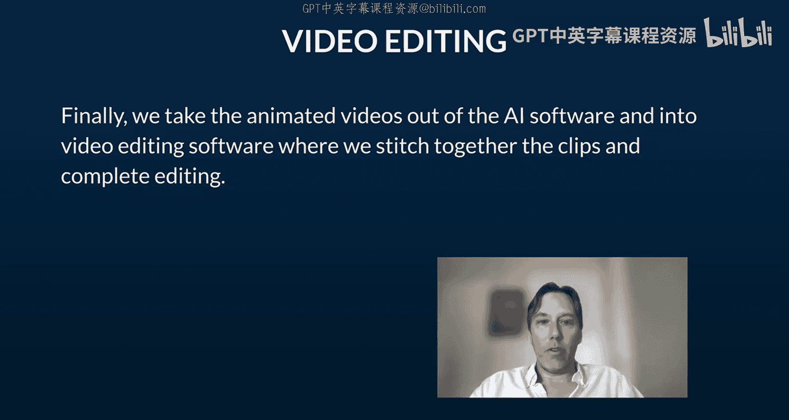
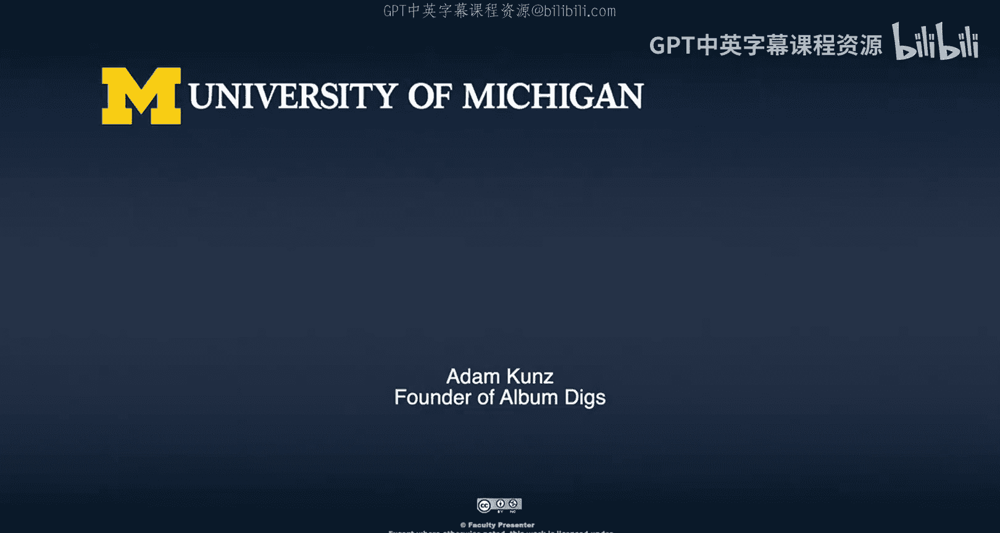

# AI用于创意工作:7：亚当·昆兹的实操演示 🎨

在本节课中，我们将跟随娱乐科技高管亚当·昆兹，详细了解其团队“Album Digs”如何将AI与人类创意结合，为音乐专辑创作沉浸式视觉内容。我们将一步步拆解从聆听音乐到最终视频成品的完整工作流程。

---

我叫亚当·昆兹。我是一名娱乐科技高管，拥有丰富的首席运营官、产品撰稿人和制作人经验。我的职业生涯始于一家名为Mogley的娱乐科技公司。在那家公司，我们早在AI流行之前就构建了专有算法，让人们无论音乐天赋如何都能重新混音和混搭歌曲。这也是我最初开始与索尼、华纳、环球等主要唱片公司合作的原因。此后，我还带领许多早期初创公司并与大型企业建立了合作伙伴关系。

今天我要讨论的是我通过“Album Digs”项目实践的部分流程。“Album Digs”是一个开创性的视觉内容项目，我们让乐迷感觉仿佛能步入他们最喜爱的歌曲和专辑之中。我们独特的视觉内容方法曾与音乐传奇人物合作，并在顶级媒体上亮相。我们将内容发布在Instagram、TikTok、Facebook等社交媒体渠道上，并且即将推出YouTube频道。在接下来的视频中，你可能会认出我们正在创作内容的一些专辑。这是将AI与人类创造力和艺术指导相结合的漫长过程的一部分，我将详细为你讲解这个过程。

---

以下是整个流程我将要介绍的各个阶段：**聆听**、**情绪板**、**提示词工程**、**迭代**、**复制**、**直接置入**、**提示词动画**、**分层动画**以及**视频剪辑**。

### 聆听 👂

上一节我们介绍了项目背景，本节中我们来看看流程的起点。这个阶段假设我们已经选定了一张专辑，并从这里开始。当我们开始处理一张专辑时，会通过从头到尾播放专辑来深度聆听音乐，同时进行研究。这个过程可能包括观看音乐视频、演唱会、阅读乐评、查看幕后花絮以及浏览社交媒体，以深入理解粉丝群体。

### 情绪板 🖼️

一旦完成深度研究，我们便开始创建情绪板。情绪板可以包含具有相似感觉的空间摄影、家具、建筑，或是音乐视频、现场演出、专辑封面美学风格的反映。我们会汇集各种类型的图像，力求准确反映该专辑的精髓。

### 提示词工程 💬

在收集了所有素材后，我们将进入提示词工程阶段。我们将情绪板中的所有图像素材连同文本提示词一起输入AI。这些文本提示词旨在描绘我们对专辑感觉的理解，这些感觉可能无法完全从输入的图像中体现，例如色彩搭配。同时，我们也会给出关于**时间**、**摄影风格**以及可能存在的**环境条件**的提示。然后，我们会权衡提示词与图像的比重，根据需要更侧重图像或文本。

以下是提示词工程的核心公式：
**最终输出 = 权重(图像输入) + 权重(文本提示)**

### 迭代 🔄

接下来，我们不断调整提示词，使生成的图像越来越接近我们对空间的设想。这就是迭代阶段。最终，经过反复调整，我们可能会发现图像的某个部分看起来是正确的——可能不是整张图，但我们会觉得图像的某个角落正是我们想要的房间角落。然后，我们开始遮罩图像的其他部分，并用额外的提示词重新生成，直到得到一个完全正确的完整房间。这些初始图像都不是完美的，因此这也是一个非常漫长的过程，我们可能需要进行成百上千次迭代，才能最终找到能反映这张专辑的核心图像。

### 复制 🏠

下一阶段是复制阶段。我们的目标是以2D图像的形式，围绕这张专辑构建一整个房子。一旦有了第一个房间，我们就希望将其风格外推，以反映或“模仿”整个房子的外观。这个过程将逐个房间进行，每个房间都可以包含引用不同歌曲歌词的额外“彩蛋”。例如，我们可能根据某首歌曲来设计下一个房间，或根据另一首歌曲设计另一个房间，而房子的外观则要看起来能够容纳所有这些反映专辑的房间和环境，使其成为一个连贯的整体。我们会以第一张图像为参考点，来生成所有后续的图像。

### 直接置入 🛠️

当我们拥有了所有不同的房间和所需的外部镜头后，有时需要将内容从AI中取出，放入我们自己的软件中进行直接对象置入。通常，使用AI无法得到你想要的精确物品。例如，我们可能想（在获得许可后）将一个乐队的标志精确地放在墙上。如果这样做，我们必须通过自己独立的**3D灯光和环境软件**来完成，因为如果尝试在AI内部完成，它只会生成对该标志的“诠释”，而不是那个精确的标志。另一个例子是，我们曾与一些雕塑和街头艺术家合作，将他们的作品放入我们的内容中，以反映启发他们的专辑。对于这些情况，我们需要将他们精确的雕塑放入房间，并正确打光，使其感觉像是放置在我们创造的虚拟房间中。但通过AI来完成会再次扭曲和改变这些图像，创造出AI自己的版本，而不是他们精确的艺术品。因此，在这个阶段，我们必须暂时离开AI，进行如前所述的3D灯光和环境工作，以正确放置所有元素。

在此阶段，如果置入对象的边缘与背景图像看起来有些不协调，我们也可以再次使用AI来帮助实现无缝过渡。

### 提示词动画 🎬

流程的下一部分是提示词动画阶段。我们将所有这些完成的图像导入额外的AI软件并进行动画处理。这个过程涉及将这些静态图像和文本提示词输入AI，这些文本提示词会解释这个镜头的动作。这可以包括从**摄像机运动**到**环境效果描述**的一切。例如，我们可能想描述房间里有某种雾气，或者描述摄像机如何平移，或者这是一个静态镜头。

### 分层动画 📊

接下来是动画部分的分层处理。AI通常无法精确理解哪些元素应该在特定前景或不应该。因此，我们会逐一处理，让近处的物体运动较少，让远处的物体运动更明显。我们还会尝试通过额外的环境噪音在特定位置添加环境效果。例如，如果房间里有一个壁炉，我们会希望给火焰添加很多额外的环境噪音，因此我们会突出显示该图层并确保它有额外的环境噪音。同样，如果窗外有海洋，我们也会希望给它额外的运动效果。

### 视频剪辑 ✂️

流程的最后部分是视频剪辑。我们将动画视频从AI软件中导出，并将这些片段拼接在一起。当我们为新的YouTube频道制作音乐视频时，这个环节还包括将灯光效果与节拍同步。我们会将房间里的灯光物体与节拍同步，从而创造一个完整的体验，让人们感觉环境在实时对音乐做出反应。这是我们发布内容到各个频道之前的最后一步。

---

本节课中，我们一起学习了亚当·昆兹团队“Album Digs”项目将AI融入创意工作的完整流程。从深度聆听音乐、构建情绪板，到精细的提示词工程与迭代，再到结合3D软件的直接置入和分层动画处理，最终完成与音乐同步的视觉内容。这个过程清晰地展示了如何将AI作为强大工具，在人类艺术指导和创意的引领下，共同创造出新颖而富有感染力的艺术作品。