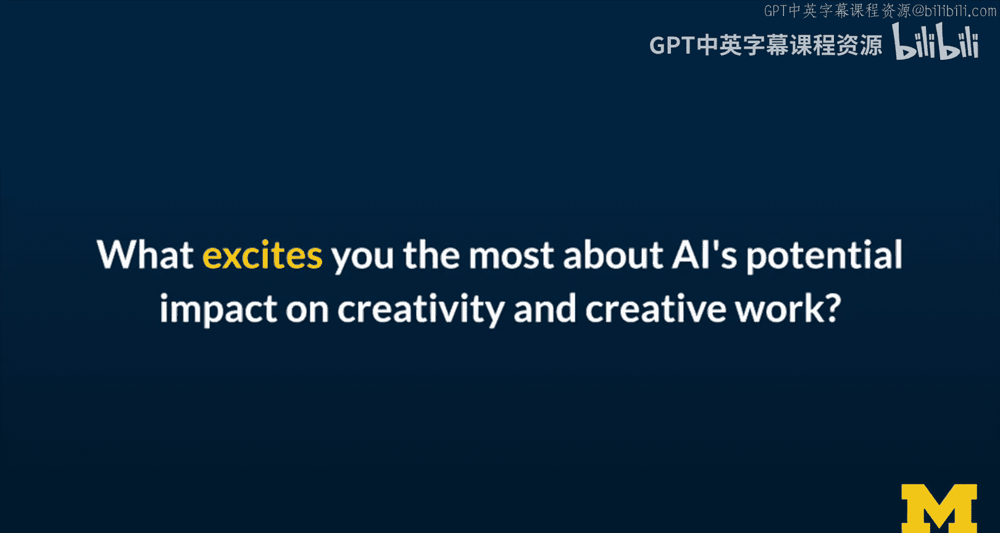
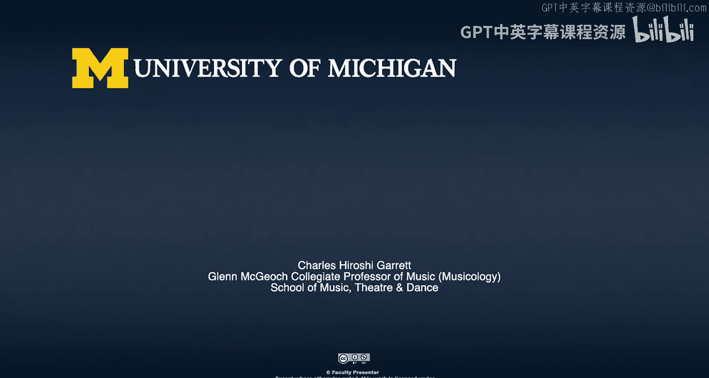

# AI用于创意工作：P8：领域之声：查尔斯·浩石·加勒特 🎤

在本节课中，我们将跟随查尔斯·浩石·加勒特教授的视角，探索人工智能如何辅助学术与创意工作，并帮助我们进行自我反思与能力拓展。

---

我目前正在探索各种旨在辅助我作为教授的创意工作的AI工具。

这些都是近期出现的工具，它们承诺能帮助我进行个人研究和写作。

最让我感兴趣的是它们帮助我更深入地了解自己、我的创作习惯、我的思维倾向以及我的创意弱点或局限性的潜力。

例如，我现在可以训练一个AI聊天机器人，让它学习我已发表的著作，然后我可以向这个聊天机器人询问关于我工作的问题。我可以询问我已完成的成果、我可能忽略的部分，以及我接下来可以做什么。

我还可以从AI写作工具那里获得关于如何改进书面沟通、如何更清晰有效地写作的建议。

我目前还没有确切的答案，但我希望AI能帮助我更好地了解我是谁、我做过什么，以及未来如何拓展我的创意工作。

---

上一节我们介绍了查尔斯教授探索AI工具的初衷，本节中我们来看看他具体关注的几个方面。以下是AI工具在创意工作中可能提供的几种辅助方式：

*   **自我分析与反思**：训练一个基于个人作品的AI模型，用以回顾成就、发现盲点并规划未来方向。
*   **写作能力提升**：获取关于如何使书面表达更清晰、更有效的具体建议。

---

本节课中我们一起学习了查尔斯·浩石·加勒特教授如何将AI视为一面“镜子”和一位“助手”。他利用AI工具来剖析自己的学术成果、反思创作习惯，并寻求提升写作与思考能力的方法。这展示了AI在创意领域中，超越单纯的内容生成，向深度自我认知与技能辅助发展的可能性。