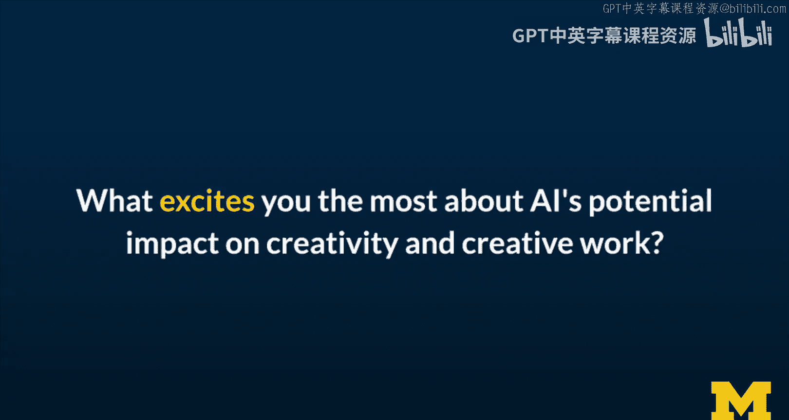
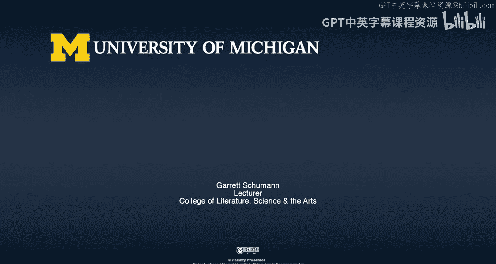

# AI用于创意工作:9：领域之声：加勒特·舒曼 🎵

## 概述
在本节课中，我们将聆听作曲家加勒特·舒曼分享他对人工智能如何影响创意工作的见解。我们将探讨AI在简化繁琐任务方面的潜力，以及它如何作为个人创造力的延伸。

## 正文

与许多人一样，关于人工智能影响创造力和创意工作，我首先想到的是它有可能简化那些非常繁琐的任务。

例如，作曲家在与像管弦乐队这样的团体合作时，需要处理一项特别耗时的任务：为团体中的每个成员制作分谱。

这项工作必须手动完成，在该领域内是如此令人厌恶，以至于催生了一个活跃的抄谱员二级市场，作曲家们将分谱制作外包给他们。

人工智能似乎有可能为作曲家处理这类任务，或者为其他创意专业人士处理类似的任务。

不过，我会克制我的乐观，因为这种小规模、高度个性化的人工智能工具似乎并不是科技行业的首要任务，至少在目前是这样。

为此，人工智能工具能够作为个人创造力的镜子和延伸的方式令我着迷，我将很高兴看到这条道路的发展。

## 总结
本节课中，我们一起学习了作曲家加勒特·舒曼的观点。他指出了AI在自动化创意工作中繁琐任务（如制作分谱）方面的潜力，同时也表达了对当前技术发展重点的审慎态度。最后，他分享了对AI作为创造力延伸工具的期待。