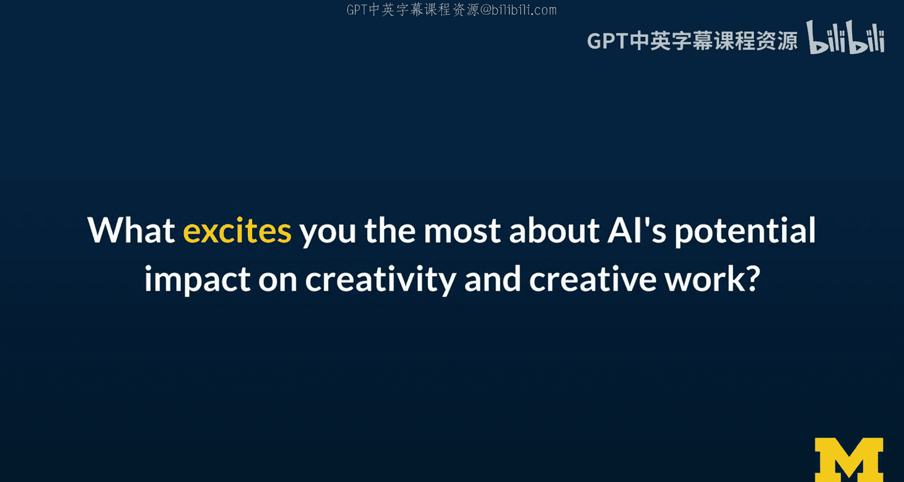
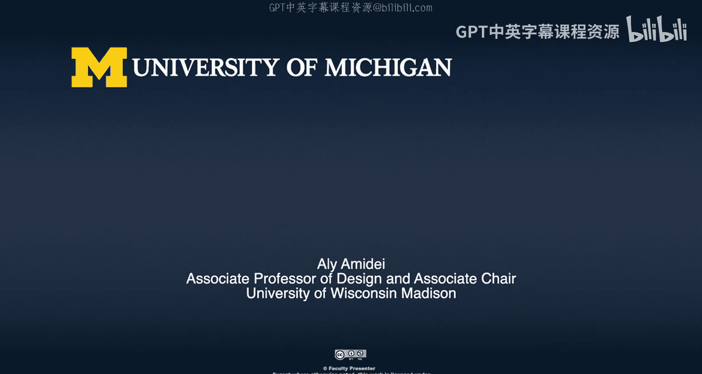

# AI用于创意工作:10：领域之声：艾丽·阿米迪 🎨

在本节课中，我们将学习创意工作者艾丽·阿米迪分享的关于人工智能如何影响其创作实践的观点。她将阐述AI如何帮助她进行快速、低风险的创意原型验证，从而促进实验并保护其艺术实践的流畅性。

---

到目前为止，人工智能通过允许我进行大胆而冒险的尝试，影响了我的创造力。

本质上，它帮助我快速、低成本地构建想法原型，以验证概念。

这可以促进实验，减少对我的艺术实践和项目流程的负面影响。

---

## 核心概念解析

上一节我们了解了艾丽·阿米迪对AI的总体看法，本节中我们来看看她提到的核心工作方式。

以下是AI在她创作流程中扮演的关键角色：

*   **功能**：**快速原型验证**。
*   **目的**：以**低风险**的方式获得**概念验证**。
*   **结果**：**促进实验**，减少对既有创作流程的干扰。

其核心逻辑可以概括为：`想法 -> AI快速原型 -> 概念验证 -> 决定是否深入创作`。这个过程允许创意工作者在投入大量时间和资源之前，高效地探索想法的可行性。

---

## 总结

本节课中我们一起学习了创意从业者艾丽·阿米迪的实践经验。她指出，人工智能的主要价值在于作为一个**快速、低成本的创意原型工具**，这使她能够更自由地进行实验和承担风险，同时保护其核心艺术实践的完整性与流畅性。