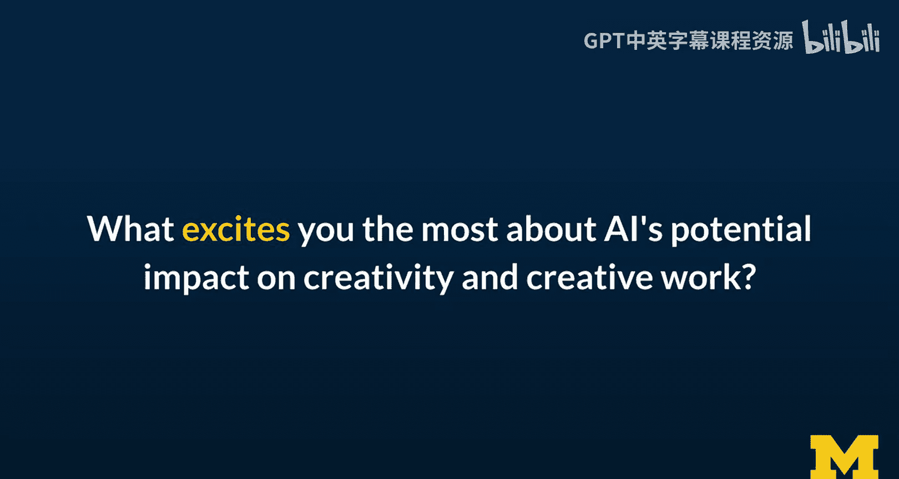
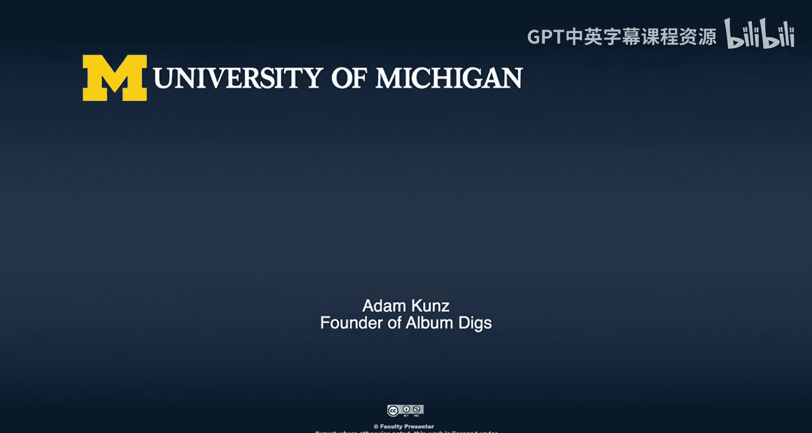

# AI用于创意工作:11：10_领域之声：亚当·昆兹

## 概述 📋

在本节课中，我们将探讨人工智能如何提升创意工作的基准水平，并催生全新的内容形式。我们将通过回顾历史上技术革新（如计算机、Excel、Photoshop）对行业的影响，来理解AI带来的变革本质。

## 核心观点：提升基准与创造新形式 🚀

这实质上是关于我们能创造的内容的**保真度**。我认为，在许多行业中，可完成工作的基础水平标准已经被提高了。

为了理解这一点，我们可以回顾历史。当计算机最初出现时，许多人认为它只会取代工作。但实际上，它提高了人们能够产出的工作水平。

## 历史技术革新的启示 📈

以下是几个关键的历史案例，它们说明了技术如何提升行业标准而非简单地取代工作。

*   **Excel与会计行业**：当Excel出现时，会计师的工作并未被消除。相反，他们能够完成质量高得多的工作。
*   **Photoshop与摄影/设计行业**：当Photoshop首次面世时，人们担心这会毁掉许多摄影师的工作。然而，它实际上使人们能够创造出远比以前更好的内容，并且让更多人参与到这个领域。
*   **计算机与音乐行业**：最初，人们认为音乐必须是乐器演奏的，用电脑制作的音乐不是“真正的音乐”，并对此有很多批评。

## AI的独特潜力：催生全新表达形式 🎨

上一节我们回顾了技术如何提升现有工作的标准。本节中我们来看看AI带来的更深层变革。

随后，出现了像**Daft Punk**这样的乐队。他们通过开辟一个全新的音乐流派，能够远远超越当时被创造出来的内容。

因此，我认为当像AI这样的技术出现时，真正发生的是：人们用它来创造更高质量的内容，同时也用它来创造**全新的内容形式**和**全新的表达方式**。

看到人们能够利用AI创造出什么，将会非常令人兴奋。

## 总结 ✨

本节课中我们一起学习了AI对创意工作的双重影响。一方面，它像历史上的关键技术一样，提升了各行业产出内容的基准水平。另一方面，它更具革命性地催生了前所未有的内容与表达形式。AI不仅是提升效率的工具，更是拓展创意疆域的催化剂。