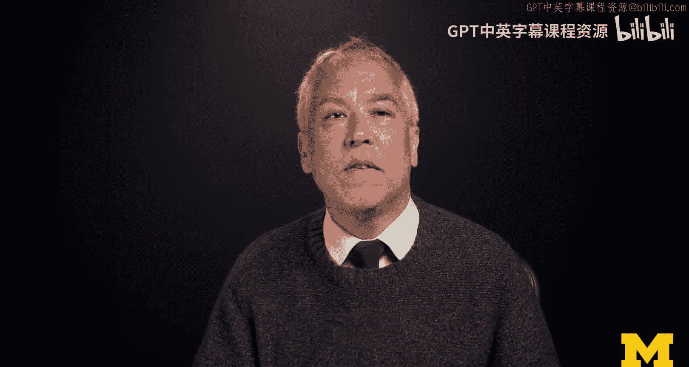
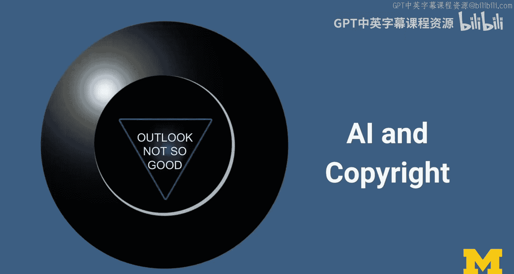
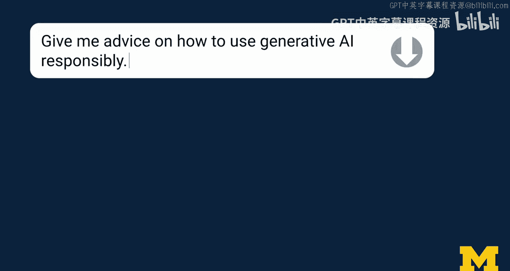
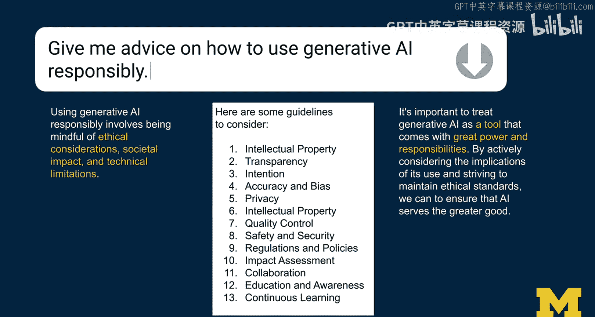
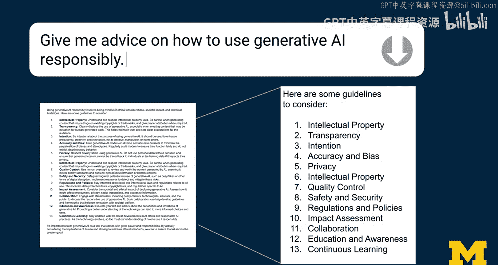
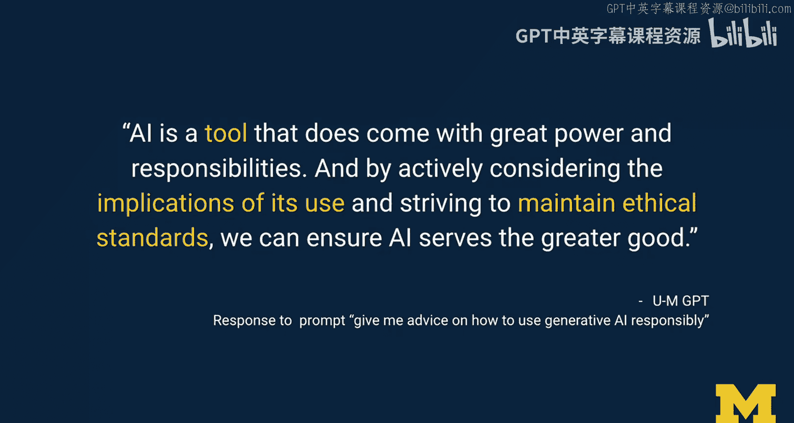
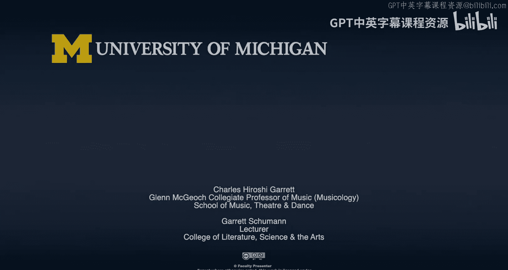

# AI用于创意工作：P13：负责任地使用生成式AI 🧠

在本节课中，我们将要学习如何负责任地使用生成式AI。我们将探讨在拥抱这项强大技术的同时，如何保持审慎的态度，并思考其涉及的伦理、可持续性、安全与知识产权问题。

---

生成式AI发展迅猛，这很容易让人产生一种印象：AI可以毫不费力地解决任何问题，可以准确回答任何疑问，并且只需按下一个按钮即可完成。

身处AI革命浪潮之中，也意味着许多人感到一种紧迫感，急于开始将AI融入日常生活，以免落后。这种完全沉浸在AI世界中的感觉可能令人兴奋，但有时也令人疲惫。它极其激动人心，但有时也令人不安。

如果你正在学习这门课程，你很可能是对AI的工作原理以及它如何帮助你提升创造力感兴趣。这正是本课程的两个核心目标。但我们同时也想鼓励你，花时间去了解AI能做什么，并认识到它（至少目前还）不能做什么。

就像第一次学习骑自行车或烘焙蛋糕一样，重要的是不要急于求成。你不仅要确保生成式AI能为你提供正确的结果，更要首先确认生成式AI是完成这项工作的合适工具。

我们鼓励你从容地探索生成式AI，以便发现它的能力，并仔细思考对于你计划完成的每一项任务、每一个项目，使用AI是否合适，或者可能并不合适。

---

上一节我们提到了审慎评估的重要性，本节中我们来看看一些需要警惕的具体领域。

当涉及伦理、可持续性、安全性和知识产权等问题时，始终值得思考AI是否是合适的解决方案。

以下是关于AI，你可以经常问自己的三类问题。

考虑到AI数据中心已占全球用电量的1%以上，我是否值得让AI去执行一个我自己可以轻松完成的任务？

如果你关心地球，答案很可能是否定的。即使是简单的网络搜索，其资源消耗也远低于为获取基本信息而查询聊天机器人。

如果我想用的生成式AI应用无法确保隐私和机密数据管理，那么将其用于专有工作项目是否安全？

如果你想保护你的公司和客户，那就别指望它。

我的项目团队是否应该订阅一个因侵犯版权而备受争议、并忙于应对知识产权诉讼的AI软件包？

采用该软件包的前景并不乐观。

正如有许多吸引人的理由去采用AI一样，在投身其中之前，你也可以学会识别一些明显的危险信号。有趣的是，AI聊天机器人通常能够帮助你回答这类问题，因为它们在这些问题上受过相当好的训练。

这里，我向密歇根大学的生成式AI工具UMGPT咨询了关于如何负责任地使用生成式AI的建议。

UMGPT是一个专为密歇根大学使用而定制的生成式AI程序，它借鉴了流行的生成式AI语言模型，包括OpenAI的GPT-4。以下是密歇根聊天机器人的回复。

我们可以看到这个聊天机器人的强大之处，它立即识别出了十几种你可以探索如何更负责任地使用生成式AI的方法。

当你审视这些建议时，许多有趣的问题会浮现在脑海中。

你对生成式AI的使用可能会如何影响你工作组或公司里的其他同事？

你认为使用AI可能会对你所在领域或其他领域的就业产生什么影响？

你如何才能更好地了解生成式AI的能力和局限性？

你甚至可以询问你的聊天机器人，它上次接受训练是什么时候，它是否在特定学科领域有专长，以及它是否会记住并从你的所有提示和对话中学习，还是会对你所有的聊天对话保密。

UMGPT的有益回复以一个值得强调的重要观点作为总结：

> AI是一种工具，确实伴随着巨大的力量和相应的责任。通过积极思考其使用的影响，并努力维护道德标准，我们可以确保AI服务于更大的利益。

---

在下一个模块中，我们将更深入地探讨在工作场所创造性使用AI时两个特别重要的领域：第一，与AI相关的法律问题；第二，使用AI带来的声誉风险。

---

---

本节课中我们一起学习了负责任地使用生成式AI的核心理念。我们认识到，尽管AI功能强大，但必须审慎评估其适用性，并时刻警惕其在伦理、环境、安全和法律方面的潜在风险。通过主动提问和思考，我们可以确保这项技术被用于正确的目的，并发挥其最大的积极价值。