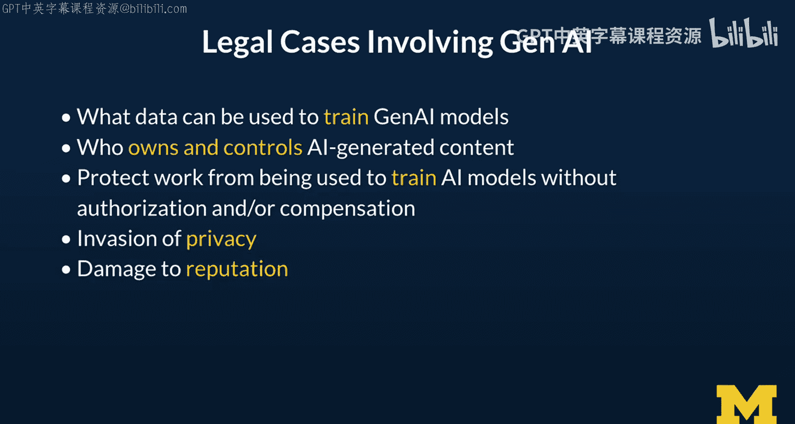
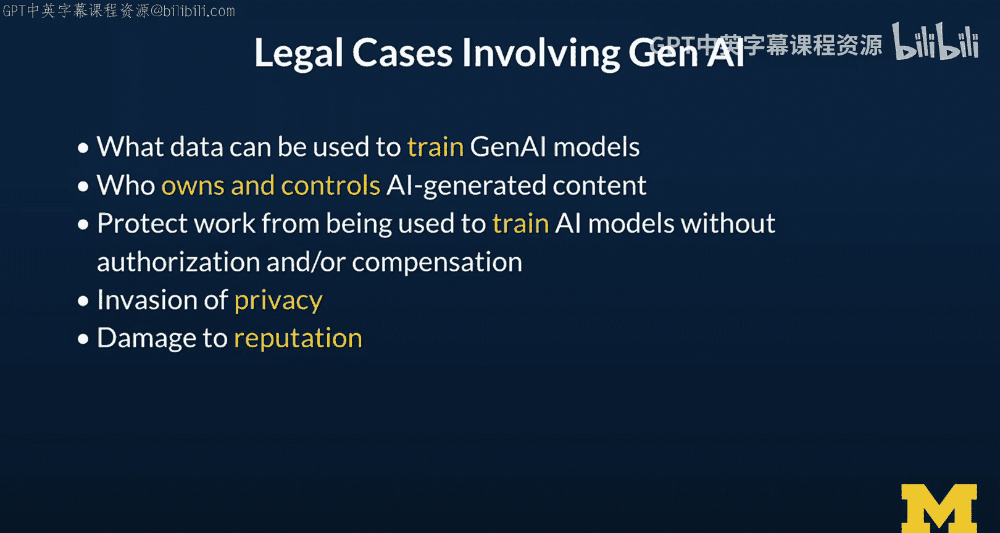
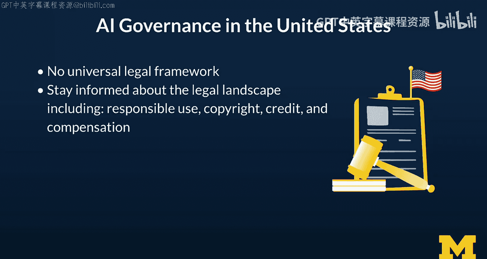
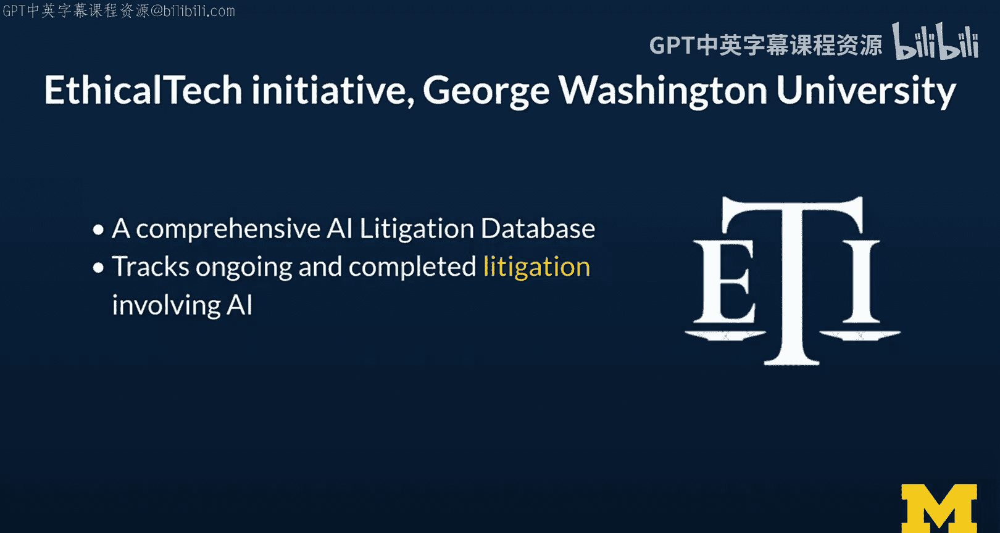
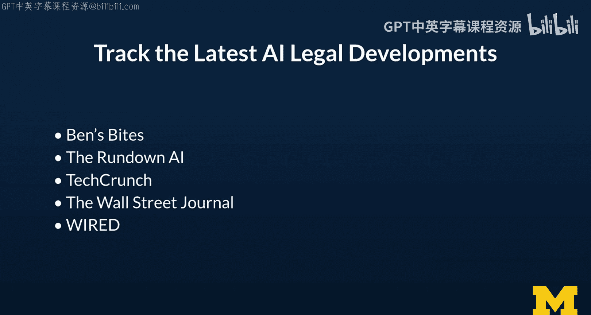
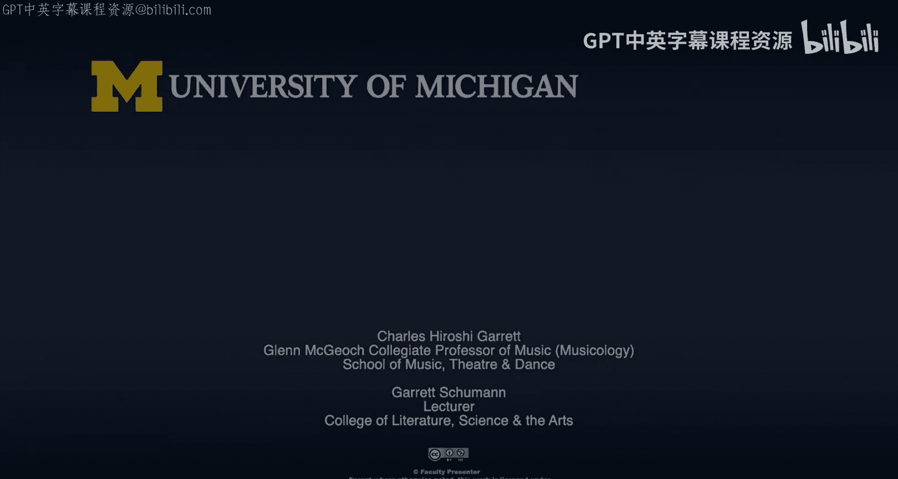

# AI用于创意工作：P14：人工智能与法律考量 ⚖️

在本节课中，我们将要学习人工智能在创意领域应用时所面临的法律与政策环境。随着AI技术的普及，全球各地的立法者都在努力制定规则，以平衡其潜在益处与可能带来的风险。本节课将介绍当前的法律争议、主要诉讼案例以及不同地区的监管动态，帮助你理解并应对AI创意工作中的法律考量。

---

## 全球监管格局 🌍

随着人工智能的影响力日益增强，世界各地的政策制定者和立法者正在努力思考如何对其进行监管，以在不过度牺牲潜在益处的前提下，最大限度地减少可能的危害。

由于不同政府采取了不同的监管路径，关注与你生活和工作所在地相关的新闻动态变得尤为重要。

在人工智能与创意领域，许多法律问题尚未有定论。围绕知识产权、版权、作者身份、许可权和报酬的重大问题仍需厘清。

---

## 美国法律圈的核心争议 ⚖️

上一节我们介绍了全球监管的概况，本节中我们来看看美国法律界的具体争议焦点。美国法律界内的激烈辩论主要围绕AI生成物的所有权展开。

以下是当前美国法律实践中的几个关键点：

*   **纯AI作品的版权**：目前，完全由生成式AI创作的作品不受美国版权法保护。即使该AI模型是基于人类数据训练，并且由人类提示生成，因为“作者”这一法律术语并未延伸至机器或生成式AI程序。
*   **人机协作作品的争议**：人类与AI程序合作产生的创意作品也引发了法律纠纷。因此，受到AI影响的各方利益相关者卷入了持续不断的诉讼、申诉和集体诉讼中。
*   **诉讼的主体与目的**：大型企业以及个人都已提起法律诉讼，旨在厘清哪些数据可用于训练生成式AI模型，以及谁拥有和控制AI生成的内容。

---

## 代表性法律案例 📑

基于上述争议，现实中已经出现了许多具体的法律案例。以下是几个具有代表性的诉讼：

*   **Getty Images 诉 Stability AI**：Getty Images起诉了开发Stable Diffusion的公司，指控其在未经许可的情况下使用了Getty的图片数据库。
*   **《纽约时报》诉 OpenAI 与 Microsoft**：《纽约时报》起诉OpenAI和微软，指控其使用数百万篇报纸文章来训练他们的生成式AI软件。
*   **创意工作者的集体诉讼**：音乐家、视觉艺术家、作家和演员们发起了集体诉讼，以保护他们的作品在未经授权和/或未获补偿的情况下被用于训练AI模型。
*   **个人隐私与名誉诉讼**：甚至有个体提起诉讼，他们认为生成式AI公司不公平地侵犯了他们的隐私或非法损害了他们的声誉。

---

## 行业的应对与自律 🤝

由于许多案件悬而未决，AI行业已开始更主动地应对业界对合法数据、明确规则和公平报酬的需求。

以下是行业正在推动的几个方向：

*   获取法律上清晰的数据训练集。
*   制定更强的许可政策。
*   建立法律赔偿机制。
*   设计公平的版税方案，以奖励那些其作品被用于训练生成式AI模型的贡献方。

---

## 美国的法律现状与挑战 🇺🇸

目前，美国将更多注意力放在厘清现有法律如何适用于AI技术上，而非颁布全新的AI法规。尽管如此，各种相互竞争的AI倡议、法律和政策正在联邦、州和市各级推进，其中包括联邦政府对领先AI科技公司所扮演角色发起的反垄断调查。

当前在美国，并不存在一个统一的法律框架。这意味着洛杉矶的生成式AI用户可能需要遵守与纽约用户不同的规则。无论身处何地，任何寻求将生成式AI用于创意实践的人，都需要持续关注AI法律环境的变化，特别是在负责任使用、版权、署名和补偿等问题上。

---

## 欧洲的监管进展 🇪🇺

与美国相比，欧洲的创意工作者获得了更多的官方指引。2024年3月，欧洲议会正式通过了《欧盟人工智能法案》，这是一项具有里程碑意义的AI治理立法。

这部通常被称为《AI法案》的法律，在欧盟内部为AI建立了一个共同的法律框架。它旨在规范AI系统的提供者，并将AI的具体应用划分为“不可接受”、“高”、“有限”或“最小”等风险类别，不同类别受不同法律规管。《AI法案》拥有众多支持者，因此其部分框架最终可能影响美国的AI法律。

---

## 如何跟进法律动态 📚

跟踪最新的AI法律发展可能颇具挑战性，因为相关案例数量庞大。不过，有多种公共和私人资源可供利用。

以下是获取相关信息的主要途径：

*   **斯坦福大学《AI指数》报告**：斯坦福大学以人为本人工智能研究所每年发布的《AI指数》报告，全面涵盖了AI政策与治理，包括重大AI政策制定事件时间线以及全球AI立法努力的最新进展。阅读最新的年度报告是快速了解美国及全球AI法律发展的好方法。
*   **乔治华盛顿大学AI诉讼数据库**：由乔治华盛顿大学主办的跨学科合作项目“伦理科技”维护着一个全面的AI诉讼数据库，跟踪涉及AI的正在进行和已完结的诉讼。
*   **专业机构与律所追踪器**：各种公共组织、专业协会以及精通科技领域的私人律师事务所也维护着与版权保护、数据隐私、责任等紧迫AI问题相关的专门诉讼追踪器。
*   **科技媒体与新闻网站**：专注于AI的网站（如Ben’s Bites和The Rundown AI）以及关注科技的新闻媒体（如TechCrunch、《华尔街日报》和《连线》杂志）也能帮助你掌握最新的AI法律动态。

---

本节课中我们一起学习了人工智能在创意应用中的法律框架与挑战。我们探讨了全球特别是美国和欧洲的监管现状，分析了关于版权、数据使用和所有权的核心法律争议，并介绍了跟踪这一快速变化领域的实用资源。理解这些法律考量，对于负责任且合规地使用AI进行创意工作至关重要。