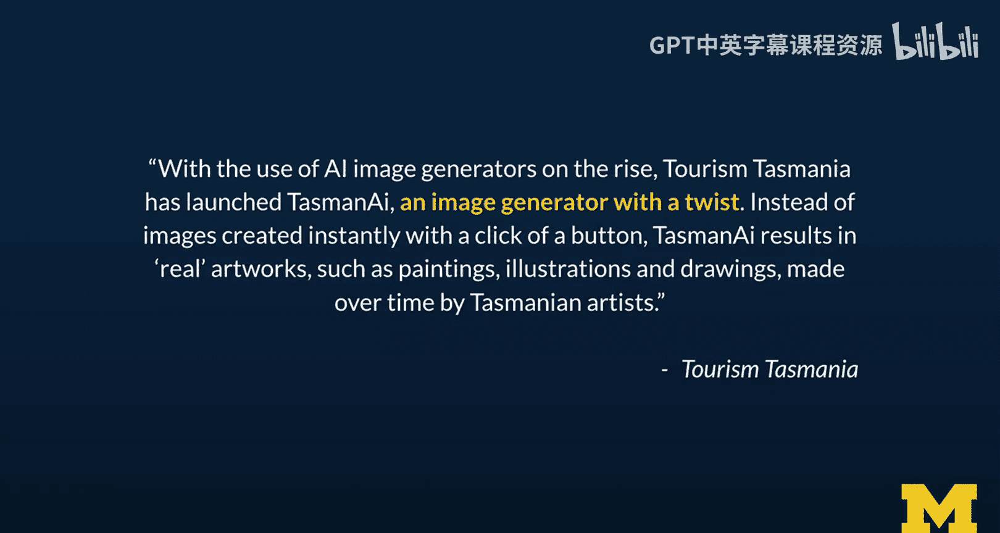
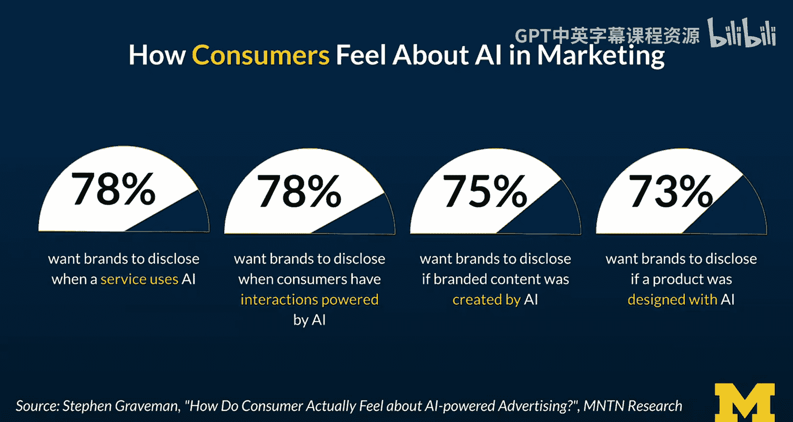
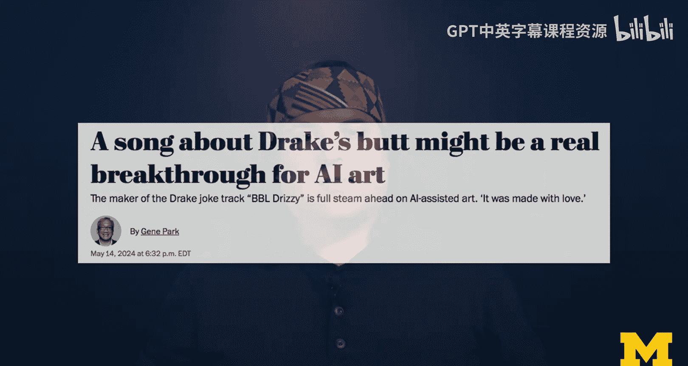

# AI用于创意工作:15：声誉风险管理概述 🛡️

在本节课中，我们将要学习当个人与机构使用生成式AI时，可能面临的声誉风险及其应对策略。这些策略对于任何面向公众的创意工作者都至关重要，同时也能帮助你在工作场所或与客户关系中处理类似问题。

随着生成式AI影响力的扩大，公众及特定目标受众对创意项目中应用或疑似应用AI，表现出强烈且负面的反应。虽然对计算机生成艺术与媒体真实性的担忧由来已久，但当今AI技术引发的声誉风险似乎更为普遍。

过去几十年，从算法音频母带处理、音乐与声音设计，到影视与游戏制作中的程序化生成，某些形式的人工智能已成为创意工作的常规部分。然而，这些软件通常隐藏在创意项目的幕后。得益于当今AI行业的营销策略，软件本身正受到更多公众审视。

例如，《体育画报》杂志在2023年11月尝试发布AI生成文章时，招致了负面头条新闻。2024年初上映的多部电影，也因使用AI生成视觉效果而引发了观众的不满。

这种对生成式AI的负面反响已变得如此普遍，以至于塔斯马尼亚旅游局近期的一项广告活动，就利用了“AI产出的媒体缺乏真实创意”这一公众情绪。随着AI图像生成器的使用增加，塔斯马尼亚旅游局推出了“塔斯曼AI”——一个与众不同的图像生成器。它并非一键即时生成图像，而是由塔斯马尼亚艺术家耗时创作出真实的绘画、插画等艺术作品。

为了负责任且成功地使用这项技术，承认公众对生成式AI的敏感性并理解其根源至关重要。

根据MNTN Research在2023年进行的调查，透明度在消费者如何看待AI于营销中的应用方面起着决定性作用。以下是具体数据：

*   78%的消费者希望品牌在使用AI提供服务时予以披露。
*   78%的消费者希望品牌在消费者与AI驱动的服务互动时予以披露。
*   75%的消费者希望品牌在品牌内容由AI创建时予以披露。
*   73%的消费者希望品牌在产品由AI设计时予以披露。

除了透明度，创意工作者还可以通过创作**意图明确且具有说服力**的作品，来避免在使用生成式AI时招致批评。这一点在早期世代的创意人工智能软件中已有清晰体现。

例如，导演彼得·杰克逊在21世纪初的《指环王》三部曲中，使用了程序化生成工具Massive来制作人群和大型战斗场景。此后，该工具也成为了视频游戏制作中的主力。在这两种情况下，该技术被专门用于实现其他方法难以企及的视觉效果，这使得其应用更容易被观众接受。

此外，这些AI工具通过让创意产品更具吸引力而增强了它，从而说服观众和玩家相信该技术是创意过程中合理的组成部分。

我们可以在2024年流行音乐人肯德里克·拉马尔与德雷克之间的说唱对决中，看到关于AI生成音乐的类似情况。在他们争执早期，一首据称是德雷克泄露的曲目出现在网上，但听众困惑于这究竟是德雷克本人制作还是AI生成。正如Sky News在2024年4月报道的，德雷克未能就这首歌进行清晰说明，加之他自己也发布了其他AI生成内容，这给试图理解这首神秘曲目的听众和粉丝带来了困扰。

德雷克缺乏透明度，未能向他的粉丝提供重要的保证。

而在两位音乐人后续的来回交锋中，肯德里克·拉马尔的歌曲《B. B. L Dizzy》则带来了对AI生成音乐的不同反响。这首歌于5月5日发布，肯德里克及其制作人Metro Boomin以**透明**的方式处理了它。与德雷克相反，拉马尔和Metro迅速透露歌曲的主旋律是使用生成式AI软件创作的。他们还通过放弃对这首音乐的版权主张，帮助营造了对歌曲的积极反响，这使得听众可以不受限制地对曲目进行混音。

这一策略取得了成功，因为听众没有像对待德雷克早期发布那样被困惑所干扰。他们能够享受这首歌，并且通过混音来“玩转”音乐的能力，产生了一种受欢迎的**共同所有权和参与感**。

我们已经看到了许多关于消费者和观众对AI生成材料担忧的不同例子。解读这些感受的一种方式是，它们反映了消费者不希望AI技术被完全强加于其体验的愿望。这就是为什么透明度很重要。当人们知道生成式AI将成为他们体验创意成果的一部分时，他们的不满就会减少。

正如我们在德雷克的案例中所见，他未能明确自己与AI生成音乐的潜在关联，损害了他的声誉。

**有意图且具体地**使用生成式AI，可以通过避免那种“强加感”来消除消费者的负面反应。如果你经过深思熟虑，并有明确的理由在创意工作中使用AI，那么你的受众和/或客户群就更可能对你的决定感到放心。

本节课中，我们一起学习了生成式AI应用中的声誉风险。关键要点在于：**公众对AI的负面反应往往源于对“强加感”的抵触**。因此，通过保持**透明度**（明确告知AI的使用），以及确保应用的**意图性和说服力**（让AI服务于明确的、能增强作品价值的创意目标），可以有效地管理声誉风险，并让受众更愿意接受AI作为创意过程的一部分。