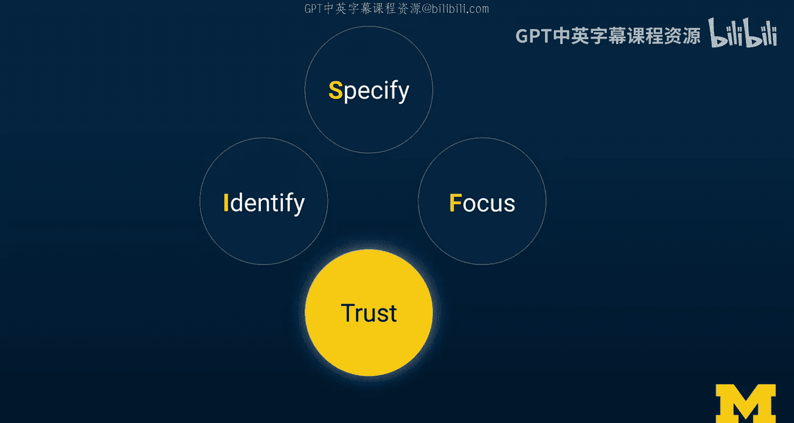

# AI用于创意工作:16：SIFT方法导论 🧠

在本节课中，我们将学习一种名为SIFT的结构化方法，用于评估人工智能工具。该方法旨在帮助创意工作者在纷繁复杂的AI工具中，找到最适合自己工作流程、品牌和组织文化的选项。我们将依次探讨SIFT的四个步骤：明确任务、识别风险、聚焦声音和建立信任。

通过掌握SIFT方法，你将能够更有信心地将AI技术融入你的创意实践，并向你的管理者、同事或客户清晰地论证使用（或不使用）某项AI工具的合理性。

---

## 明确任务（Specify）🎯

上一节我们介绍了SIFT方法的整体框架，本节中我们来看看第一步：明确任务。

在使用任何AI工具之前，你必须清晰地定义你希望它完成的具体任务或提供的协助。如果你不知道想让AI做什么，就无法找到最合适的工具。同时，理解将AI引入工作流程能带来何种益处也至关重要。

以下是明确任务时需要考虑的几个方面：
*   **任务定义**：具体描述你需要AI处理的工作内容。
*   **预期成果**：明确你希望AI工具达成的目标或输出的结果。
*   **工作流程整合**：思考AI将如何嵌入你现有的工作步骤中。
*   **价值评估**：分析引入AI能为你的效率、创意或成果带来哪些提升。

## 识别风险（Identify）⚠️

明确了任务目标后，下一步需要审慎地识别潜在风险。

你需要评估使用AI可能对你个人、公司品牌、组织理念及职场文化构成的威胁。这包括数据隐私、输出偏见、品牌一致性以及工具对团队协作方式的潜在影响。

以下是识别风险时需关注的要点：
*   **品牌风险**：AI生成的内容是否可能偏离品牌调性或价值观。
*   **伦理与偏见**：工具的训练数据或算法是否存在偏见，可能导致有问题的输出。
*   **数据安全**：使用该工具是否会泄露敏感的商业信息或个人数据。
*   **文化契合度**：工具的使用方式是否与团队协作文化和组织哲学相冲突。

## 聚焦声音（Focus）🎨

识别并权衡风险之后，我们需要将注意力回归到作为创意工作者的核心——你的独特声音。

这一步的核心是思考如何利用AI来支持、增强并保持你个人的观点和创意风格。AI应该成为你创意的放大器，而非替代品。

以下是聚焦个人声音的几个思考方向：
*   **风格强化**：AI能否帮助你更高效地探索或完善独特的视觉或行文风格。
*   **创意拓展**：工具能否激发新的灵感，或帮你突破创意瓶颈。
*   **效率与深度**：能否将重复性任务交给AI，从而让你更专注于需要深度思考的创意环节。
*   **一致性维持**：在使用AI辅助时，如何确保最终产出依然带有鲜明的个人或品牌印记。

## 建立信任（Trust）🤝

最后，在决定采用某项AI工具前，建立信任是关键一步。

你必须确保能够信任AI工具的提供商，并了解你所选工具的数据来源。这关系到输出的可靠性、伦理合规性以及长期使用的可持续性。

以下是建立信任需要核查的要素：
*   **供应商信誉**：了解开发公司的背景、历史记录和行业声誉。
*   **数据透明度**：工具的训练数据来源是否公开、合法、合规且无不当偏见。
*   **隐私政策**：仔细阅读并理解用户数据如何被收集、使用和保护。
*   **输出可控性**：你能否对AI的生成过程施加足够的影响，以确保结果符合预期。

---

本节课中，我们一起学习了SIFT评估方法，它包含**明确任务（Specify）、识别风险（Identify）、聚焦声音（Focus）、建立信任（Trust）** 四个步骤。这套结构化流程能帮助你系统化地评估AI工具，做出更明智、更负责任的技术采纳决策。发现AI提升创造力的潜力令人兴奋，但无需匆忙决定。在承诺使用任何AI工具前，请务必花时间仔细思考，并始终问自己：对于需要完成的任务，AI是否真的是最佳解决方案。