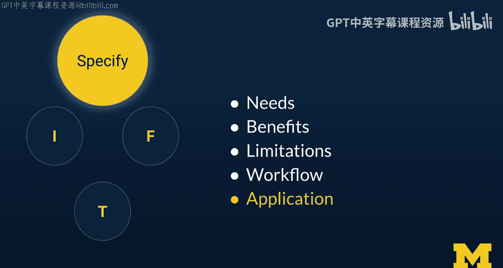

# AI用于创意工作：P17：5_明确参数

## 概述
在本节课中，我们将学习如何为AI工具明确具体参数。我们将以一位音乐家将AI引入工作流程为例，详细探讨如何通过明确需求来评估和选择合适的AI工具，并理解其中的权衡。

---

## 明确需求与目标
我是一名音乐家，正在考虑将AI引入我的工作。因为我遵循 **SiFft** 流程来评估和选择AI工具，所以我将从明确我希望从AI中获得什么以及我将如何从中受益开始。

让我们从一个简单的目标开始：我希望找到一个能生成音乐素材的工具，以帮助我为未来的项目构思创意。

## 工具比较与初步选择
在上一节课程中，我们介绍了如何比较不同的AI工具。我曾比较过两个易于使用的音乐生成工具：**Google Music Es** 和 **Bandlab Song Starter**。我最终认为 **Song Starter** 对我更具吸引力，原因之一是我可以更轻松地定制其输出。

从抽象层面看，这个特性可能意味着 **Song Starter** 是我当前需求的最佳选择。但我需要更具体地明确需求，以确保将其引入工作流程能真正使我受益。

## 理解工具的局限性
每个AI工具都有其局限性。尽管 **Song Starter** 有其他优点，但它只允许我从其提供的菜单中选择一种风格提示。我无法通过提示词工程进行实验，以创建高度定制化的输入。

我的客户或项目需求，有可能无法在 **Song Starter** 提供的选项中得到体现。

## 评估引入AI的实际收益
首先，我需要考虑将AI音乐生成融入我的工作是否真的有益。**Song Starter** 可以提供灵感火花，但我仍然需要做一些工作来充分利用它生成的素材。

事实上，我喜欢 **Song Starter** 的这一点，因为它意味着我可以定制和个性化最终产品。

但 **Song Starter** 的这一特性也意味着，除非我处于特定的工作流程情境中（例如几乎没有时间进行头脑风暴），或者一天工作过度需要将灵感外包给AI音乐生成器来获得提升，否则我不应期望这个工具能极大地节省时间。

如果我的具体情况不允许我有时间进行定制，我可能会使用不同的工具，比如 **Google Music Effects**，它能根据我输入的文本提示快速生成一个现成的音轨。

## 明确参数的重要性
以如此细致的方式处理这个工具可能看起来很繁琐，但有充分的理由需要明确参数。在创意工作中，许多经久不衰的成功AI工具，如 **Autotune**，都有明确的应用范围。它们最适合完成有限范围的任务。

它们在这些任务上表现出色。以 **Autotune** 为例，它带来了巨大的好处，使创意工作者能够完成原本不可能的事情。

## 权衡与生产力
**Song Starter** 和其他生成音乐素材的 **Gen II** 工具的主要好处在于提升个人生产力。然而，其中仍然存在需要权衡的方面，这反映了改变工作流程以融入AI所带来的复杂现实。

---

## 总结
本节课中，我们一起学习了如何为AI工具明确具体参数。我们通过音乐家的案例，探讨了从明确目标、比较工具、理解局限性到评估实际收益的完整过程。关键在于认识到，即使是优秀的工具也有其适用范围，明确自身需求和工作流程中的具体情境，是成功引入AI并从中获益的基础。