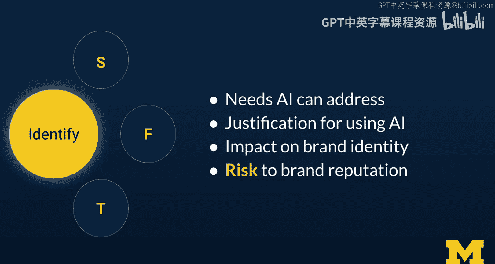
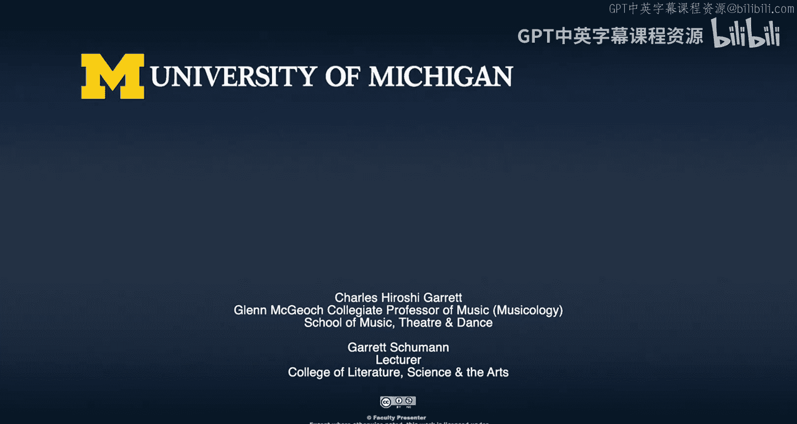

# AI用于创意工作：P18：6_身份验证 🔍

在本节课中，我们将学习创意流程框架（Cft）中的第二步——“身份验证”（Identify）。这一步骤要求我们审慎思考使用生成式人工智能（Gen AI）对工作关系与品牌身份可能产生的影响。

在上一节“明确需求”（Specify）之后，我们确定了需要解决的问题。本节中，我们将深入探讨“身份验证”环节，它挑战我们去考量应用生成式AI时，在人际关系和品牌形象方面需要做的关键考量。

---

“身份验证”步骤要求你清晰思考使用生成式AI对工作关系和品牌身份的影响。在更广泛地采用这项技术时，你必须明确你希望AI解决的需求，以及选择使用AI而非其他方法的理由。我们已经看到，工作者和企业之间对于生成式AI工具提供的价值及其必要性存在分歧。

2023年美国演员工会（SAG）和美国编剧工会（WGA）的双重罢工中，这个问题就是一个争议焦点。这两组工作者都寻求电影制片厂的保护，以防范可能威胁其在影视行业中创作生命力的生成式AI工具应用。

AI一直被用于优化和简化繁琐的流程。但人们对于新的生成式AI软件可能取代或削弱在特定领域中人类角色的担忧，并非技术本身固有的。我们作为人类，必须个体地并集体地决定这些工具将如何被使用，以及它们对现有工作方式将产生何种影响。

SAG和WGA的罢工表明，在企业环境中，关于实施AI的决策必须集体做出。否则，创意工作者可能难以找到使用这项技术的正当理由，反而会将其视为一种威胁。

---

当你评估生成式AI对品牌身份的潜在影响时，运用类似的深思熟虑和敏感性也同样重要。在本课程早期，我曾讨论过伴随这项技术而来的明显声誉问题。音乐人Drake的例子说明了透明度如何帮助避免消费者和观众的负面反应。

该实例也揭示了Drake缺乏品牌意识，或他对与生成式AI音乐工具建立长期联系漠不关心，这两点都使情况变得更糟。自2023年以来，Drake的声音一直是AI合成软件的目标。

尽管他本人并未选择参与使用其声音风格计算机克隆版的AI生成歌曲项目，并且他对这些项目不负有责任，但当Drake选择公开涉足这项技术时，理解这种与生成式AI的长期关联所带来的影响至关重要。

这种考量是伴随使用生成式AI工具而来的一个需要清醒面对的现实。例如，一个致力于环境正义倡导的非营利组织，若使用生成式AI为营销材料创建图像，由于其技术的高能耗需求，其品牌声誉面临的风险要高于一家定位不同的公司。

很可能你和/或你工作的组织已经制定了最佳实践来维护和保护你们的公众形象。

---

创意流程框架中的“身份验证”步骤鼓励你在使用生成式AI之前，清晰地思考人际动态和品牌身份。这样做是为了让你所合作的人以及你所服务的对象感到应用这项技术是恰当且有充分理由的。

---

本节课中，我们一起学习了“身份验证”这一关键步骤。我们探讨了在工作关系中集体决策的重要性，以避免将AI视为威胁；也分析了评估AI对品牌身份影响的必要性，包括考虑透明度、长期关联和潜在声誉风险。通过这一步的审慎思考，可以确保生成式AI的应用既合理，又能得到相关各方的支持。