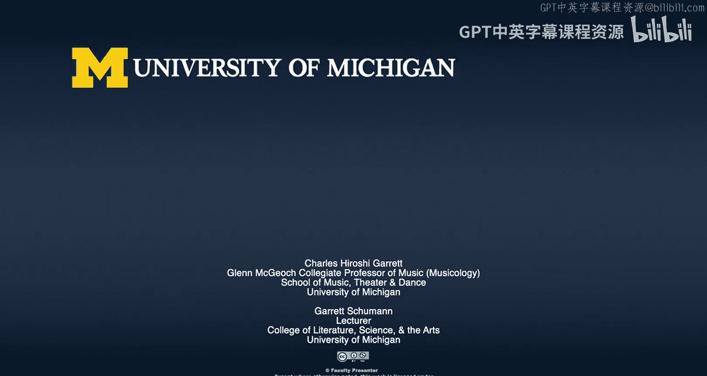

# AI用于创意工作：P19：7_聚焦核心 🎯

在本节课中，我们将学习SP流程的第三步——聚焦。这一步骤旨在引导你以突出和强调自身独特创意声音的方式，将生成式AI工具融入你的创意工作中。

## 概述：聚焦的意义

上一节我们讨论了如何明确需求，本节中我们来看看如何将AI工具聚焦于你的创意表达。聚焦步骤鼓励你将生成式AI工具引入创意工作的方式，应以你的独特创意声音为核心和重点。

## 聚焦与先前步骤的互补关系

你或许能发现，SP流程中的“聚焦”这一环节与前两个步骤是相辅相成的。

*   如果你成功地明确了需要AI完成的任务，那么你在进行下一个项目时，就更有可能将精力聚焦于你的创意声音。
*   同样地，如果你在使用某些生成式AI工具时，感觉自己能够有意义地表达自我，那么你将更容易规避上一节视频中讨论的某些组织内部风险。

## 以自动化思维理解AI的辅助作用

作为一名经验丰富的创意专业人士，有一种思维方式帮助我设想AI在工作中的应用，同时又不掩盖我的个人视角，那就是思考那些已经使我受益的其他形式的自动化和工作流程效率工具。

我是一名作曲家，在记谱和数字音频工作站软件中，我经常使用**快捷键**。任何使用电脑的创意工作者可能也都依赖快捷键。这个功能消除了我与所用软件之间工作流程中的许多步骤。

我在创意上因此受益，因为我有更多时间专注于我的实践和流程中，最能展现我个人声音的部分。任何人都可以点击鼠标，但并非每个人都能创作出我所作的音乐。因此，我受益于使用快捷键的自动化功能，这让我有更多时间专注于我的工作中，那些因我的独特性而产生最大价值的部分。

**AI也能做到这一点，前提是你以正确的方式使用正确的工具。**

## 案例分析：音乐制作中的AI应用

考虑一位嘻哈制作人、节拍制作人或混音艺术家的例子。他们的创意实践通常分为两部分：一是收集音频文件以融入音乐项目的后勤性任务；二是将不同来源的音乐样本融合成激动人心的新作品的创造性任务。

就像棱镜将白光分离成不同颜色一样，诸如Moises和Vocal Remover这类AI工具，可以将从录制歌曲中分离出独立的人声和器乐音轨这一曾经繁琐的过程，变得高效得多。在这种场景下的权衡，对涉及的创意工作者而言显然是有益的。

AI软件提供了一个新的机会，可以卸下那些通常无法进行有意义的个人表达的繁琐工作。结果就是，他们可以将更多工作时间用于发挥自己的创意视角。

## 聚焦于个人表达的普遍价值

这是一个具体的例子，但任何创意工作者都会面对其实践中枯燥或乏味的部分。基于项目的创意工作的重复性可能导致单调感，而尽可能将时间聚焦于你个人独特表达的工作方式，是让你的劳动对你而言更有意义的强大方法。

以支持和促进个人表达的方式使用AI，对自由职业者和企业都有利，因为创意工作者希望展现他们的观点。这是激励我们的热情驱动力。

## 聚焦以抵御技术趋势的负面影响

将AI引入工作时，聚焦于你的创意声音之所以重要的另一个原因是，它可以帮助工作者抵制那些仅对开发生成式AI工具的大型公司有利的技术行业趋势。

设想一种创意实践：生成式AI图像创作工具在没有任何定制或个人表达的情况下生成设计，而将下载文件、整理文件并为客户打包的任务留给那些充满创意热情的人。这种模式除了远方的科技公司CEO外，无法让任何人满意。

在探索将AI工具引入创意工作的过程中，聚焦于你的个人视角，将为你留出做自己的空间，实现自我价值，并掌控关于AI与人类创造力关系的主流叙事。

## 总结

本节课中，我们一起学习了SP流程的第三步——聚焦。我们探讨了如何将AI工具视为像快捷键一样的效率助手，从而将更多精力投入到最能体现个人独特价值的创意核心环节。通过具体案例，我们理解了聚焦于个人表达不仅能提升工作意义感和满足感，还能帮助创意工作者在AI时代保持主动性和独特性。记住，关键在于让AI服务于你的创意声音，而不是取代它。