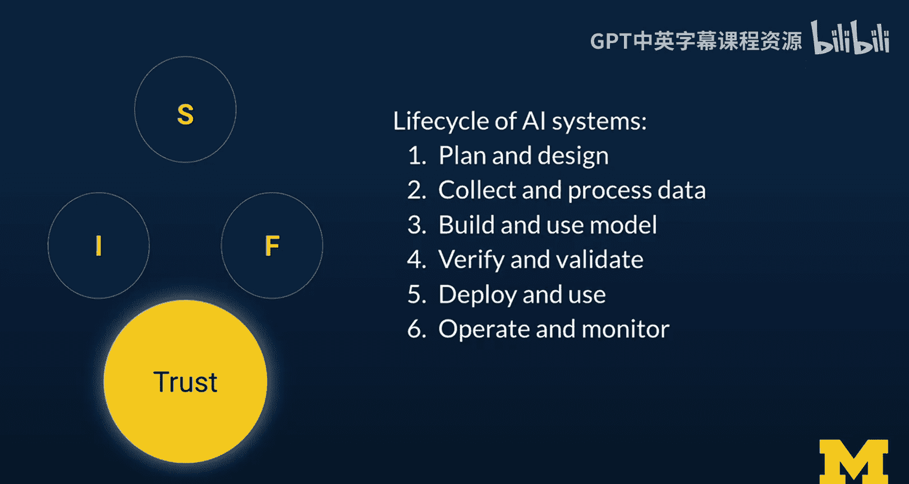

# AI用于创意工作：P20：建立信任 🔍

在本节课中，我们将学习SIFT流程中的“信任”环节。这一环节旨在通过提供评估工具可靠性的资源，来支持你与AI工具之间的关系。建立对所选AI工具的信任，是整个流程的最后一步。

## 理解信任在AI中的重要性 🤔

AI技术可能显得新颖且令人应接不暇，其文化影响和营销策略常常强调其潜力而淡化风险。然而，信任长期以来一直是计算、网络空间和自动化领域的关键方面。

加州大学伯克利分校长期网络安全中心（CLTC）引用了美国国家标准与技术研究院（NIST）对**可信度**的定义：
> **可信度** 是指在任何条件下，系统按照设计行为运行的、可证明的可能性，其证据体现在包括但不限于**安全性、隐私性、可靠性和韧性**等特性中。

## 评估AI可信度的框架 🛡️

关于人工智能，CLTC概述了评估技术可信度的150种不同属性，这些属性与以下七个特征相关联：
*   **有效且可靠**
*   **安全且有韧性**
*   **可问责且透明**
*   **可解释且可解读**
*   **隐私增强**
*   **公平**（有害偏见得到管理）

正如我们在其他评估AI工具的材料中所讨论的，提供AI软件、服务或系统的企业应能展示其产品如何体现这些品质。理解这套全面的期望可以帮助你识别潜在风险，并根据项目的具体需求进行权衡。

## 关注AI对人的影响与生命周期 🔄

CLTC还建议考虑AI工具与人的互动及其影响：
*   这项特定技术是否利用了人类产生的数据？
*   它的应用如何影响人们？

此外，CLTC概述了AI技术的**六个生命周期阶段**，这是评估潜在工具时需要纳入考量的另一个细节：
1.  **规划与设计**
2.  **收集与处理数据**
3.  **构建与使用模型**
4.  **验证与确认**
5.  **部署与使用**
6.  **运营与监控**

要对你选择的AI工具建立充分信任，可能需要了解产品处于生命周期的哪个阶段。像“监控”这样的后期阶段步骤，对于技术的长期性和可持续性至关重要。

## 要求透明度并付诸实践 🚀

尽管美国目前关于AI软件的监管状况意味着这一框架尚未标准化，但你应当期望AI工具的提供方保持透明。如果开发者或供应商无法明确说明产品的特性和生命周期，你为何要信任它？

现在，我们已经更详细地探讨了SIFT流程。你可能已经看出，所有四个步骤是相互关联、并以不同方式相互支持的。在识别了潜在风险之后，建立信任会更容易；在明确了希望技术完成的任务之后，专注于AI如何增强个人创造力也会更简单。最后，剩下的就是将SIFT流程付诸实践。

## 总结 📝

本节课我们一起学习了建立AI工具信任的关键步骤。我们了解了可信度的官方定义，认识了评估AI可信度的七个核心特征与生命周期六个阶段，并强调了要求工具提供方保持透明度的重要性。建立信任是SIFT流程的收官之步，它确保你能在了解潜在风险的基础上，自信地运用AI来增强你的创意工作。