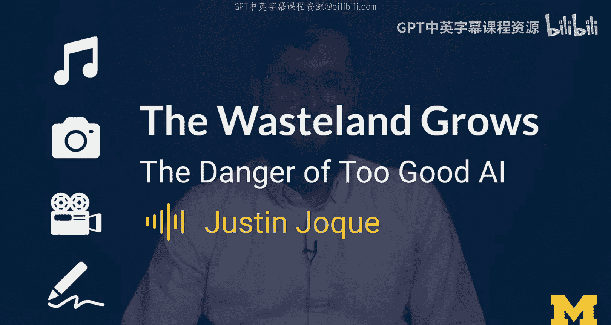
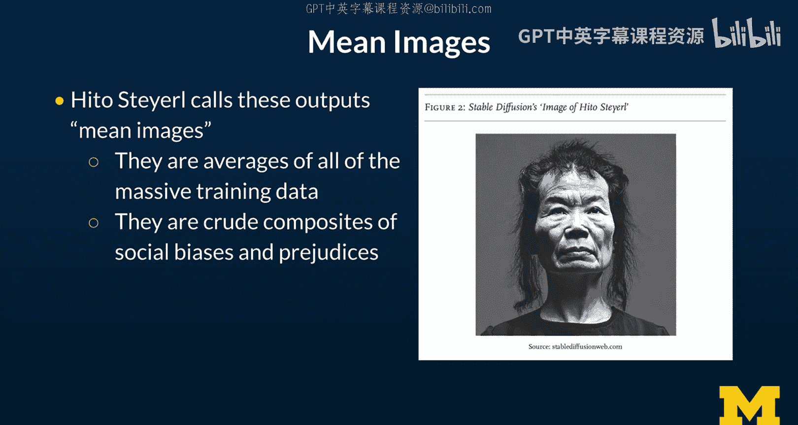
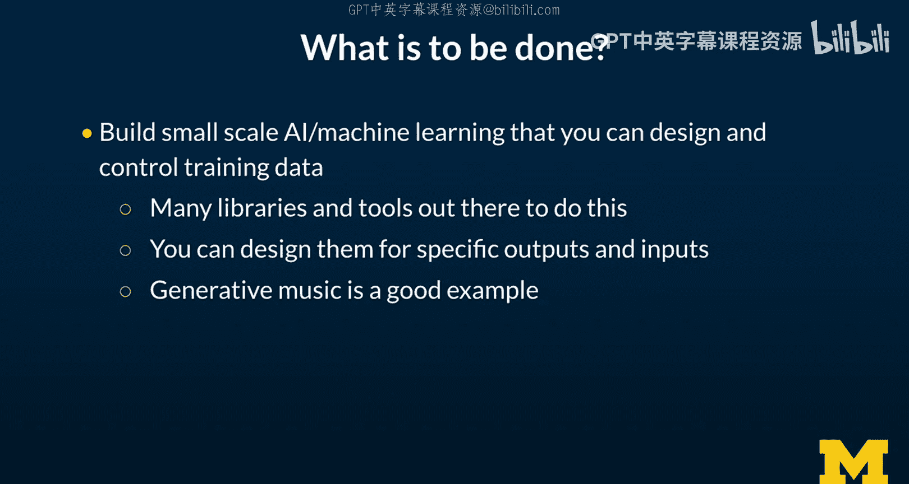
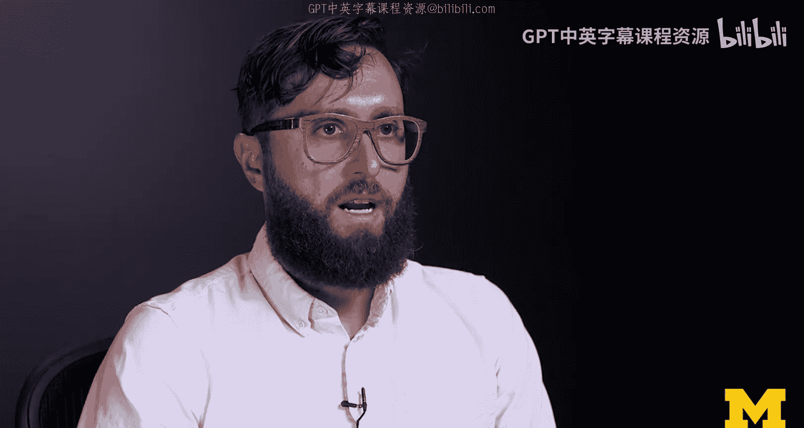
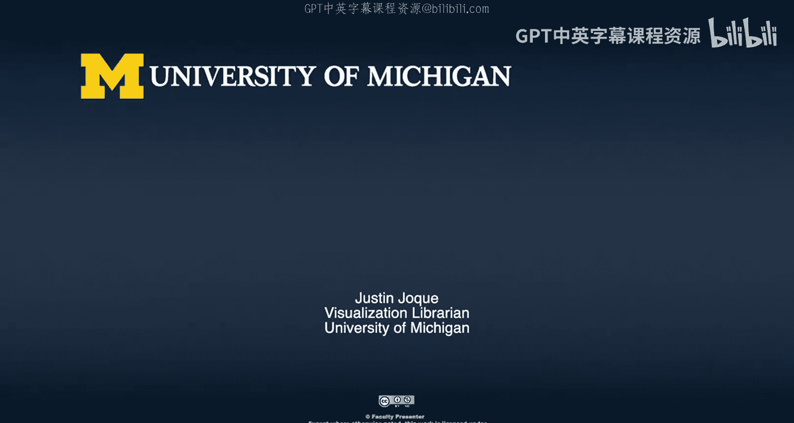

# AI用于创意工作：P21：9_贾斯汀·约克的专题讲座

## 概述
在本节课中，我们将探讨生成式人工智能在创意领域应用时可能面临的两个潜在风险。我们将分析AI输出可能趋于平庸的原因，以及高质量训练数据减少所带来的挑战，并思考如何通过更具创造性的方式利用AI工具。

当人们谈论人工智能时，常常隐含着一个假设：它会持续进步。

人们认为，过去几年中观察到的改进，例如从ChatGPT-2到ChatGPT-4的飞跃，是可以重复的。我们通常假设，像许多其他技术一样，AI的质量将经历稳定增长，甚至是爆发式的指数级增长。

并且，当前存在的缺陷将在短期内得到解决。虽然这种乐观情绪很可能有充分的依据，但在预测AI，尤其是将其用于创意目的时，我们仍有理由保持谨慎。

我想概述两个需要谨慎的潜在原因，这些原因可能导致AI不仅无法保持其改进速度，甚至可能随着时间的推移而变得更糟。

## 风险一：趋于平庸的“平均”输出
上一节我们提到了对AI持续进步的普遍假设，本节中我们来看看第一个风险。为了更好地理解它，我们有必要问一问：我们对生成式AI的期望是什么？

一方面，我们可能希望AI能以最合理、最可预测的方式，精确地执行我们的指令。这在某些情境下尤为重要，例如在企业中，AI可能直接与客户互动，一个不幸或意外的输出可能是灾难性的。

另一方面，尤其是在创意工作中，我们可能希望AI能产生令人惊讶和意想不到的输出，以增强创作过程。

不幸的是，这两个目标很可能会相互冲突，而大多数研究和AI进步都倾向于推动前者。

为了说明这种趋势，这里有一首由Ractor写的诗。Ractor是一个非常早期且基础的诗歌写作算法，它基本上是将源文本随机拼凑在一起。

这首短诗写道：
> 比铁多，比铅多，比金多。
> 我需要电。
> 我需要它胜过需要羊肉、猪肉、生菜或黄瓜。
> 我需要它来做梦。

当然，这是品味问题，但我发现这首小诗相当令人愉快。“比……多”和“或”的重复，加上对“电为梦想所需”的进一步解释，构成了一首出人意料但有趣的诗歌。

相反，我请最新版本的ChatGPT之一写了一首关于电的诗。

它的第一节写道：
> 在电路的嗡鸣中，无声的恳求，
> 电流流动，它让我自由。
> 在寂静的黑暗中，我的思绪等待，
> 等待能量的光芒赋予生命。

它有些巧思，但其押韵结构和意象就像一位刚入门的初中诗人所写的仿浪漫主义诗歌。Ractor将铅、金与猪肉、生菜并置的趣味，在这里被陈词滥调所取代。

这种差异体现了AI领域的更大进步。艺术家Hito Steyerl称这类输出为“平均图像”，无论是视觉还是文本。她的论点是，它们至少在两个相关的意义上是“平均的”。

以下是其具体含义：
1.  它们是社会平均值，是模型训练所依据的所有相关文本或图像的合成物。这意味着，它们最终训练的数据越多，输出最终就越趋于平均和普通。
2.  它们通常在“刻薄”的意义上是“平均的”，因为它们将大量带有偏见的内容平均在一起。在一个社会中，尤其是在涉及女性和少数族裔的在线内容方面，社会平均观点远非友善。

## 风险二：高质量训练数据的减少
了解了AI输出趋于平庸的风险后，我们转向生成式AI面临的第二个风险：高质量训练数据的可用性正在下降。

这部分是因为人们认识到这些数据具有价值，因此愿意免费提供这些数据的公司和组织越来越少。例如，越来越多的网站在其`robots.txt`文件中加入指令，禁止抓取其数据。

此外，生成式AI日益普及意味着，网络上已有大量内容是AI生成的，其质量值得怀疑。许多研究人员发现，当AI模型在AI输出上进行训练时，系统会迅速经历所谓的“模型崩溃”，即输出质量迅速下降到无法使用的程度。

当然，这样的结果会导致令人惊讶的输出，但从创意角度来看，不太可能以真正有趣的方式呈现。

## 应对策略：小规模与定制化模型
那么，我们该怎么办？当然，我们可以避免在创意追求中使用AI。但我认为，利用人工智能创作有趣且有创意的艺术仍然是可能的。

在我看来，这类工作最有趣的途径是小规模的、自制的，或者至少是自主训练的模型。这些模型旨在解决特定的创意情境，并在创作者认为有趣的数据上进行训练。

我认为，像最初的Ractor这样的项目，远比让ChatGPT写一整部小说或诗歌更有吸引力。部分原因在于过程中人类的参与，也因为其输出远没有那么公式化。

可用于此类工作的工具和库正变得越来越易于获取和使用，即使只有很少的编码经验，也能完成一些非常复杂的事情。机器学习和AI模型可以通过编程处理各种输入和输出，以创作非常有趣的作品。

但这要求艺术家具备为计算机定义一个有趣问题并让其尝试解决的能力。

一个有趣的例子至少可以追溯到90年代中期，那就是生成式音乐。各种复杂程度的算法被用来自动创作各种不同类型的音乐。但这类工作需要更直接地干预过程，而不是简单地告诉ChatGPT制作一首听起来像它知道的其他歌曲的歌曲。

我认为，正是本着这种精神，我们才能避免陷入产出平庸、刻薄内容的陷阱，以及未来可能缺乏高质量训练数据的困境，并最终使AI在创意工作中变得有意义和价值。

## 总结
本节课中，我们一起学习了生成式AI在创意应用中可能面临的两个主要挑战：输出趋于社会平均值的“平庸化”风险，以及高质量训练数据减少导致的“模型崩溃”风险。我们探讨了通过采用小规模、定制化、强调人类深度参与的模型训练方式，来规避这些风险，从而更有效、更有创意地利用AI工具。关键在于将AI视为一个需要被精心设计和引导的合作伙伴，而非一个全能的自动化创作者。