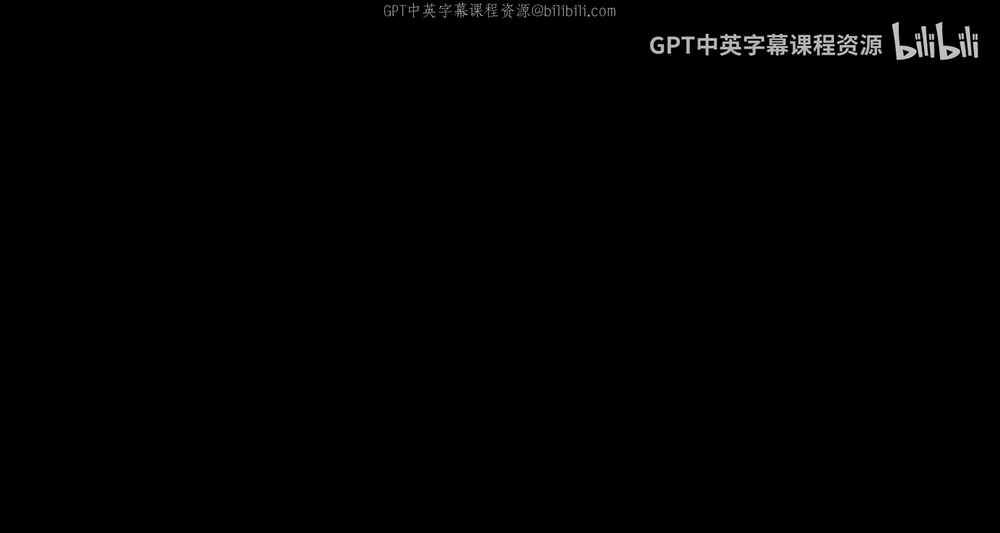
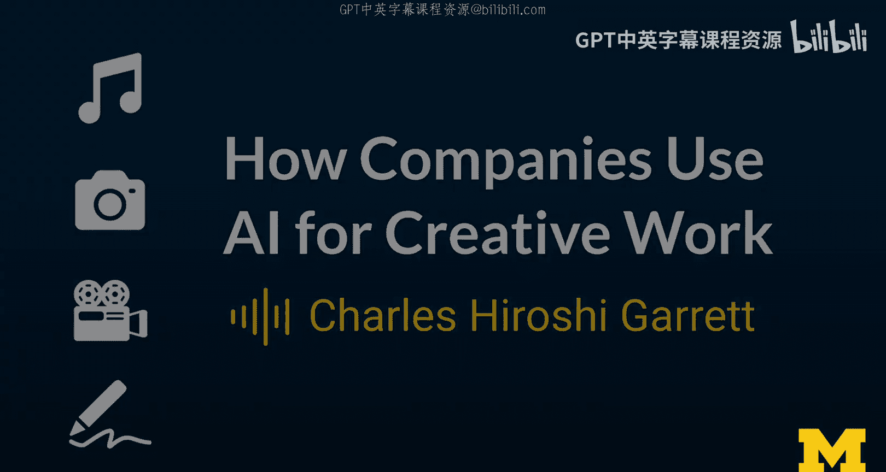
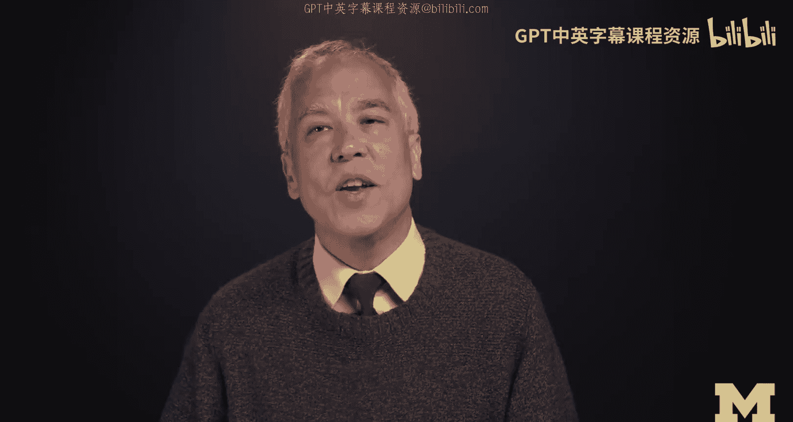
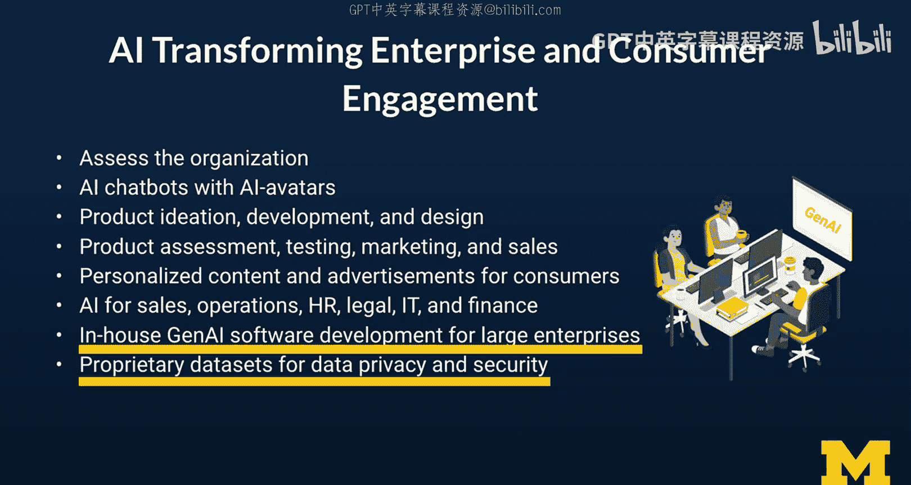
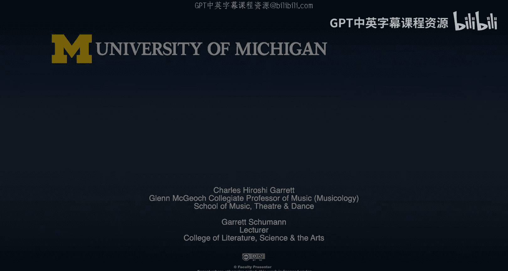

# AI用于创意工作：P22：10_企业创意工作中的人工智能应用

## 概述 📋

在本节课中，我们将探讨生成式人工智能（Gen AI）如何重塑企业环境下的创意工作。我们将了解AI如何从个体任务到整个组织流程中发挥作用，并分析其带来的广泛影响。

---

## 生成式AI正在重塑创意工作 🚀

正如我们所知，生成式人工智能正在开始重塑创意工作。个体创意专业人士、团队领导、项目小组、大型企业乃至整个行业，都在探索生成式AI如何能够辅助、增强并加速创意流程。

将AI整合到工作中并非总是简单或顺利的，革命性的变革也从不缺乏争议。即便如此，生成式AI正以极快的速度融入工作场所，其迄今为止的影响既广泛又深刻，是多方面、多维度的。

---

## AI在企业中的广泛应用场景 🏢

上一节我们介绍了AI对创意工作的整体影响，本节中我们来看看它在企业环境下的具体应用场景。本课程明确指出，许多创意工作者已开始利用生成式AI应用进行头脑风暴、探索想法并生成新的内容，包括文本、图像、音频、视频等。然而，AI所激发的变革范围更为普遍。

以下是AI在企业中的几个关键应用领域：

*   **组织与流程优化**：许多大型企业现在雇佣精通AI的人员来评估其组织结构、项目工作流程和内部流程，以识别哪些具体任务和员工最能从AI自动化或AI辅助中受益。
*   **客户服务**：如今，大多数客户已经熟悉了集成到客服行业中的、面向公众的生成式AI界面，包括由AI生成虚拟形象配备的、经过AI增强的聊天机器人。
*   **产品与营销**：AI也正在改变产品的构思、开发和设计，以及产品评估、测试、营销和销售。正如Spotify的AI引擎会判断向你推荐什么音乐一样，各行各业的企业都希望生成式AI能帮助他们通过个性化内容和广告来锁定个体消费者。
*   **后台支持**：在幕后，销售人员、运营团队、人力资源人员、法律团队、IT员工和财务规划师都在使用生成式AI，无论是为了自动化任务、头脑风暴、提高效率，还是加快周转速度。
*   **内部工具开发**：一些大型企业拥有足够的资源来开发自己的内部生成式AI软件，包括基于专有数据集训练的大型语言模型。这些模型既能整合内部知识，又能保护数据隐私并解决安全问题。

---

## 总结与展望 🎯

本节课中，我们一起学习了生成式AI在企业创意工作中的整合与应用。我们看到，AI的影响贯穿了从创意构思到产品上市、从前台客服到后台支持的全链条。

生成式AI似乎将在工作中长期存在。因此，现在正是你作为一个创意工作者，深入了解生成式AI可能为你提供什么、不能提供什么的好时机。