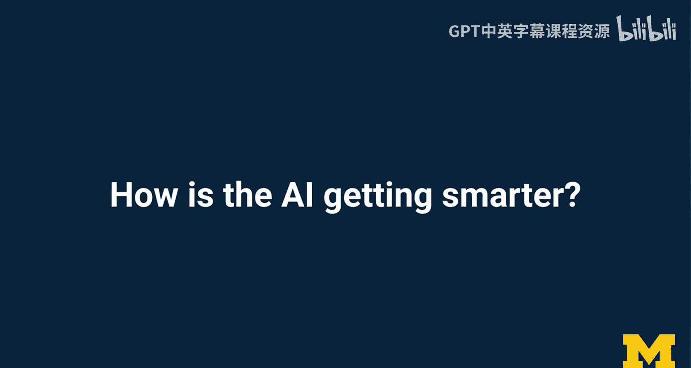
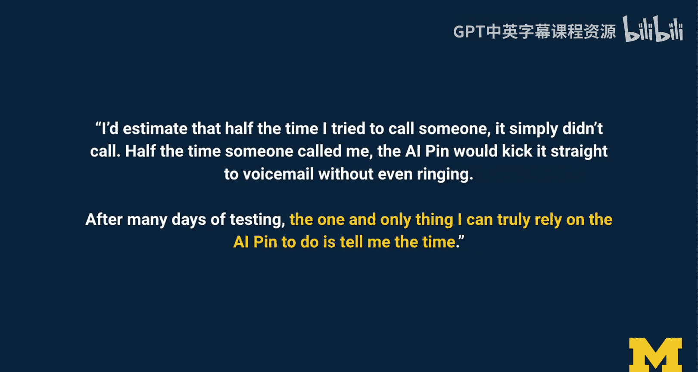

# AI用于创意工作:23：对AI工具投资的批判性思考 🧠

在本节课中，我们将学习如何对生成式AI工具的投资进行批判性思考。你将了解到，除了使用筛选流程外，评估AI工具时还需考虑数据来源、模型性能、长期可靠性以及产品本身的实用性等多个维度。我们将通过一个具体的产品评测案例，来理解为何实际测试和长期评估至关重要。

---

## 投资AI工具的核心考量

你、你的团队或组织围绕生成式AI可能要做出的最重要决定之一，就是是否应该投资一个工具来支持你们的工作。虽然你在本课程中学到的筛选流程可以帮助你做出这类决定，但还有其他一些因素需要牢记。

例如，来自专注于创建合规营销材料的AI公司Cipher的内容营销助理Sarah Walker建议，向潜在的AI供应商提出以下问题。

以下是Sarah Walker建议提出的关键问题：
*   **使用的AI类型是什么？**
*   **数据从何而来？**
*   **模型表现如何？**
*   **AI如何变得更智能？**

你和你的团队应该记住，生成式AI是一种产品，开发这项技术的公司会使用营销手段来销售它。Walker的示例问题非常有用，因为它们突出了与特定AI工具相关的可靠性、长期性能和数据来源等问题。

但同样重要的是，要像评估你计划购买并集成到工作中的任何其他产品一样来评估AI工具。除了价格之外，客户服务和安全性等因素——这些也是你的企业在进行其他采购时常见的考量——对于评估生成式AI产品也同样相关。

---

## 案例研究：Humane AI Pin评测

许多AI工具确实令人印象深刻，并且几乎所有的工具在呈现给我们时，都被描述为能够实现惊人的功能。正如我们在课程其他部分提到的，我们很容易被宣传中生成式AI工具所谓的强大能力所吸引，但令人窒息的兴奋并不能保证它们是好的产品。😊

David Pierce于2024年4月11日在《The Verge》上发表的关于Humane AI Pin的评测，为我们提供了一个富有启发性的例子，展示了如何对待一个新颖、炫目的AI产品。

Humane的网站将其可穿戴AI Pin描述为一种能让用户超越触摸、超越屏幕的设备。

该设备旨在通过聆听用户指令，接管我们使用智能手机完成的许多任务。它甚至有一个投影仪，可以根据请求在用户的手上显示文本、方向和其他信息。

正如Pierce所描述的，它可以回答基本的类ChatGPT风格的问题、打电话、拍照、发送短信、告诉你附近有什么等等。你还可以通过点击触摸板来做一些事情，就像电脑上的键盘快捷键一样。例如，用两根手指双击可以拍照，用两根手指双击并按住可以录制视频。

Pierce承认，Humane的营销让AI Pin看起来像是一个功能异常强大的产品，这里的标准很高。Pierce在评测开头指出，AI Pin有可能解决涉及智能手机功能的实际问题。他写道：“我逐渐意识到，事实上，有很多事情我的手机做得很差。通常，我只想看看时间、记点东西或者给我妻子发个短信，结果却被TikTok、电子邮件或屏幕上任何不需要的通知吸走了注意力。” Pierce继续写道：“另外，你有没有想过你的手有多少次被杂物、皮带、孩子、方向盘占着，同时还要试图平衡手机是多么烦人和不安全？我意识到我在手机上做的很多事情，可能更希望在其他地方完成。所以，是的，这（AI Pin）是个东西。”

但是，Pierce并不推荐Humane AI Pin，因为简单来说，它无法正常工作。

“AI Pin是一个有趣的想法，但它如此彻底地未完成，在许多不可接受的方式上如此完全地损坏，以至于我想不出我会推荐任何人花费699美元购买这个设备，并支付每月24美元的订阅费。” Pierce描述了他对产品的沮丧：“我测试AI Pin越多，就越感觉这个设备试图做太多事情，而硬件根本跟不上。” 他继续写道：“我估计，有一半的时候我试图给别人打电话，它根本打不出去；有一半的时候别人给我打电话，AI Pin会直接转到语音信箱，甚至不响铃。经过多天的测试，我唯一能真正依赖AI Pin做的事情就是告诉我时间。”

---

## 从案例中汲取的经验

Pierce的评测特别具有指导意义，因为它强调了产品测试的至高重要性。对Pierce来说，AI Pin的价格问题只有在他发现它无法正常工作后才成为关注的焦点。

本讲座前面提到的Sarah Walker的问题并非针对某个单一特定产品，但目标类似。她希望确保她评估的AI工具能够长期可靠、稳定地工作，并且不会损害用户数据。

当你评估AI产品时，考虑产品在可持续性方面的表现也很重要，即它随时间推移向用户交付内容的质量。随着一些大型语言模型（如ChatGPT）的使用时间增长，AI生成的内容已经进入了训练数据，这导致其生成的文本可靠性下降。

通过测试产品、查阅评测以及与产品开发人员沟通以评估其长期表现，你可以更有信心地确认，你所选择的AI工具能够持续地交付高质量的结果。

---

## 总结

本节课中，我们一起学习了如何批判性地评估是否投资生成式AI工具。我们了解到，不能仅仅被营销宣传所吸引，而必须深入考察工具的数据来源、模型性能、长期可靠性和实际效用。通过David Pierce对Humane AI Pin的评测案例，我们看到了产品实际测试的极端重要性——一个想法再有趣，若无法稳定工作，便没有投资价值。最终，结合Sarah Walker提出的关键问题、对产品可持续性的考量以及实际的测试验证，才能做出明智的投资决策。