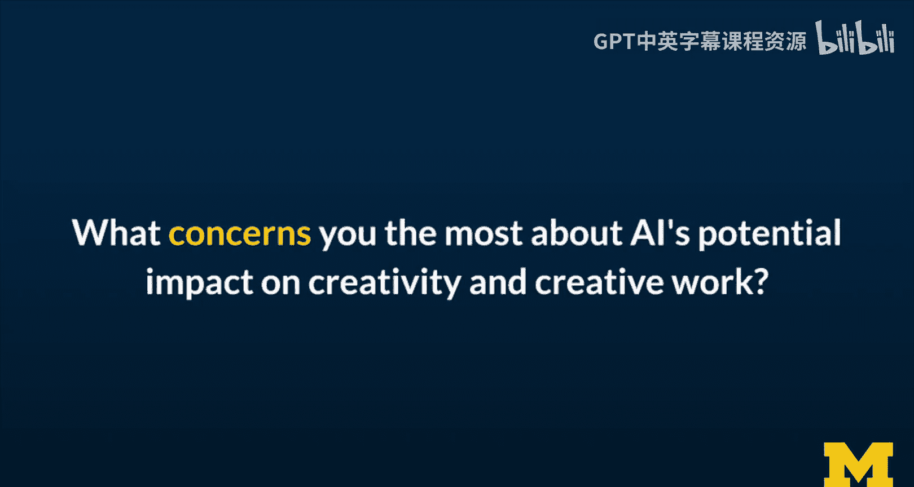
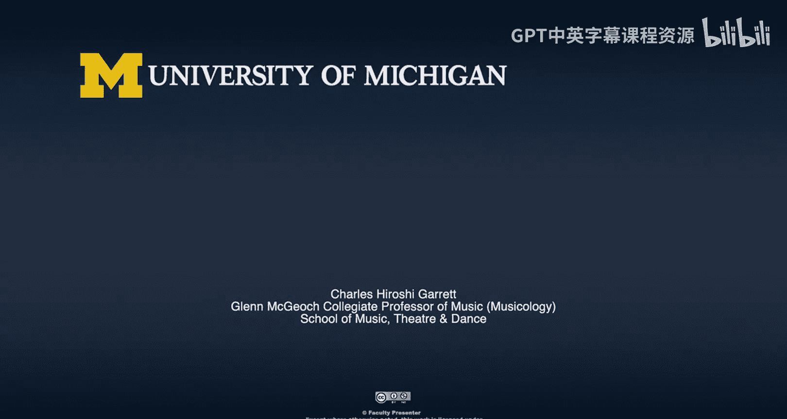

# AI用于创意工作:24：领域之声：查尔斯·浩石·加勒特

在本节课中，我们将探讨创意工作者查尔斯·浩石·加勒特对人工智能工具发展的观察与担忧。我们将分析AI工具从“助手”到“解决方案提供者”的演变趋势，并思考创作者应如何在这种变化中保持自身的创造力和价值。

## 核心观察：AI工具的演变趋势

上一节我们介绍了AI在创意领域的广泛应用。本节中，我们来看看查尔斯对当前AI工具发展趋势的具体观察。

他认为，由于AI工具发展非常迅速，并且其设计初衷是让事情变得更简单、更容易，这导致了一个现象：**寻找那些感觉像“助手”、“工具”或“帮手”的AI工具正变得越来越困难**。

相反，他越来越多地听说那些承诺提供完整、宏大解决方案的、光鲜亮丽的新AI应用。

以下是这类应用的两个典型承诺示例：
*   承诺为我创作全新的音乐。
*   承诺为我创作视觉艺术作品。

请注意，这些应用的承诺是“为我”创作，而不是“与我一起”创作。这标志着AI角色从协作伙伴向解决方案供应商的转变。

## 核心担忧：创造力与便捷性的权衡

基于上述观察，查尔斯表达了他对未来的主要担忧。随着AI不断进步，他最大的忧虑是：**最新技术将变得如此强大，以至于我开始采取创造性的捷径——仅仅按下按钮，就接受现成的结果**。

即使程序生成的结果并不完全符合我最初的设想。

因此，他未来的担忧是双重的，既关乎AI技术本身，也关乎个人与创造力的关系。

以下是这两个层面的具体阐述：
1.  **关于AI技术**：它未来会变得有多强大？
2.  **关于个人与创造力的关系**：我会在多大程度上选择坚持并珍视我自己的创作冲动？

## 总结

本节课中，我们一起学习了创意工作者查尔斯·浩石·加勒特的观点。他指出了AI工具正从“协作助手”转变为“全包解决方案提供者”的趋势，并对此表达了深切担忧。他担心过度依赖这种高度自动化的AI会导致创作者采取“创造性捷径”，从而削弱个人原创冲动的价值。这提醒我们，在利用AI提升效率的同时，必须主动思考并捍卫自身在创意过程中的核心角色与价值。