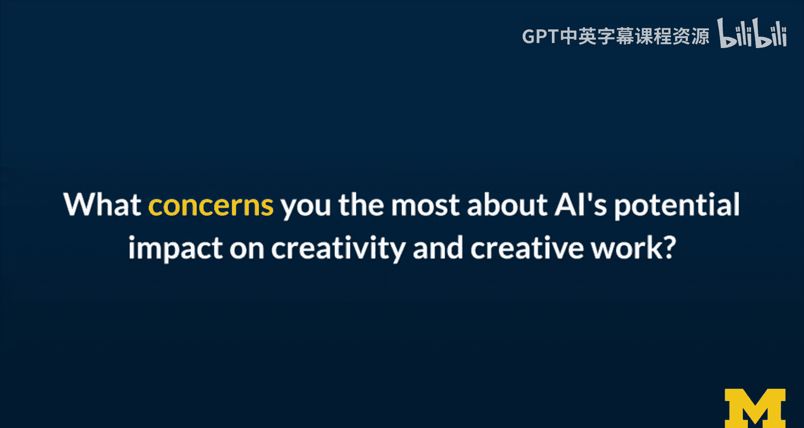
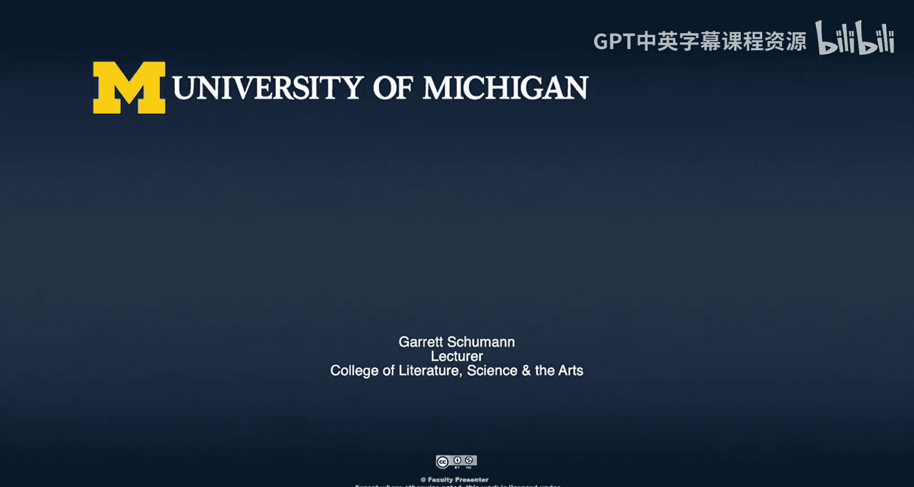

# AI用于创意工作:25：13_领域之声：加勒特·舒曼

## 概述

在本节课中，我们将学习加勒特·舒曼对人工智能的看法。我们将探讨AI作为一种工具的本质、其发展过程中的潜在问题，以及行业与监管层面的挑战。核心观点将用**加粗**或直接引用的方式呈现，以帮助初学者理解。

## AI作为工具的本质

人工智能是一种技术。因此，与任何其他工具一样，它所承载的意义仅限于我们作为使用者所赋予它的。

上一节我们明确了AI的工具属性，接下来我们来看看其发展方式可能带来的具体担忧。

## 对AI发展方式的担忧

以下是加勒特·舒曼提出的几个主要担忧点：

*   **数据来源与安全问题**：当前的AI程序，尤其是生成式AI，在开发过程中很少考虑数据来源和安全性。这意味着我们无法确切知道这些程序会产生什么结果。其开发模式可以概括为：**开发过程 ≈ 数据输入 - 充分的来源与安全考量**。

*   **固化现有权力结构**：一些AI的应用令人沮丧，因为它们大规模地强化了现有的权力和资源结构，而不是利用该技术的变革潜力去改变现状。

在了解了发展方式的问题后，我们还需要审视支撑这项技术的行业本身是否健康。

## 行业可持续性的挑战

我担心的另一个问题是，开发AI的行业不够强大，无法维持这项技术的长远发展。

以下是当前行业状况的具体体现：

*   **缺乏长远规划**：目前的商业报告显示，那些掌控着当前AI工具核心资源的公司，对于自身以及这项技术的长期性和可持续性，几乎没有规划。
*   **监管干预的可能性低**：至少在美国，政府监管似乎不太可能介入，以激励这种前瞻性思考。

## 总结

本节课中，我们一起学习了加勒特·舒曼对人工智能领域的见解。我们认识到AI的意义由使用者赋予，但其发展在数据安全、社会影响和行业可持续性方面存在显著担忧。这些讨论提醒我们，在拥抱AI潜力的同时，必须审慎思考其发展路径与长期影响。

