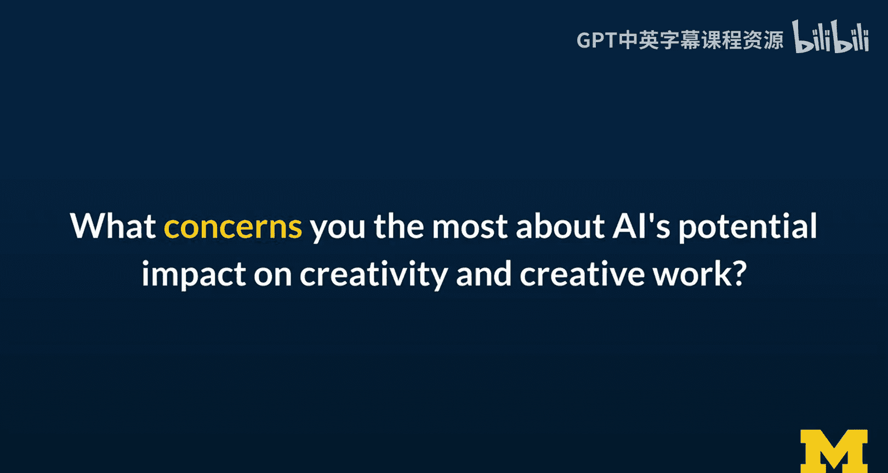
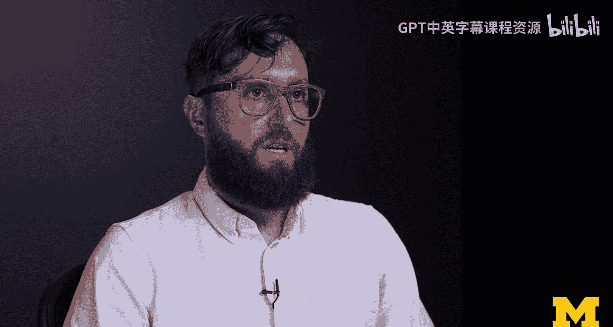
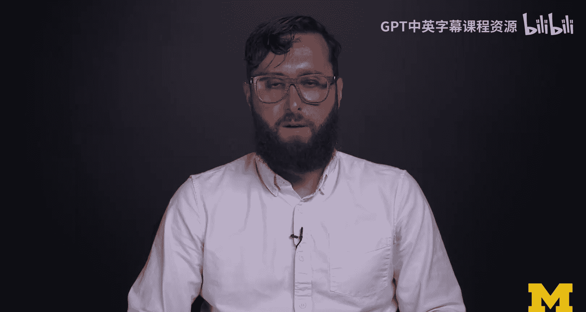
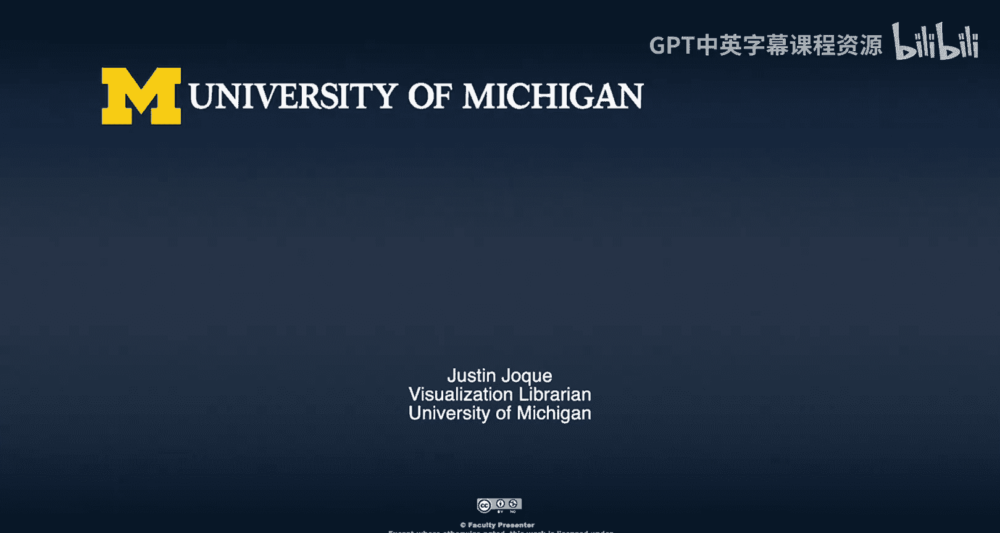

# AI用于创意工作：P26：14_领域之声：贾斯汀

## 概述
在本节课中，我们将学习密歇根大学课程《AI用于创意工作》中，来自领域专家贾斯汀的观点。我们将探讨他对人工智能在创意领域应用的担忧，并理解其核心论点。

## 核心观点阐述
贾斯汀表达了他对人工智能在创意工作中应用的主要担忧。他认为，AI可能会被用于生产低质量的艺术作品，主要原因在于其成本低于人类创作者。

上一节我们介绍了贾斯汀的核心担忧，本节中我们来看看他具体担心的几个方面。

以下是贾斯汀提出的几个关键点：
*   AI不会组织工会。
*   AI不会要求加薪。

这些特性使得AI在资本层面具有吸引力，但可能对创意劳动的价值产生负面影响。

## 深层担忧
基于上述特点，贾斯汀进一步阐述了他的恐惧。他担心AI会被广泛用作内容生产工具。

其根本原因可以概括为一个简单的**公式**：
**选择AI的原因 = 成本低 + 可进一步压榨创意劳动价值**

这种应用方式可能导致创意劳动被进一步低估和剥削。

## 总结
本节课中我们一起学习了领域专家贾斯汀对AI用于创意工作的看法。他最大的担忧是，企业可能仅仅因为AI成本更低、更“顺从”，而使用其生产低质量内容，这会导致创意劳动的价值被贬低，创作者权益受到侵害。理解这些担忧有助于我们更全面、审慎地思考AI在创意领域的角色与边界。