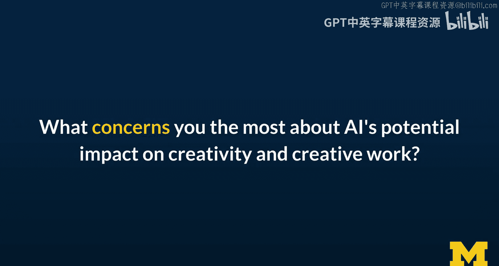
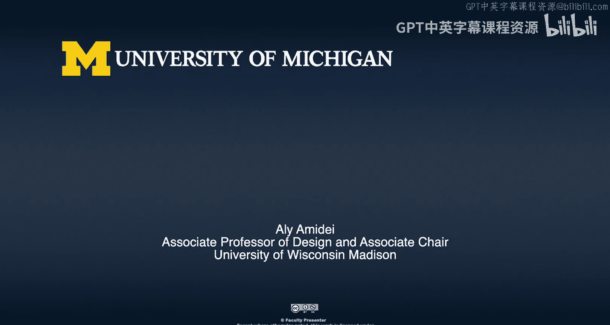

# AI用于创意工作:27：15_领域之声：艾丽·阿米迪 🎨

## 概述
在本节课中，我们将聆听来自创意领域的专业人士艾丽·阿米迪的见解。她将分享其对人工智能在创意领域应用的担忧，特别是关于AI图像对互联网生态、视觉素养教育以及心理健康的影响。

## 核心观点阐述

艾丽·阿米迪表达了她对人工智能生成图像的主要担忧。她认为，这些图像正在对互联网搜索和创意研究环境产生显著的负面影响。

上一节我们概述了本课内容，本节中我们来详细看看她的具体观点。

以下是艾丽·阿米迪提出的几个关键问题：

*   **对互联网搜索的干扰**：她最大的担忧是AI图像正在堵塞互联网搜索结果。
*   **对专业研究平台的影响**：她指出，尽管Pinterest对她而言从来不是进行服装研究的最佳平台，但现在它几乎变成了一个“AI农场”，在上面很难找到真实的内容。
*   **对视觉素养教育的挑战**：她担心AI图像对视觉素养教育构成挑战，影响她教授学生如何具备视觉素养的能力。
*   **区分真实与虚构的困难**：这涉及到学生识别和理解何为现实、何为人工制造内容的能力。
*   **对心理健康的潜在影响**：她特别提到了被大量不可能实现的、完美的、不准确的图像所轰炸，对所有相关人士的心理健康和福祉造成的冲击。

## 总结
本节课中，我们一起学习了创意领域专家艾丽·阿米迪对AI图像的深刻见解。她指出了AI生成内容在污染信息环境、阻碍专业研究、削弱公众视觉素养以及可能损害心理健康等方面带来的多重挑战。这些观点提醒我们，在拥抱AI技术的同时，也需要审慎思考其对社会和个人的潜在影响。