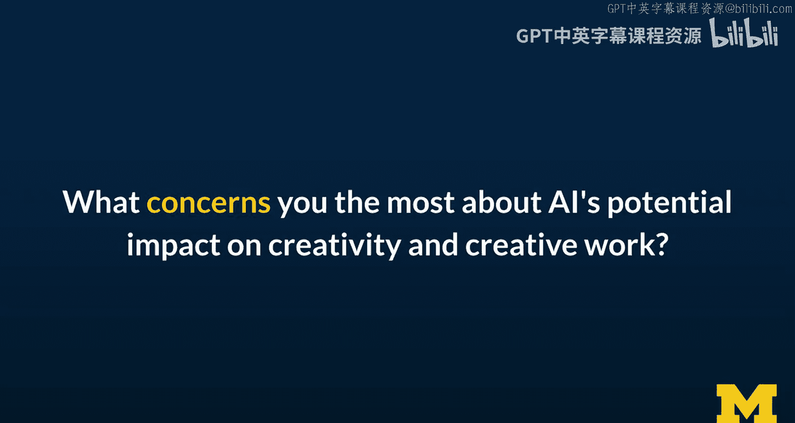

# AI用于创意工作：P28：16_领域之声：亚当·昆兹

## 概述
在本节课中，我们将探讨人工智能在创意工作领域的应用及其对就业市场的影响。我们将分析AI如何改变工作模式，并讨论其潜在的积极与消极影响。

## 核心观点分析

上一节我们讨论了AI在创意领域的潜力，本节中我们来看看亚当·昆兹对AI应用模式的担忧。

他认为，当前AI的应用趋势并非旨在提升员工的工作水平。

以下是亚当·昆兹指出的具体问题：
*   公司和企业的目的并非是利用AI赋能员工，使其在更高层次上工作。
*   其真实意图可能在于减少工作岗位数量。
*   目标是让更少的员工在同一个项目上，产出与以往同等规模的工作量。

因此，这种应用模式令人担忧。如果AI能普遍提升工作标准，那将是积极的。

但若其应用仅仅是为了用更少的人完成相同的工作量，并可能导致从业者收入下降，这显然是一个值得关切的问题。

## 总结
本节课中我们一起学习了亚当·昆兹对AI在创意产业中应用模式的见解。核心在于区分AI是作为提升人类能力的工具，还是作为削减成本、压缩岗位的手段。理解这一点对于预见未来工作场景和制定相应的职业策略至关重要。

