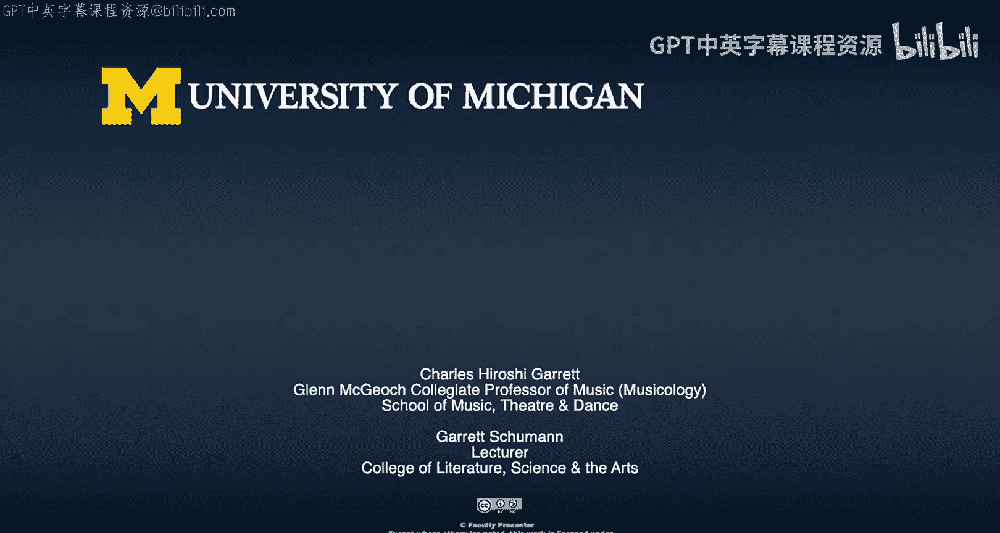

# AI用于创意工作：P29：欢迎学习本课程 🎨

在本节课中，我们将深入探讨人工智能与人类创造力之间的关系，并学习如何在创意实践中更有效地与AI协作。我们将回顾已学知识，并引入新的思考角度，帮助你强化个人创意表达，同时理解AI如何帮助你保持人性本质。

---

课程进行至此，你已经学会了批判性地思考人工智能，在适当场景下负责任地使用生成式AI，并权衡工作场所中使用AI的风险与收益。

你也了解了**筛选流程**，它将帮助你评估众多可用的AI工具，以提升工作场所中的创造力。

现在，是时候深入一步，进一步思考AI与人类创造力，并在你的创意实践中拓宽使用AI工具的视野。

---

## 什么是人类创造力的根本特质？🤔

上一节我们介绍了如何评估AI工具，本节中我们来看看创造力的本质。创造力为何是一种根本的人类特质？理解这一点是有效协作的基础。

## 如何在与AI协作中强化个人声音？🎤

与AI协作时，如何学习与之合作，同时强化你个人的独特表达？这需要平衡工具的使用与个人创意的注入。

## AI如何帮助你保持人性本质？❤️

事实上，与AI共同工作如何帮助你保留基本的人性？这涉及到对技术角色的反思，以及它如何辅助而非取代人类的创意过程。

---

## 核心方法与步骤 📝

最终，回答这些问题需要反思。因此，除了介绍新想法和额外的创意机会，我们还将请你重温本系列早期的材料，以强调这些概念如何与你个人的创意实践产生共鸣。

以下是本课程的核心学习路径：

1.  **批判性评估**：持续应用批判性思维，评估AI在创意工作中的适用性。
2.  **工具筛选**：运用**筛选流程**（Sift Process）来识别和选择最适合你项目的AI工具。
3.  **深度反思**：定期回顾所学，思考AI如何影响并融入你的个人创作流程。
4.  **实践与融合**：在创意项目中主动尝试与AI协作，观察其对你创意输出和个人风格的影响。

---

本节课中，我们一起学习了如何深化对AI与创造力关系的理解，探索了在协作中保持个人声音的方法，并强调了反思对于整合AI进入创意实践的重要性。通过持续评估、筛选工具和深入反思，你将能更自信、更有创意地在工作中运用人工智能。