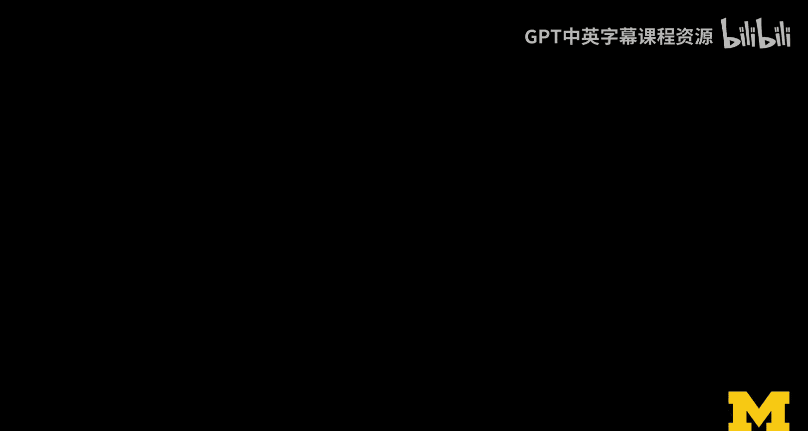
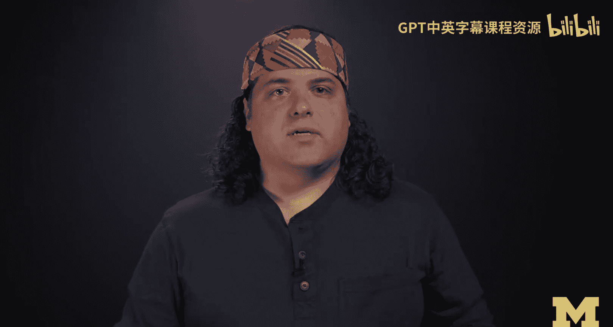
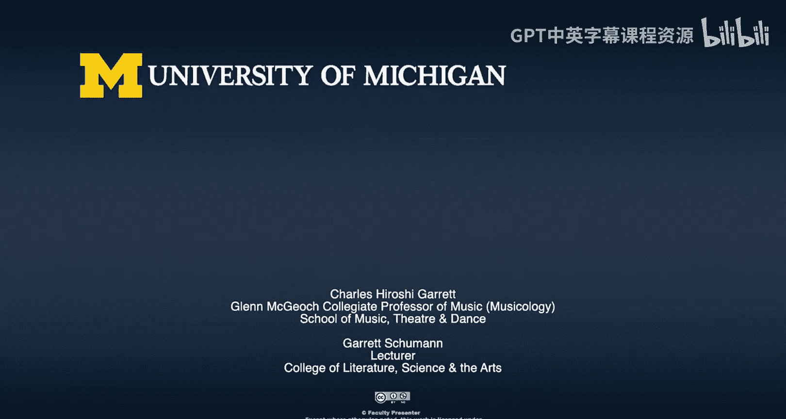

# AI用于创意工作：P30：1_AI与深度思维

在本节课中，我们将探讨生成式AI如何超越单纯提升效率的层面，成为深化创意思维、拓展创作边界的强大工具。我们将学习如何利用AI进行深度思考，并通过历史与当代的案例，了解创意工作者如何运用AI来放大其创意的影响力与反思性。

前两门课程介绍了生成式AI支持创意工作的不同方式，以及确保个人、团队或组织负责任且可持续地实施AI技术的方法。

总体而言，我们之前的重点在于AI的初步采纳行为及其直接影响。

本课程将引导你更深入地思考：你选择加入工作流程的工具，将如何变革你的创意实践并强化你的个人风格。

我们常看到AI被描绘为生产力倍增器。

它通过消除那些耗时、重复或抽象难解的任务，来最大化工人的效率。

但这种视角是有限的。确实，生成式AI技术可以节省时间，让人们做更多事。

但这里的“更多”可以且应该超越单纯的数量。毕竟，当AI简化了某人的工作流程时，它也创造了进行更高层次思考的空间。

以下材料结合讲座与阅读，探讨深度思考的益处，并展示专家和实践者的演示，以说明AI在现实世界中的强大功能。

通过当代与历史的例子，我们将看到各类创意专业人士如何以令人印象深刻的方式使用AI来拓展其创造力、放大其影响力和反思性，并磨练其工作方法。

数十年来，AI一直是各学科创意专业人士实验的焦点。

当你以新方式接触这项技术时，这些先例可以构成宝贵的基础。

超越生产力去思考。想象一下，如果你的创意工作能够超越现状的局限，包括许多你以前可能从未考虑过的事情，那将会是怎样的景象。

当然，AI可以节省时间，但它也可以是一面镜子，为你提供审视自身创意思维与过程的新视角。

它将你的倾向反射给你，并为你提供一个“合唱团”般的声音，而不仅仅是单一的声音，来将你的创意工作推向终点。

---

本节课中，我们一起学习了生成式AI作为深度思维工具的潜力。我们认识到，AI不仅是效率工具，更是拓展创意边界、提供新视角和促进反思的伙伴。通过借鉴历史先例和当代实践，我们可以更好地将AI融入创意流程，实现超越单纯生产力提升的创造性突破。