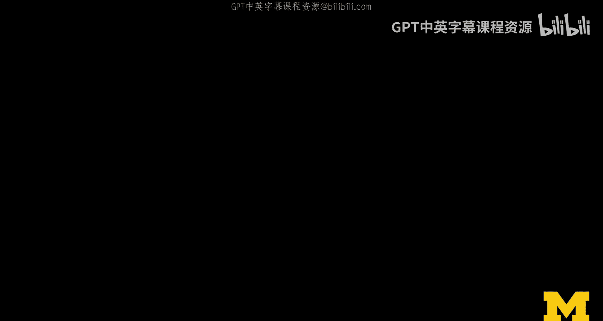
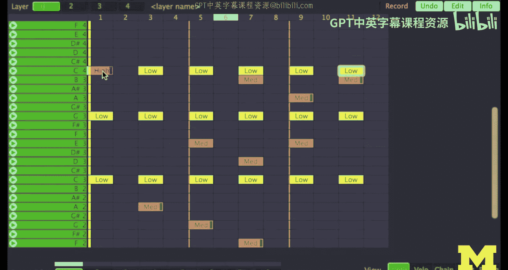
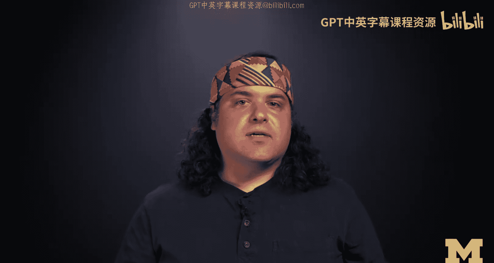
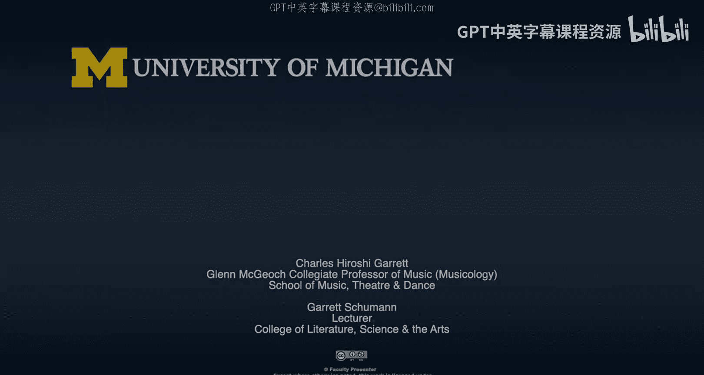

# AI用于创意工作:31：人工智能与艺术思维

在本节课中，我们将探讨人工智能如何不仅仅是提升效率的工具，更能从根本上改变我们构思和进行艺术创作的方式。我们将通过两个具体的AI音乐工具实例，来理解它们如何重塑创作者的思维过程。

## 概述：AI如何重塑创作思维

关于AI对创意工作潜在影响的讨论，大多集中在它如何节省时间或提高生产力上。然而，在本节中，我们将展示并讨论几种不同的AI驱动音乐工具，如何引导我和其他创作者以不同的方式思考我们的创造力。

当思考AI与创造力时，最令我兴奋的是它改变个人构建和概念化其创作过程的能力。我是一名音乐人，在特定项目中喜欢使用的一款软件工具叫做**Stooks**。

## 从确定性到概率性：Stooks 工具演示

上一节我们提到了AI改变创作框架的潜力，本节中我们来看看一个具体工具如何实现这一点。**Stooks** 是一个**算法概率MIDI音序器**。这意味着它控制着由我选择的软件乐器，在我偏好的数字音频工作站中演奏的节奏和音符。

使用Stooks迫使我以不同的方式思考音乐创作。传统上，音乐创作是完全确定性的。作为作曲者或歌曲作者，我决定在特定时间演奏哪些音符。但当我使用Stooks时，我选择放弃对循环模式在每次迭代中具体演奏哪些音符的完全控制。

该工具允许我设置它在音乐时间的特定时刻选择演奏特定音符的**概率**。

Stooks还有一个名为“Chain”的功能，它允许我通过影响软件从一个音符移动到下一个音符的决策来构建旋律。

但最终，我无法完全预测Stooks将呈现的最终演奏效果。我只能为程序设置一系列偏好和通用指导原则。

以下是使用Stooks的实时演示，展示如何将一个空白的、随机化的音乐纹理转变为更具传统旋律元素的片段。

（演示音频描述略）

## 协作式创作：工具作为合作伙伴

使用像Stooks这样的工具，从根本上改变了与传统方法相比创作音乐的意义。我必须将一定程度的控制权让渡给软件，使其成为一种**协作伙伴**，而不仅仅是音乐纹理中的一个乐器。

我决定演奏结果的能力受到限制，这迫使我以不同于传统环境下的方式，去思考旋律与和声等基本音乐参数。这改变了我在此背景下工作时“创造力”的含义。

我的决策过程被新的、特定的约束条件所重塑。我需要调整我对音乐表现力的处理方法，以适应软件的优势和局限性。

## 深度学习赋能：RAVE 声音合成工具

Stooks是一个算法工具，但同样影响音乐人创作范式的当代机器学习软件并不难找。例如，**RAVE** 是一个备受赞誉的声音合成程序，它使用**深度学习**来精确复制由单个表演者提供的音频输入。

这个工具实现了一种原本不可能完成的表演。独奏者可以与“自己”一同演奏，并非基于预先录制的音轨，而是与一个基于其特定嗓音或乐器声音的计算机化合作表演者一起。

这里的反射性是新颖且引人入胜的。该软件就像训练它的音乐人的一面镜子。

与Stooks（一个兼容任何标准数字音频工作站的免费软件插件）类似，RAVE是一个开源工具，设计用于与Max MSP和其他常见的现场电子音乐制作平台协同工作。

RAVE的设计也考虑到了有限的训练需求。用于训练RAVE的输入音频只需**三小时**长度。

## 总结：可及性与创新

这种水平的可及性意味着Stooks和RAVE能够激励比昂贵软件更多的音乐人。使用这些工具的音乐人，得以从音乐制作和创意技术市场的传统惯例中突破出来。

本节课中，我们一起学习了AI如何通过引入概率性、协作性和深度学习模型，从思维层面而不仅仅是效率层面，深刻影响艺术创作过程。我们看到了像Stooks和RAVE这样的工具，如何通过改变创作者的控制权、决策框架和表达方式，重新定义了音乐创作中的“创造力”。