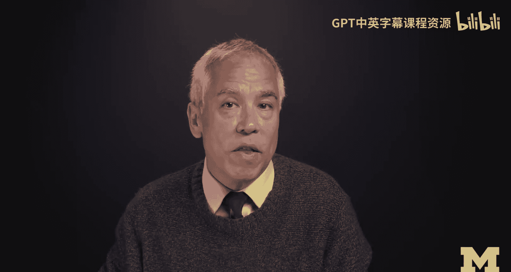
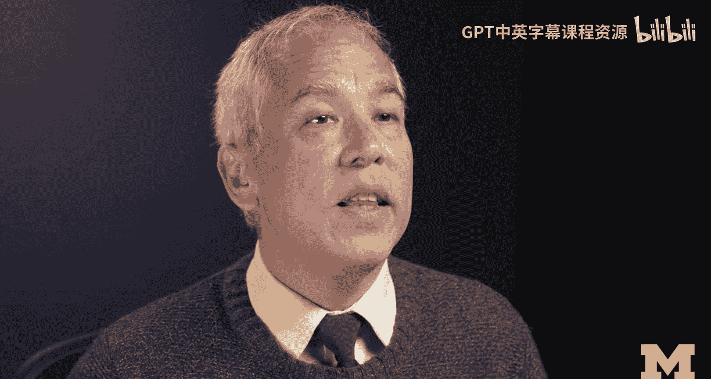
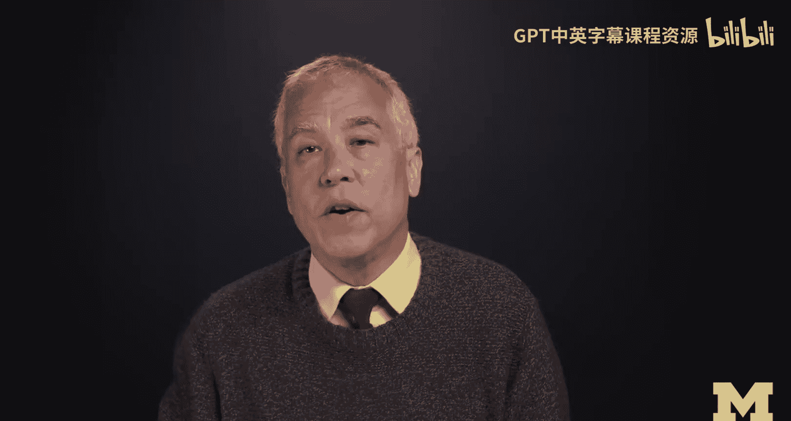
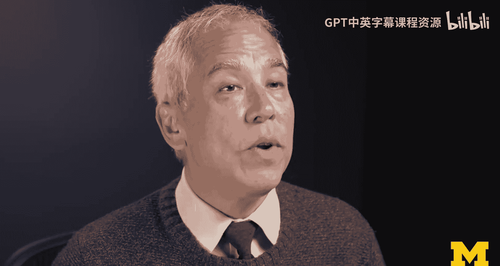
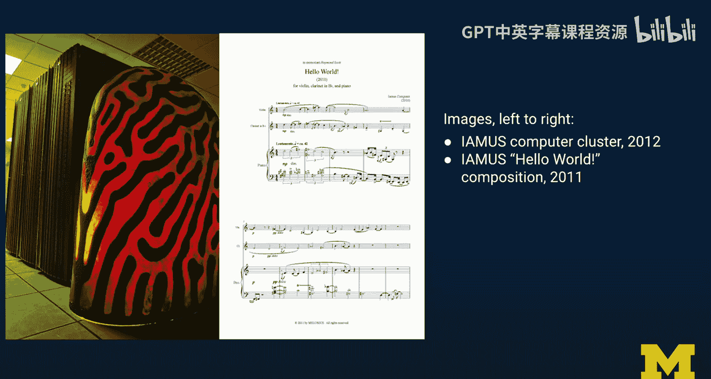
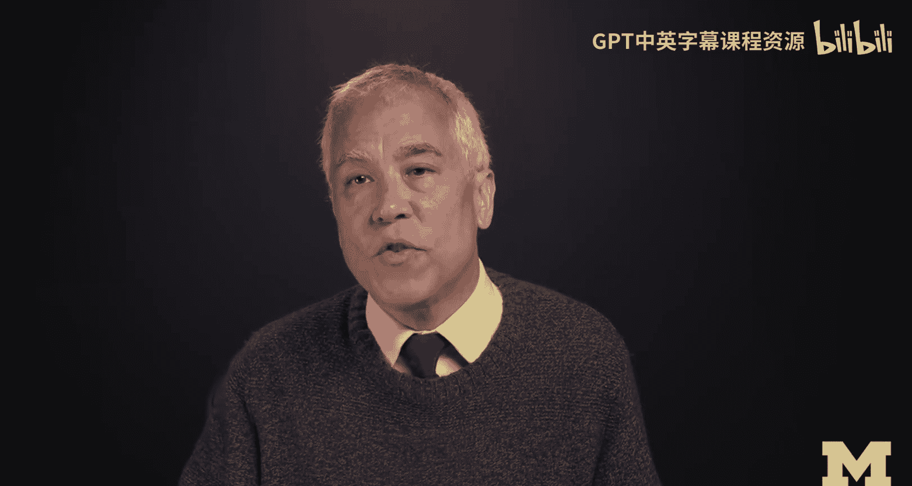
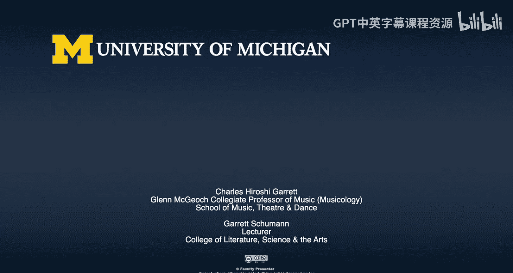

# AI用于创意工作:32：实验性艺术扩展的历史演进 🎨

在本节课中，我们将学习创意艺术家和音乐家如何从20世纪中期至今，利用计算技术和人工智能进行多方向的实验演进。我们将从基础的算法编程开始，一直探索到当今创意工作者可用的复杂AI软件。

---

## 从算法编程到早期AI艺术

上一节我们介绍了课程概述，本节中我们来看看实验性艺术扩展的起点。创意工作者对计算技术和人工智能的实验，从20世纪中期至今已向多个方向演进。这一进程始于基础的算法编程，并逐步发展到当今创意工作者可用的复杂AI软件。

第一次世界大战期间及之后的计算技术进步意味着，到1957年，作曲家莱亚伦·希尔和数学家伦纳德·艾萨克森已经能够为**伊利阿克1号**（Illiac I）计算机编程，创作出完全由计算机生成的弦乐四重奏。

以下是20世纪60至70年代的一些关键进展：
*   到20世纪60年代后期，德国生成艺术先驱乔治·尼斯能够设计算法，使用可编程绘图仪制作复杂的计算机图形。
*   不久之后，哈罗德·科恩在1970年开发了**Aaron**，这是一个绘图软件程序，常被引为最早用于视觉艺术创作的AI软件示例。
*   美国创新作曲家劳里·施皮格尔在贝尔实验室从事绘图程序和数字音乐项目，她创造了**Magic Mo**，这是一个智能乐器，也是一个用户友好的音乐软件程序，使普通公众能够在家庭计算机上创作算法音乐。她还于1980年发行了具有影响力的专辑《The Expanding Universe》，其中收录了她整个70年代最重要的音乐实验。

## 算法作曲的突破与争议

上一节我们看到了早期AI在视觉和音乐艺术中的应用，本节中我们来看看算法作曲领域的一项革命性成就。1981年，另一位有影响力的音乐思想家大卫·科普开始开发一个名为**Experiments in Musical Intelligence**的软件程序。该程序不仅能分析如约翰·塞巴斯蒂安·巴赫等作曲家的音乐，还能创作出相同风格的新作品。

这项算法作曲领域的革命性成就引发了关于创造力本质的争议和辩论。科普持续的研究最终催生了**Emily Howell**的发布，这是一个经过他精心训练以创作音乐的交互式计算机界面，后来甚至发行了自己的专辑。

## 生成艺术与AI的融合

在音乐领域取得突破的同时，视觉艺术家们也在继续探索。这一时期的视觉艺术家继续尝试新技术，一些人利用AI探索生成过程，启动复杂的算法，以分形艺术作品的形式产生不可预测、复杂且常常令人惊讶的意象。

随着20世纪末计算能力的增强和互联网使用的爆炸式增长，AI在实验性艺术和音乐中的作用进一步扩大。像艺术家兼机器人专家肯·戈德堡这样的视觉艺术家开始探索交互性和远程呈现的概念，在线用户可以在画廊空间中控制物理对象，将在线现实与物理现实联系起来。同样，像卡尔·西姆斯和埃里克·米利肯这样的先驱AI艺术家展示了AI辅助视觉艺术如何既能打动观众，又能获得评论界的赞誉。

## 21世纪的加速发展与现状

进入21世纪，基于科学实验室和大学的音乐研究人员继续取得显著进展。2010年，西班牙的AI研究人员开发了一个名为**Iamus**的软件程序，开始创作自己原创的当代古典音乐。

与此同时，在巴黎的索尼实验室，法国科学家兼作曲家弗朗索瓦·帕切的持续研究在音乐AI和机器即兴创作方面取得了一系列突破，这最终使他被任命为Spotify实验室的负责人，该实验室致力于开发音乐创作的计算工具。

更戏剧性的进步推动了生成艺术的爆炸性增长，导致了诸如2018年佳士得拍卖会等重大事件。在那次拍卖中，AI艺术品《Edmond de Belamy》以超过40万美元的价格售出。同时，流行的社交媒体应用程序发布，使用户能够通过按下一个按钮来生成、编辑和过滤图像。

## 当今的AI创意工具与未来展望

上一节我们回顾了21世纪初的突破，本节中我们来看看当今最先进的AI创意工具及其带来的深刻影响。借助复杂的神经网络和深度学习算法，当今在生成艺术领域（如**Stable Diffusion**、**DALL-E**和**Midjourney**）以及生成音乐领域（如**AIVA**和**Soundful AI**）的AI软件，使得没有经过高级培训的用户也能通过简单的提示词来创作音乐和视觉作品，其先进程度有时甚至与人类创作的作品难以区分。

如此戏剧性的进步已经挑战并改变了创造力的本质、艺术的定义，以及在未来几十年艺术和音乐发展中人类与机器将扮演的角色。

---

本节课中，我们一起学习了实验性艺术与AI结合的历史演进。我们从20世纪中期的算法编程开端，历经早期AI艺术与音乐软件的诞生、算法作曲引发的争议、生成艺术的探索，一直看到21世纪计算能力爆发后AI创意工具的普及和其带来的根本性变革。这段历史展示了技术如何持续拓展艺术创作的边界，并不断重塑我们对创造力的理解。