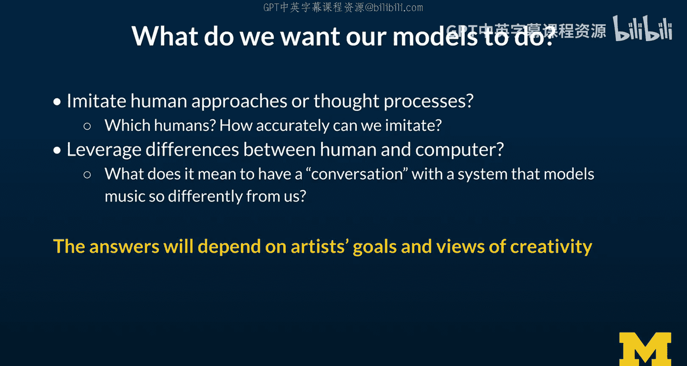
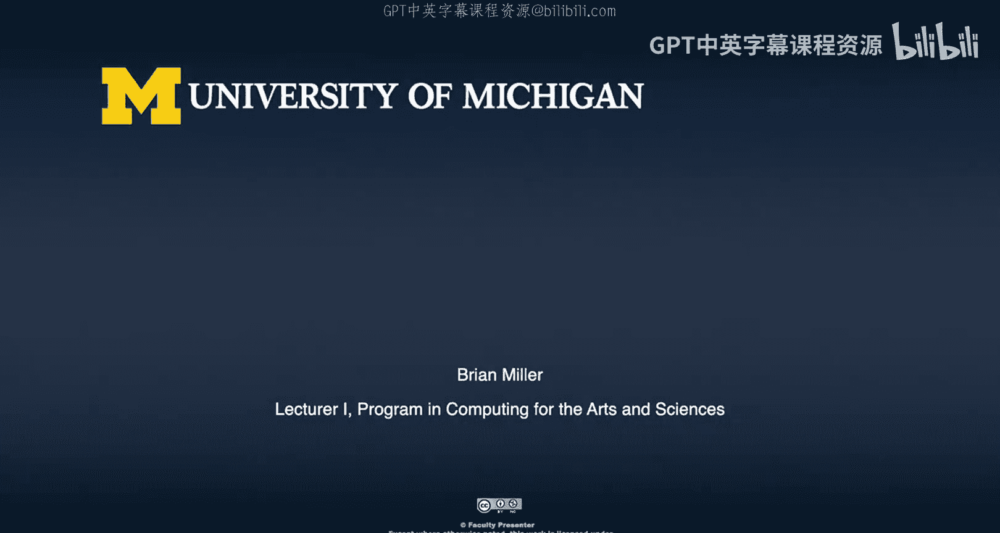

# AI用于创意工作:33：4_机器爵士：AI即兴演奏研究 🎷🤖

在本节课中，我们将探讨人工智能如何被用于模拟爵士乐即兴演奏这一复杂的创造性过程。我们将了解一个名为“Shimon”的机器人爵士乐手，并分析其背后的技术原理与设计哲学。

---

## 概述：AI与音乐的对话

你可能听过一种说法：爵士乐即兴演奏就像一场对话。每位演奏者通过乐器表达自我，同时倾听乐队的整体声音，并在恰当的时机前进或后退。这虽然是老生常谈，但其中蕴含真理——音乐即兴可以被视为日常人际互动的一个缩影或特例。

正是这种特性，使得即兴演奏成为一些计算机音乐研究者的“圣杯”。如果我们能让计算机与人类实时即兴合奏，那就意味着我们对人类互动的本质有了真正的洞察。这个想法如此引人入胜，以至于美国国防部高级研究计划局（DARPA）也曾投资一个旨在创建能与人类即兴演奏爵士乐的计算系统的项目。

---

## 机器人乐手Shimon

虽然DARPA的项目似乎进展有限，但佐治亚理工学院的一个研究小组确实开发出了一个真正的爵士乐演奏机器人，他们称之为 **Shimon**。Shimon之所以引人入胜，并非因为它是最令人信服的爵士乐表演者，而是因为它集成了许多关键的计算技术，并解决了让机器人演奏音乐所涉及的诸多难题。

Shimon演奏马林巴琴，因此它有多只可以独立移动的手臂，用琴槌敲击不同的琴键。但真正引人注目的是，它有一个安装在机械臂上的、看起来像巨大眼睛的装置，在表演时会四处移动，仿佛在注视着与它合奏的人。

这是因为Shimon的创造者认为，与乐队合奏时的**具身化**（embodiment）方面，是良好音乐互动的关键之一。当人类一起演奏时，他们倾向于用身体和乐器做出各种动作来进行交流和协调。在视频中，你可以看到机器人的头部如何摆动和摇晃，并似乎在注视着其他演奏者。

当然，Shimon并不真正理解随音乐律动是什么感觉，但它被编程为以让周围人类觉得合理的方式移动。这似乎能产生更好的表演效果，尽管观看时可能有点诡异。

---

## 具身化AI的意义

你可能听过对ChatGPT等新型AI系统的批评，认为它们真正理解事物的能力有限，因为它们只建模语言，与物理世界没有接触。这实际上与Rodney Brooks等机器人学家对AI的长期批评不谋而合。而Shimon有助于展示，即使是有限形式的具身化，在人机交互中也能多么有意义。

---

## Shimon的音乐生成技术

在音乐音符的建模方面，Shimon结合了多种技术。它演奏的很多内容，比如歌曲的整体形式和遵循的和弦进行，是通过**基于规则的过程**来处理的，类似于David Cope的EMI系统等早期计算机音乐中的技术。

但当Shimon演奏独奏时，它使用了一个**机器学习模型**，该模型经过了许多真实爵士音乐家独奏范例的训练。这发生在当前生成式AI时代之前，因此Shimon使用的不是神经网络，而是一种叫做**隐马尔可夫模型**的技术。

---

### 理解隐马尔可夫模型

一般来说，马尔可夫模型是一种利用事物当前状态信息来预测未来事件的系统。

以英语拼写为例，字母 **Q** 后面几乎总是跟着 **U**。如果我们想建立一个英语拼写的马尔可夫模型，Q的表示可能如下：大约有98%的概率转移到U，1%的概率转移到其他字母如I或A。要获得精确的数字，我们需要分析大量英文文本以查看真实的概率。

现在，我们不把那些字母看作英文字母，而是看作**音符**。

这个模型告诉我们，音符 **C** 最有可能移动到 **E**，但也有可能移动到 **G**；而 **G** 最有可能移回 **C**，但也有很小的概率上移到 **A**。即使只有这个简单的图表，我们也可以根据这些概率选择一系列音符来生成一些旋律。

Shimon使用的隐马尔可夫模型是这类系统的一个复杂得多的变体，但基本原理非常相似。它根据从大量爵士乐独奏中学习到的概率，一次生成一个音符。

---

## 音乐建模的关键决策

然而，如果你想为爵士乐这样复杂的音乐建模，选择计算技术远非唯一需要做的决定。

例如，Shimon为曲调中的**每种不同类型的和弦**使用一个单独的模型。因此，可以说它选择音符的“思考过程”总是取决于当前正在演奏的特定和声。

---

## 对比：另一个系统Improviser

还有另一个名为 **Improviser** 的系统，它不像Shimon那样进行现场表演，但也能生成爵士乐独奏，并且也使用隐马尔可夫模型。

但与Shimon一次选择一个音符不同，Improviser从一个**更长的旋律形态集合**中进行选择，并且它的选择不以同样的方式依赖于和声。

因此，我们拥有相同类型的计算模型，却使用了完全不同的基本音乐单元，这意味着最终产生的音乐结果也大相径庭。

---

## 模型设计背后的哲学

这些关于如何建立模型的不同决策，实际上是对“爵士乐独奏如何运作”的不同主张。是专注于哪些单个音符与和弦匹配，还是从更长的音乐姿态或乐句的角度来思考？

由此，我们可以提出一些问题：
*   一个更接近人类思考爵士乐方式的模型，是否真的能产生更好的音乐？
*   如果我们编程让模型做一些与人类完全不同的事情，是否能得到更有趣的结果？

尽管像Shimon和Improviser这样的系统中使用的特定模型已经开始被神经网络等技术所取代，但对于任何类型的AI创意工作来说，这些相同类型的问题仍然和以往一样重要。

---

## 总结

本节课我们一起探索了AI在爵士乐即兴演奏领域的应用。我们认识了机器人乐手Shimon，了解了其**具身化设计**对音乐互动的重要性，并深入分析了其核心的**隐马尔可夫模型**音乐生成技术。通过对比不同系统（如Improviser）的设计选择，我们认识到，在AI创意工作中，技术实现与对艺术本质的理解（如“音乐的基本单元是什么”）同样关键。这些思考将延续到更广泛的AI创意应用之中。