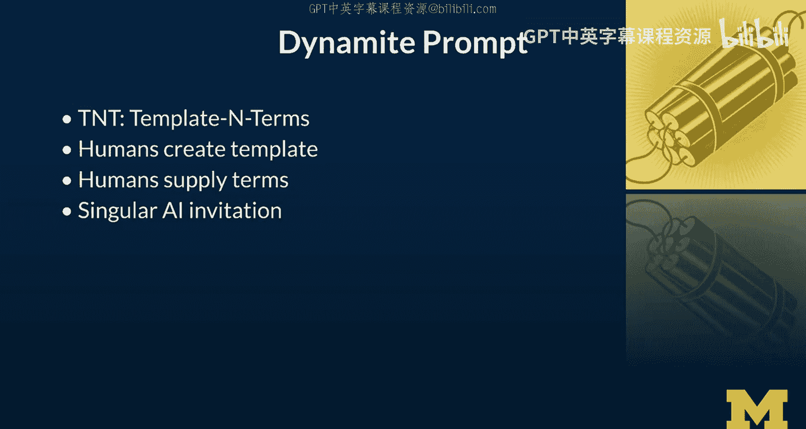
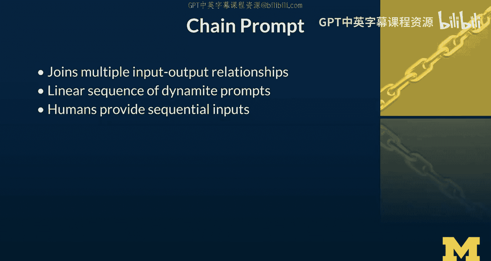
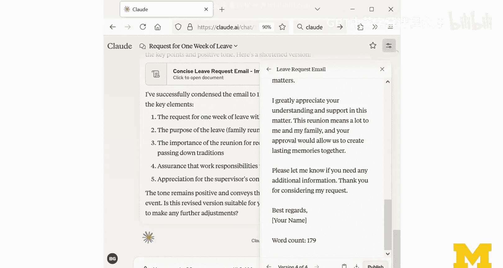
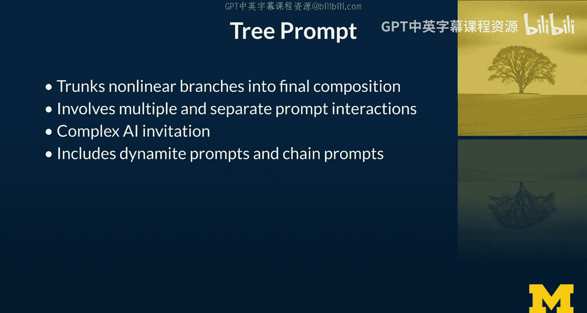
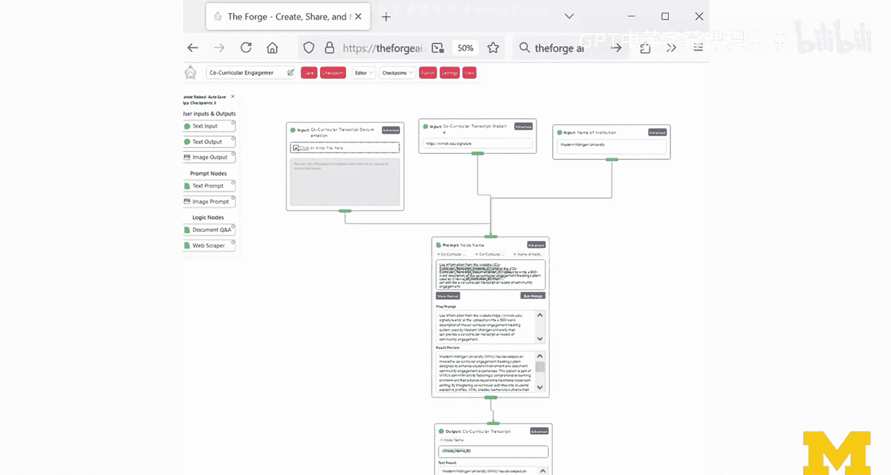

# AI用于创意工作:34：构建AI协作闭环

在本节课中，我们将探讨人工智能如何扩展写作流程。我们将学习三种宏观的提示词结构，这些结构能帮助你在创作过程中更有效、更合乎伦理地与AI协作。

我是布莱恩·高根，西密歇根大学的修辞学与写作教授。我将讨论AI扩展写作流程的一些方式。

AI正被引入写作流程，或者说我们称之为“生产循环”的各个环节。从最早的构思时刻到最后的编辑润色，AI可以在任何可想象的创作阶段介入。

无论AI在何时进入生产循环，都需要人类向AI平台发出邀请，使其参与到这个创作过程中。我发现这种邀请方式本身就极具魅力且富有创造性。特别是当产出的作品能够在现实世界中真正实现其目的时。

当我们将AI应用于现实世界的问题和具体需求时，便开启了广阔的潜力。所有这些潜力都取决于我们向AI发出的邀请。

这些邀请通常被称为“提示词”，它们是我们提供给AI以获取输出的输入内容。这些提示词的功能是指导和引导AI，使其作为伙伴和共同生产者与我们人类协作。

我感兴趣的是，人类如何能以产生更有效、更合乎伦理、更公平的写作作品或其他类型作品的方式，向AI发出这些邀请。

通过与一组学生和实践者合作，我确定了三种宏观或高级别的提示词结构。当你邀请AI进入自己的生产循环时，这些结构可能对你有用。

我将与你分享的这三种宏观结构，应被视为创建AI提示词的三种不同方法。它们是帮助我们管理输入、指令和向AI发出邀请的结构。

## 提示词结构一：炸药包提示法 🧨

这种结构的名称是对首字母缩写T和T的一种趣味演绎。在这里，T和T代表“模板”和“术语”。正如首字母缩写所示，炸药包提示法结构使用一个由人类输入AI的模板。

这些模板通常包含一些填空位置，人类必须提供术语以使提示词具体化。在炸药包提示结构中，人类创建模板并提供术语。炸药包提示结构是向AI发出的一次性邀请，以获取一个输出。

人类可以通过微妙地改变模板中使用的术语，或者更彻底地改变模板本身，来引导AI产生不同的输出。

现在，让我们看看这种结构的实际应用。我写了一个相当基础的模板，这里有两个填空位置。以下是我的模板：

**`Write a [长度] fan letter to [对象].`**

你们中有些人会注意到，这个提示词类似于谷歌在2024年夏季奥运会期间播放的一则引发争议的广告中使用的提示词。在那则广告中，一位父亲使用AI帮助他的女儿给西蒙娜·拜尔斯写一封粉丝信。

在这个案例中，我将像广告中的父亲一样，也使用谷歌的Gemini。我将看看使用两组不同的术语配合模板会得到什么输出。

以下是第一个提示词：
**`Write a two-page fan letter to Taylor Swift.`**
结果如下。

以下是第二个提示词：
**`Write a half-page fan letter to LeBron James.`**
结果如下。

请注意，这种提示结构具有“一次完成”的潜力。对于相当直接的现实世界目的，炸药包提示结构能产生爆炸性的效果。然后，人类可以着手修改炸药包提示的输出。

## 提示词结构二：链式提示法 ⛓️

这种结构的名称源于它将人类输入与AI输出之间的关系组织成一个线性序列，其中多个输入-输出关系连接在一起。

这种提示结构背后的理念是，单一的人类输入不足以获得最优的AI输出。因此，链式提示由多个串联在一起的炸药包提示组成。

在收到对初始提示的一个输出后，链式提示会基于该输出构建，精心设计另一个输入，逐步走向最终的作品。通过这种方式，在已完成的输出和后续的输入之间建立了链接。

让我们看看这种结构的实际应用。

我从一个炸药包提示开始。我使用的提示词是：
**`Write an email to my supervisor, Don, requesting one week of leave time.`**
我决定使用Anthropic的Claude。以下是使用链式提示结构的结果。

我通过输入另一个提示词，邀请AI优化这第一个输出。

我可以通过一个接一个地添加链接来扩展链式提示，用更多输入连续提示AI，例如这个：
**`Now, revise the email to explain that I need to use the leave time because of a family reunion that will happen in the United Kingdom.`**

还有这个：
**`Keeping a positive tone, stress the importance of this reunion for me, because it will give me an opportunity to reconnect with my extended family and teach my children our traditions.`**

以及最后这个：
**`Revise the email so that it is 250 words or less.`**

关于这种提示结构的一个注意事项是，人类必须意识到一个薄弱环节。因为链中一个环节的有问题的输出会影响提示中所有后续的环节。因此，随着链式提示的推进，人类必须保持警惕，检查每一个输出。

## 提示词结构三：树状提示法 🌳

这种结构的名称源于它将输入-输出关系组织成非线性的分支，这些分支最终在不同的节点汇聚到一起，共同构成一个最终作品。

由于树状提示涉及多个且通常是独立的提示交互，树状提示结构是你可以向AI发出的最复杂的邀请。

树状提示的非线性特性促进了一种生产流程，这种流程适合多模态整合、澄清指令、逻辑操作和网络抓取技术。

树状提示内部经常同时包含炸药包提示结构和链式提示结构。

让我们看看这种结构的实际应用。在这个例子中，我使用的是4J，这是一个使用OpenAI的ChatGPT的集成设计环境。

你会看到，我已经为一个分类文件的一个部分绘制了一个小型树状提示的草图，像我所在的机构可能会选择完成这个文件。

树的分支包括一个可选的文档上传功能、一个网络抓取功能和一个文本输入。这些分支随后汇聚到一个提示词中，最终产生一段可用于分类文件草案的文本。

Forge AI实际上允许我将这个树状提示作为一个应用程序启动。我可以与不同机构的同事分享这个程序，这样我们都可以为分类文件的这一部分生成草案文本。

我想再次强调，这个树状提示的例子是大幅缩小的。典型的树状提示包含多个输入、三到四个主要分支以及数十个通向最终作品的小提示。

我希望在你创造性地邀请AI进入自己的生产循环时，会发现这三种方法很有用。谢谢。

## 总结

本节课中，我们一起学习了三种与AI协作的宏观提示词结构：
1.  **🧨 炸药包提示法**：使用固定模板和填空术语，适合一次性、目标明确的任务。
2.  **⛓️ 链式提示法**：将多个提示串联，基于前一个输出构建下一个输入，适合需要迭代和细化的任务。
3.  **🌳 树状提示法**：最复杂的结构，包含非线性分支，允许整合多种输入和操作，适合处理多源信息或构建复杂文档。

理解并运用这些结构，可以帮助你更有效、更有条理地引导AI参与创意生产过程。