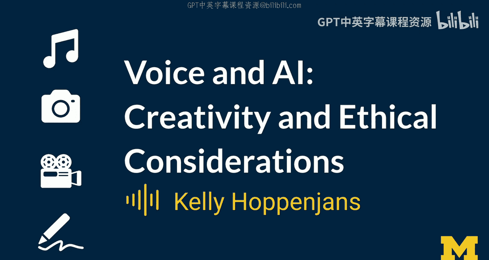
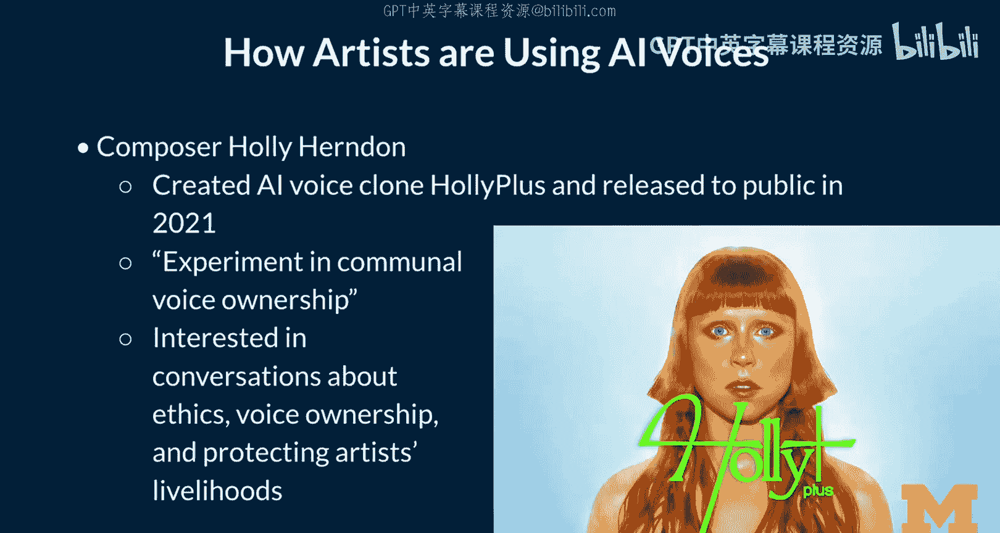
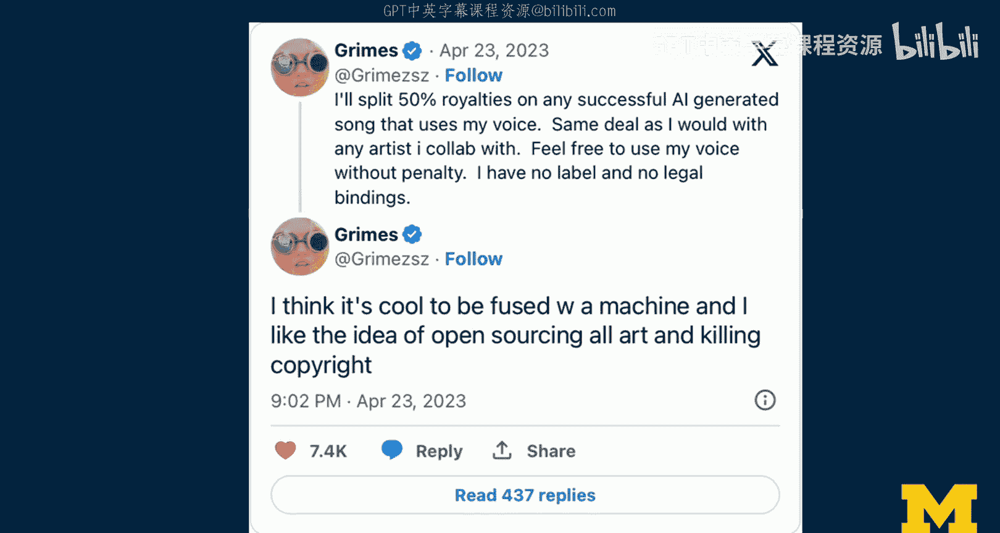
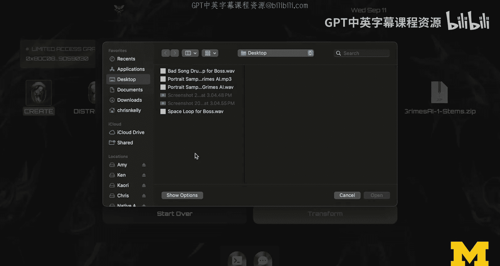
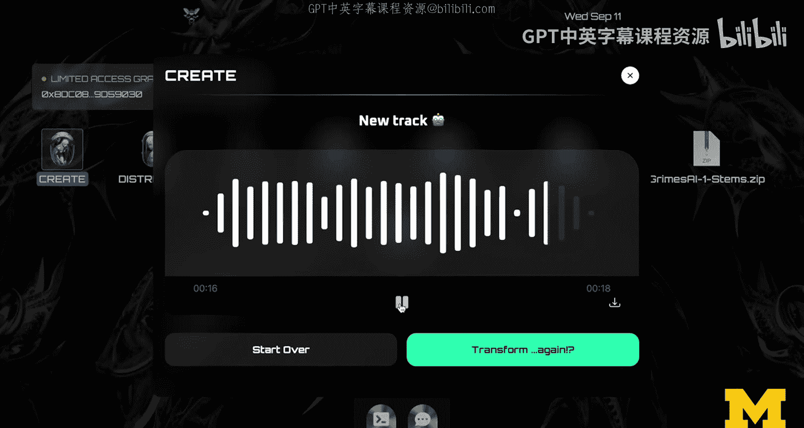
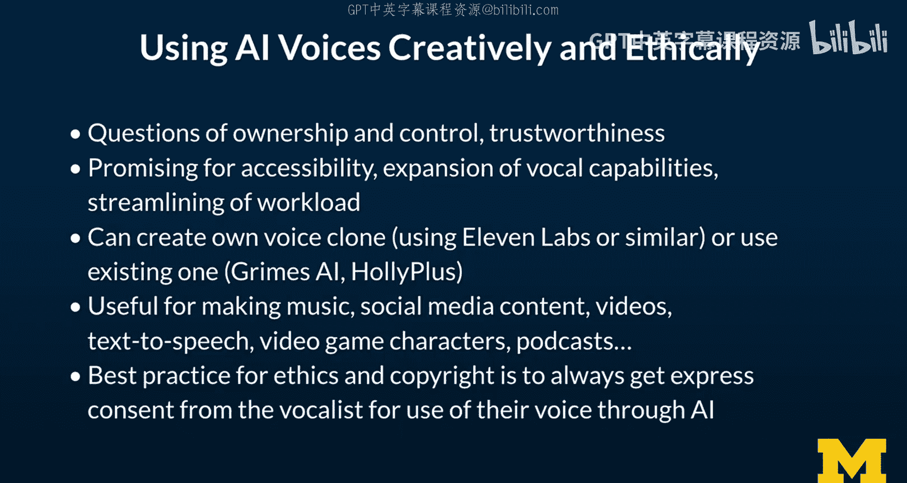
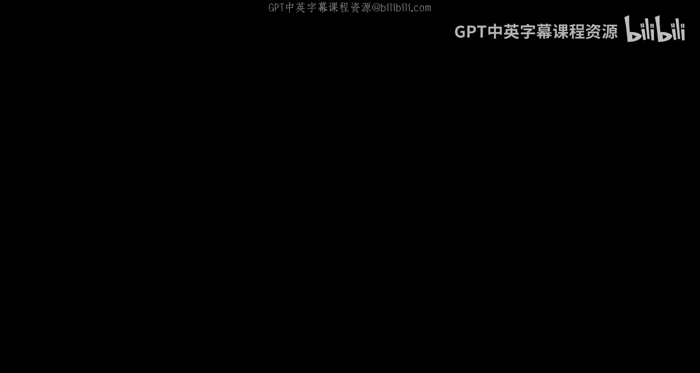
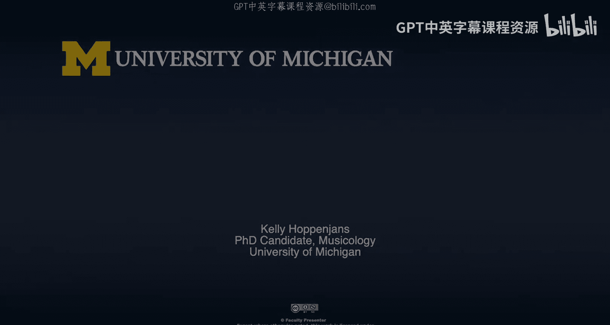

# AI用于创意工作:35：6_声觉智能：创造与伦理的双重考量 🎤




在本节课中，我们将要学习人工智能语音克隆技术。我们将了解其工作原理、在创意领域的应用，以及伴随这项强大技术而来的重要伦理与法律问题。

## 概述

人工智能可以被训练来复制人的语音或歌声，我们称之为语音克隆。你可以使用目标声音的录音作为训练数据，来训练AI模仿人声。克隆体可以模仿音色、节奏、发音，甚至呼吸声。

## 语音克隆的工作原理

上一节我们介绍了语音克隆的基本概念，本节中我们来看看它的具体实现方式。

使用AI语音克隆有几种不同的方式。如果用于复制语音，你可以通过输入文本来指示克隆体说出内容，这被称为**文本转语音（Text-to-Speech）**。例如，ChatGPT的语音库和知名的AI语音服务**11 Labs**就是这样工作的。

对于歌唱克隆，许多AI会使用歌手的演唱样本来生成目标AI语音克隆。也就是说，你演唱后，AI可以将你的声音转换成他人的声音。而在另一些系统，如**Vocaloid的AI插件**中，你可以输入歌词和MIDI数据（包括音高、节奏、强度、颤音和呼吸声），然后使用其声音库中的某个角色为你演唱。

以下是语音克隆的核心技术流程：

```python
# 概念性代码：语音克隆训练流程
训练数据 = 收集目标人声的录音
AI模型 = 初始化语音合成模型
for 音频片段 in 训练数据:
    AI模型.学习(音频片段)  # 学习音色、节奏等特征
最终语音克隆 = AI模型.完成训练()
```



## 语音克隆的应用与案例



了解了技术原理后，我们来看看艺术家们如何在实际中应用这项技术。



电子音乐家Holly Herndon在2021年向公众发布了她的语音克隆“Holly Plus”。她称这是一项“集体声音所有权实验”，旨在鼓励人们创造性地探索AI技术，同时推动关于伦理、所有权和保护艺术家生计的讨论。

暗黑流行艺术家Grimes在2022年创建并向公众发布了她的语音克隆。她将其定位为对抗音乐产业操控的艺术家的技术解决方案，并将使用她声音创作的歌曲版税五五分成。



许多其他创作者也使用这些AI克隆进行音乐创作。例如，艺术家Kito使用Grimes的AI创作了歌曲《Cold Touch》，获得了Grimes本人的认可。然而，也存在未经授权的使用案例，如Drake在歌曲中使用已故说唱歌手Tupac的AI声音，引发了法律纠纷。

这些案例表明，AI语音技术既拓展了创意边界，也带来了所有权和许可方面的挑战。

## 伦理、法律与风险考量

上一节我们看到了语音克隆的创造性应用，本节中我们来看看其伴随的伦理与法律问题。

AI语音技术引发了关于声音所有权和控制权的问题。我们是否有权控制自己声音的使用方式？美国国会已提出如《No Fakes Act》等法案，旨在保护人们免受通过AI技术对其声音和肖像进行未经授权和非自愿的使用。在田纳西州，新颁布的《Elvis Act》将声音保护添加到了现有的姓名、形象和肖像保护法中。

然而，法律的发展常常滞后于技术能力，因此如何合乎道德地使用AI语音，很大程度上取决于我们自身。

此外，AI语音克隆也引发了人们对深度伪造技术中声音可信度的担忧，如前文提到的伪造拜登总统语音电话的例子。我们如何能相信听到的话确实出自本人之口？

以下是当前面临的核心风险：

*   **未经同意的克隆**：在未经许可的情况下克隆他人声音。
*   **欺诈与误导**：利用克隆声音进行诈骗或传播虚假信息。
*   **版权模糊地带**：使用名人声音克隆创作的内容是否侵犯版权，法律尚不明确。
*   **信任危机**：难以分辨真实声音与AI生成声音，损害社会信任。

## 技术的积极潜力与创意实践

尽管存在风险，这项技术也拥有巨大的创造潜力。它使人们能够突破生理限制，极大地扩展声音表现能力。用户也可以创建自己的语音替身，从而减轻嗓音负担，更高效地创作。

该技术还为失语者用声音表达自己，以及为视障人士创建文本转语音内容带来了巨大希望。

对于你自己的创意实践，可以考虑使用11 Labs或类似程序创建自己声音的模型，用于内容创作。请记住，你只应克隆自己的声音，或在获得他人明确同意后克隆其声音。

你也可以使用那些经本人明确同意而广泛提供的语音克隆，如Holly Plus、Grimes AI等。利用这些声音，你可以进行以下创作：

*   音乐制作
*   社交媒体内容
*   视频配音
*   文本转语音内容
*   电子游戏角色语音
*   播客



## 总结





本节课中我们一起学习了AI语音克隆技术。我们探讨了其如何通过训练数据模仿人声，考察了它在音乐等创意领域的实际应用案例，并深入分析了随之而来的伦理争议、法律风险以及对声音所有权的挑战。同时，我们也看到了这项技术在赋能创作者、辅助特殊人群和提升创作效率方面的积极潜力。关键在于，在利用这项强大工具进行创新时，我们必须始终保持伦理意识，尊重声音所有权，并在法律框架内进行负责任的实践。