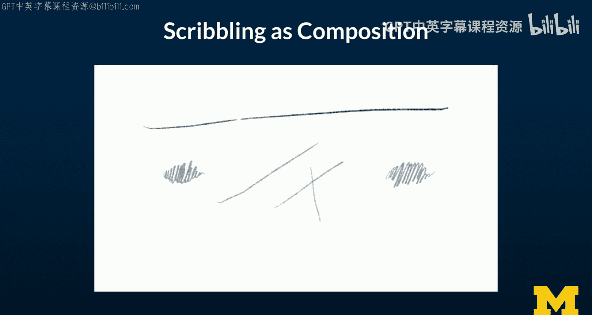
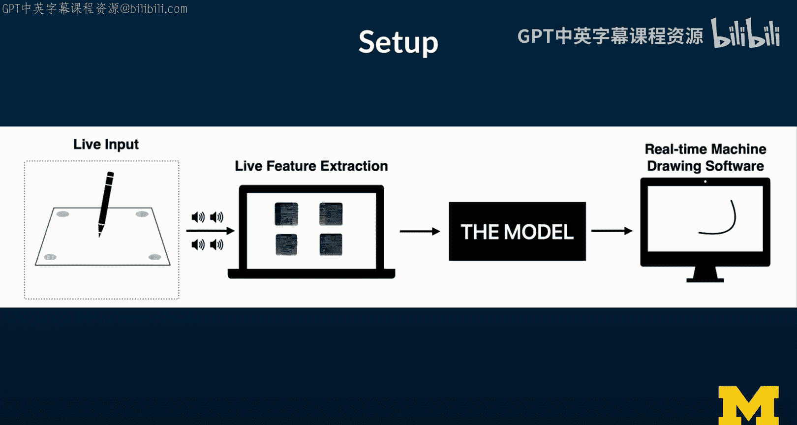
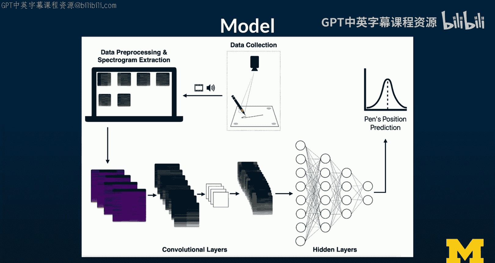
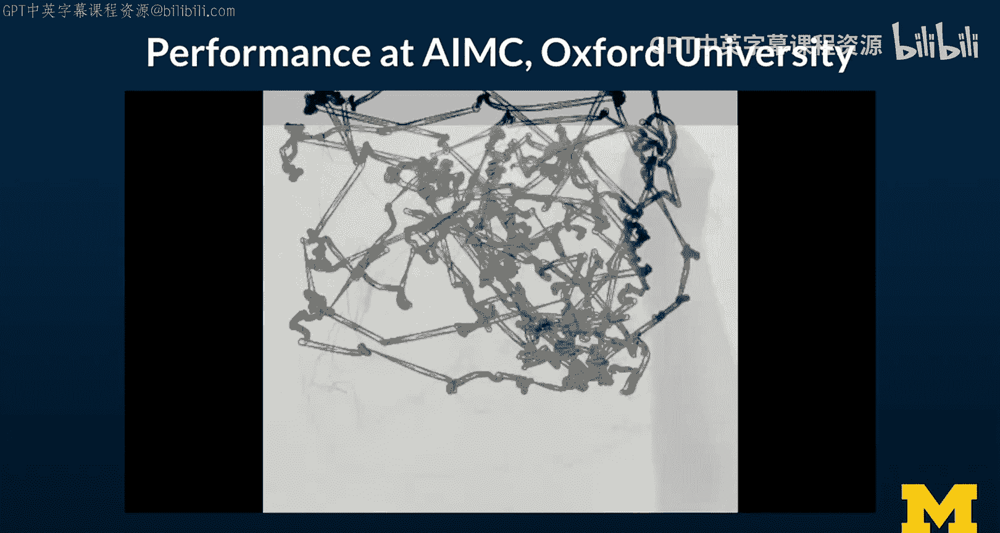
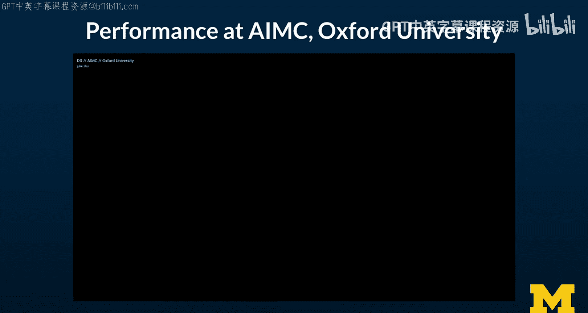
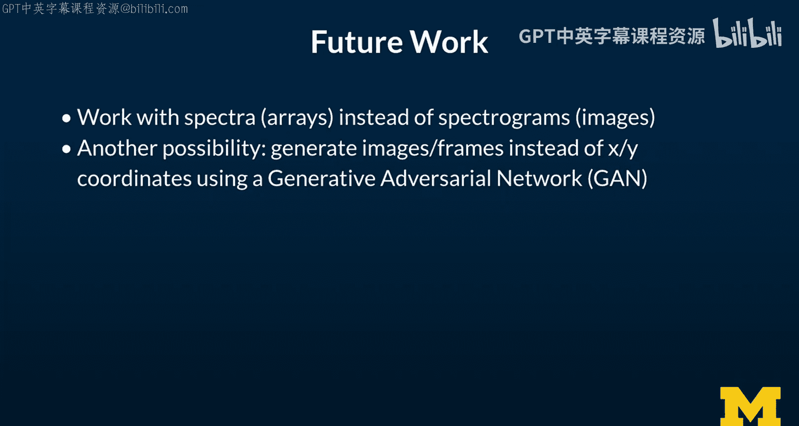
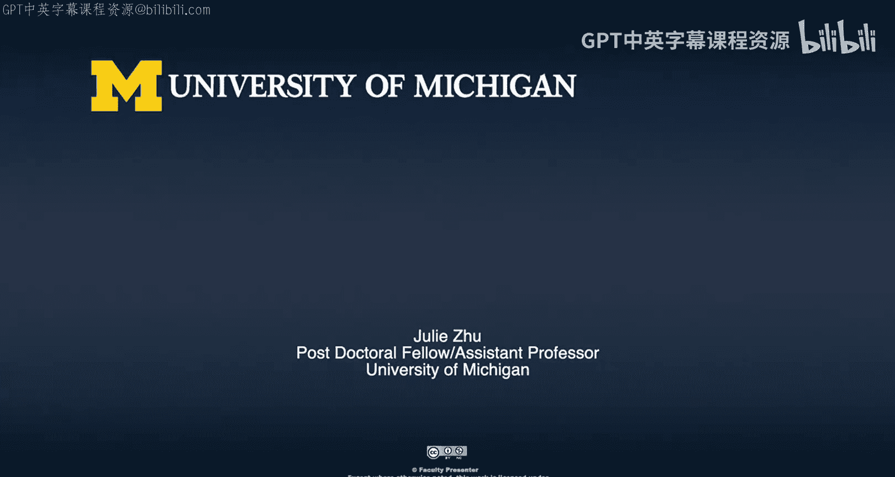

# AI用于创意工作：P36：深度绘图技术 🎨

在本节课中，我们将学习一个名为“深度绘图”的创意项目。该项目利用人工智能技术，将绘画时产生的声音实时转化为视觉图像。我们将了解其工作原理、技术实现以及未来的探索方向。

---

我叫朱莉·祖，是一名作曲家和音乐技术专家。我将向大家介绍我正在进行中的项目——“深度绘图”。这个项目使用人工智能，从声音生成视觉图像。

在投身音乐领域之前，我是一名生活在纽约市的视觉艺术家。这座城市充满了各种声音，例如鸣笛声、叫喊声、卡车和地铁的轰鸣声。但我最喜爱的声音，是石墨在重磅纹理纸上摩擦的声音，或是炭笔在带有纹理笔触的画布上涂抹的声音，就像这幅2015年的画作一样。这是我投身声音艺术和音乐创作之前完成的最后一幅画。

多年来，我创作了许多关于绘画声音的表演和作品。这是2021年为一位打击乐手创作的数字乐谱片段，乐手在一个经过扩音的木质盒子内部进行绘画。

这份数字乐谱原本仅供表演者使用，但它让我意识到一些事情。这段视频不仅在听觉上很有趣，在视觉上也令人满意。随着机器学习工具的爆发式发展，我开始思考，能否创造一个视觉上的协同即兴表演者，让它仅凭声音就能预测我正在绘制的内容。

---

## 项目构思与技术方案

上一节我们了解了项目的灵感来源，本节中我们来看看其具体的技术实现方案。

我与我的团队（约翰·格兰兹尔博士、艾尔夫·阿利和亚历克斯·赞）着手创建了一个深度学习模型。该模型从一块2英尺见方、四分之一英寸厚的胶合板四个角上放置的四个接触式麦克风获取输入，并输出所绘制内容的视觉呈现。

本质上，这是一个定位问题，类似于你的手机通过蜂窝基站和公共Wi-Fi点进行三角定位。然而，声音在木质表面的传播速度远快于在空气中，并且信号噪声很大，这证明了使用机器学习模型而非固定计算方法的合理性。

我们的视觉协同表演者的设置如下：通过四个接触式麦克风获取实时绘画输入。我们需要从这四个音频通道中提取音频特征，然后将其输入机器学习模型。该模型以每秒30帧的速度预测笔尖的X、Y坐标，并将这些坐标发送到一个JavaScript前端应用程序，该程序将坐标可视化为绘制的笔触。

---

## 模型训练与数据处理

这个AI协同表演者的核心是一个训练好的模型。深度学习神经网络有多种类型，其中一种是卷积神经网络（CNN）。这种前馈神经网络常用于图像处理，并且擅长预测。

为了实现实时的音频到笔尖位置的映射，我们首先录制了同步的绘画音频和视频。视频中的X、Y位置通过颜色追踪确定（训练时在笔尖贴有蓝色贴纸）。音频则经过预处理，提取频谱图，然后输入CNN。通过CNN，机器能够将音频中的细微差别和变化转化为相应的坐标，从而在数字画布上生成视觉标记。

---

## 首次实践与结果分析

上一节介绍了模型如何工作，本节我们来看看它的首次实际应用效果。

我们在2024年牛津大学AI音乐创造力会议上，用这个模型进行了首次10分钟的表演。我在木质表面上绘画，探索音色和节奏，优先考虑有趣的声音。真实的绘画（通过头顶摄像机拍摄）和预测性绘画被叠加在一起，以突出机器的成功与失败之处。以下是一个片段。

如你所见，这位协同表演者的预测与我的实际绘画并不完全吻合，并且存在延迟。但这完全不是一个不受欢迎的结果，它是研究过程的一部分。此外，“深度绘图”探索的一个方面，是理解从头开始开发模型的细节，这在机器学习中并不常见。同时，我们只使用自己生成的数据，这对于我作为一名实践艺术家来说很重要，意味着不使用他人的数据。

---

## 未来改进方向

基于首次实践的经验，我们正在探索以下改进方向：

*   **使用频谱而非频谱图**：这是传输音频数据的另一种方式。使用频谱，我们得到的是数字串而非图像，这可以使我们的模型更轻量、更实时。
*   **生成完整图像而非坐标**：另一种潜在的模型是生成完整的图像，而不仅仅是X、Y坐标。这将利用生成对抗网络（GAN）进行音频诱导的视觉合成。

未来还有更多值得探索的空间。

---

本节课中，我们一起学习了“深度绘图”项目。该项目通过卷积神经网络（CNN）模型，将绘画声音实时转化为视觉坐标。我们了解了其从灵感构思、技术实现（包括使用四个接触式麦克风进行声音定位）到首次表演实践的全过程，并探讨了使用频谱数据和生成对抗网络（GAN）等未来改进方向。这个项目展示了AI如何作为一种创意工具，与艺术家进行独特的协同创作。