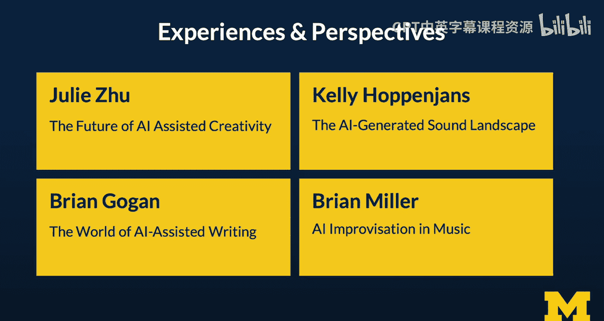
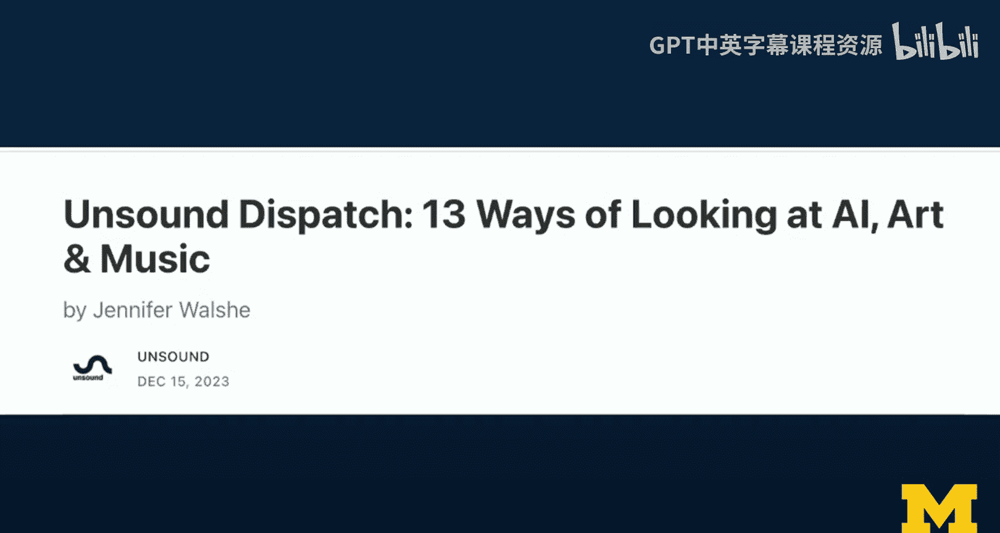
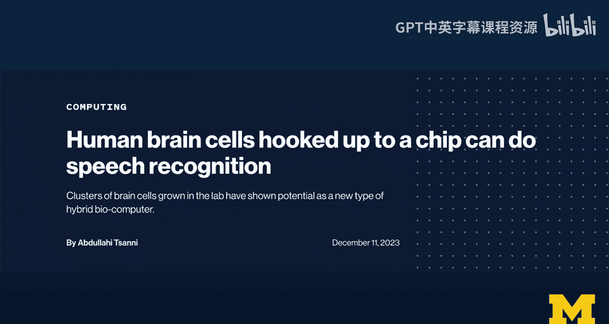
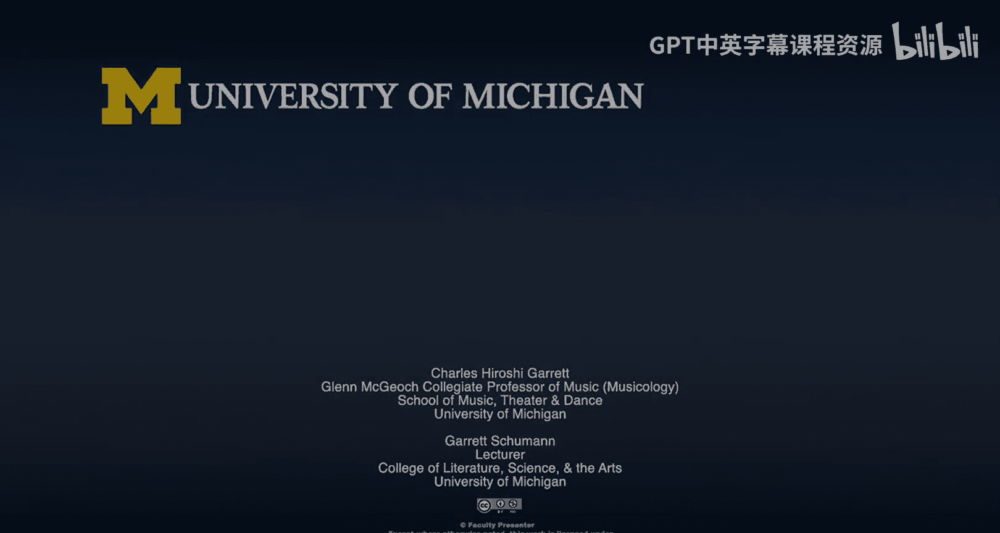

# AI用于创意工作：P37：人机表达关系反思 🤖💭

## 概述

在本节课中，我们将回顾并反思四位专家关于AI与人类创意表达关系的见解，并深入探讨AI在创意工作中一个日益凸显的深层含义——其与人类身体的交融。

## 专家观点回顾

上一节我们介绍了四位客座专家的核心分享。本节中，我们来简要回顾他们的核心观点。

以下是四位专家的主要贡献：

*   **朱莉·朱**：通过她的实验性作品，为我们展示了AI辅助创意工作的未来一瞥。
*   **凯利·赫彭宁斯**：展示了基于她本人、以及音乐人格里姆斯和霍利·赫恩登声音训练的AI人声模型，探讨了AI生成声音与音乐领域中一个引人入胜的角落。
*   **布莱恩·高根**：将我们带入AI辅助写作的世界。
*   **布莱恩·米勒**：以佐治亚理工学院开发的机器人鼓手“夏蒙”为重点，开启了客座讲座系列，重点介绍了音乐中的AI即兴创作。

## 核心反思：AI与身体的交融

在听取了专家们的分享后，我们注意到一个多位专家在视频论文中触及的、正在兴起的深层含义。

随着AI技术的发展，特别是在我们刚刚了解的创意领域，我们可以观察到AI与人类身体的交集日益增多。

这一点在机器人夏蒙的表演中尤为明显。它的**物理实体性**为人机交互开辟了基于计算机的工具所无法实现的新前沿。

同样，AI驱动的人声模型能够“体现”虚构或真实个体的潜力，也对人类体验产生了惊人影响。技术专家兼音乐家珍妮弗·沃尔什在2023年的著作中描述了AI发展的这一方面带来的多重影响。

其中之一是“AI辅助的粉丝创作”。沃尔什通过“AIsis”项目来描述这一现象。该项目由英国另类摇滚乐队绿洲的粉丝发起并推崇，它利用AI人声模型和音乐生成器，让粉丝可以通过提示词来创作具有该乐队独特风格的新歌。与凯利·赫彭宁斯讨论的霍利·赫恩登和格里姆斯的AI人声模型不同，AIsis项目**并未获得绿洲乐队成员的同意**，这造成了一种通过AI声音化身可能产生的、非自愿的“身体占有”的棘手局面。

## 个人能动性与技术整合

布莱恩·高根强调，将AI融入实践的作家需要“**将技术整合进来**”。这体现了创意工作者在与这项技术日益深入的互动中，对个人能动性的关注。

这一点尤为重要，因为AI工具正开始与人类身体性产生重叠。例如夏蒙或其他使用AI与周围世界互动的复杂机器人，或者在其建模或其他操作中依赖于人类身体。

正如《麻省理工科技评论》2023年发表的一篇文章所阐明，先进计算和人工智能的另一个前沿是**脑类器官**的使用，即“在培养皿中生长的人类脑细胞团，用于执行计算任务”。

尽管这仅是一项实验，但其潜力作为一个重要的提醒：尽管我们倾向于将计算机和复杂的信息技术视为与物理世界截然分离的事物，但像人工智能这样的先进计算，其实与人类身体及我们的肉体体验**深度相连**。

## 对创意关系的启示

当我们思考AI与人类创造力的关系时，这个观点显然具有重要分量。

或许AI技术，特别是生成式AI的新创新，并不代表传统意义上的“发现”，也并未开发出人类创造力的新部分。更准确的说法可能是：由于人工智能已经并且持续深化其与人类身体的关系，**AI帮助我们触及了人类创造力中一直存在、但在早期可能未被充分利用的部分**。

## 总结

本节课中，我们一起学习了AI在创意表达中与人类身体性日益交融的趋势。我们回顾了专家案例，探讨了从机器人实体到AI声音化身所引发的关于同意与个人能动性的问题，并最终反思了AI或许并非“创造”新能力，而是帮助我们更深入地“触及”和“激活”人类固有创造力的一部分。理解这种深层的身体与技术的联系，对于负责任且富有成效地运用AI进行创意工作至关重要。