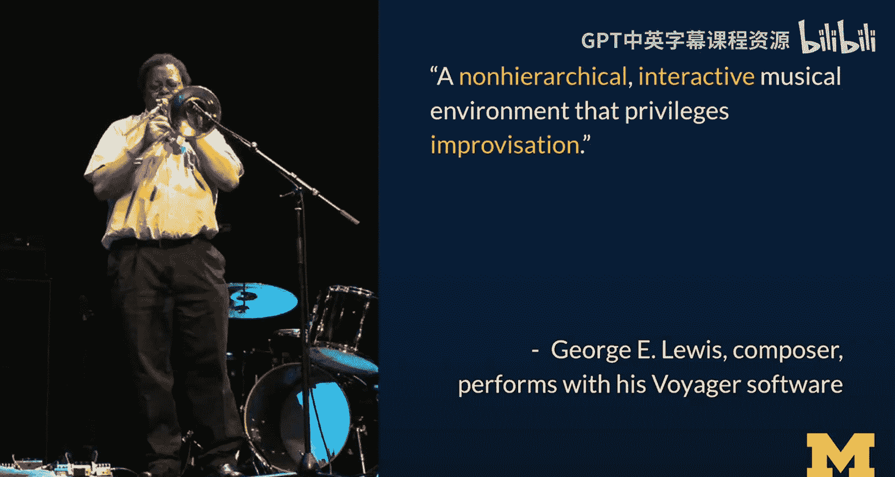
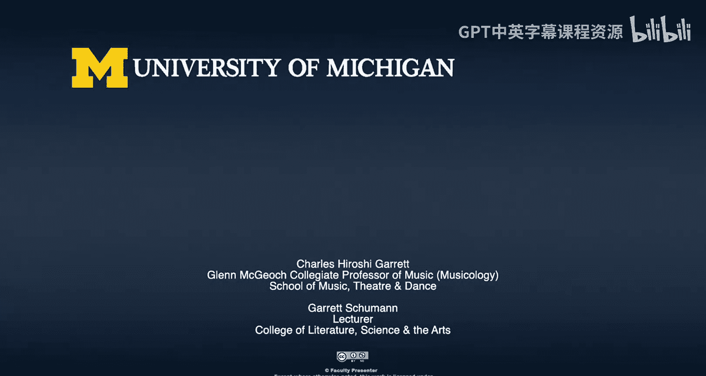

# AI用于创意工作:38：协作创新范例 🎨

在本节课中，我们将探讨人工智能如何参与创意协作。我们将分析AI与人类在决策方式上的根本差异，并通过两位创作者的实例，理解这种协作关系的潜力与局限。

---

## AI作为协作伙伴的本质

AI能够参与创意协作这一观点，既充满争议又引人入胜。

在协作情境中使用AI，突显了一个现实：当前AI工具的决策方式与人类的决策方式截然不同。因此，当我们思考AI在协作中的角色时，必须牢记，它无法以与人相同的方式成为协作者。

这未必是弱点。AI出人意料的结果自有其价值。但如果我们希望将AI视为潜在的协作者，就必须接受这项技术的思考方式与我们不同。从这个角度看，与AI协作从根本上扩展了创意过程，因为AI实际提供的贡献，很可能与一个人为项目或表演带来的贡献不同。

---

## 案例研究：作家Vahini Vera与ChatGPT

获奖作家兼记者Vahini Vera的工作，展示了这些动态，以及她所描述的与ChatGPT的协作。

Vera在2023年9月发表于《连线》杂志、题为《一位病毒式AI写手的自白》的文章中描述了她的经历。她成功地利用该软件撰写了一个关于家庭失去的故事。但由于大型语言模型并非高度定制化的，她不得不忽略其更通用的输出，专注于ChatGPT那些与她个人对真实事件看法产生共鸣的回应。

以下是她的工作流程描述：
> 我一遍又一遍地尝试。每次我都删除AI生成的文本，并在我之前写的内容上添加，要求GPT-3在故事的后半部分接续下去。起初，它一直失败。然后在第四或第五次尝试时，情况发生了变化。AI开始用感觉更真实的语言描述悲伤。随着后续的每一次尝试，它都更接近描述我自己所经历的事情。😔

Vera与ChatGPT的来回互动，在某些方面类似于协作，因为她与软件合作的经验催生了双方都无法独立创造的新作品。

然而，Vera文章的结论并非凯旋。生成式AI的输出受限于训练工具的数据。在此案例中，ChatGPT生成的声音非常通用。此外，正如Vera所写，ChatGPT缺乏实体性，这对其理解世界构成了有意义的限制。这些限制阻碍了当前AI写作所能拥有的内在性。

正如Vera总结道：
> 如果写作是我试图阐明世界对我而言是什么样子的尝试，那么AI的问题不仅在于它无法形成对世界的个人视角，更在于它甚至无法理解世界是什么。

Vera的文章提供了一个重要教训，即我们对像ChatGPT这样面向公众的生成式AI工具，应该和不应该抱有何种期望。在本课程中，我们已经遇到了更多高度可定制的AI软件，例如声音合成程序Brave。我们可以想象，一个更明确地或在Vera个人作品上训练过的写作工具，或许能更成功地满足她的期望。😊

---

## 案例研究：作曲家George E. Lewis与算法程序

相比之下，一些与AI协作的创意实践者完全接受了计算机的非人性，而不是希望技术能更成功地模仿人类决策。

作曲家George E. Lewis自20世纪80年代以来，一直在开发复杂的、由算法驱动的即兴计算机程序。在2000年的文章中，Lewis将他的软件“Voyager”（他AI实验中最著名的一个）描述为一个**非等级制的、互动的音乐环境，推崇即兴创作**。😊

这个非常规的描述再次提醒我们，与AI的协作应被视为与人类协作截然不同的事情，原因很简单：计算机不是人类。值得注意的是，Lewis在他长达数十年的职业生涯中，一直专门使用自制的工具，这使他能够发展出适合其创意价值观和观点的协作模式。😊

---

## 总结与展望

最终，未来人类与AI协作方式最重要的限制，可能部分取决于科技行业自身的发展轨迹。

但是，Vahini Vera和George Lewis的例子有力地证明了，多个学科的创意工作者如何继续学习以有意义的、个人的、独特的且不同的方式，与他们的非人类伙伴进行协作。

在本节课中，我们一起学习了AI作为创意协作者的本质、其与人类决策的根本差异，并通过作家和作曲家的具体实践，探讨了这种协作关系的不同形态与核心局限。关键在于认识到AI的非人性并非缺陷，而是拓展创意可能性的独特起点。