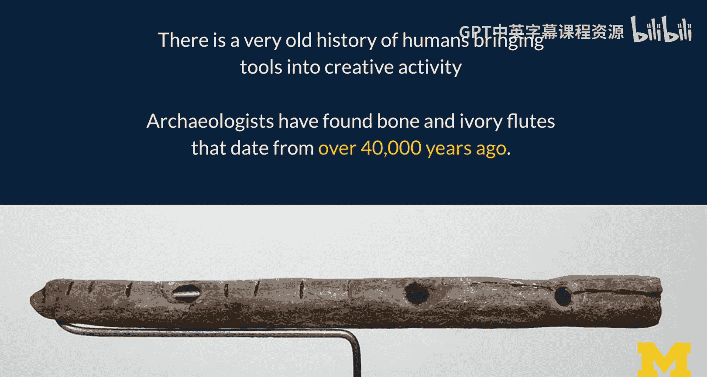
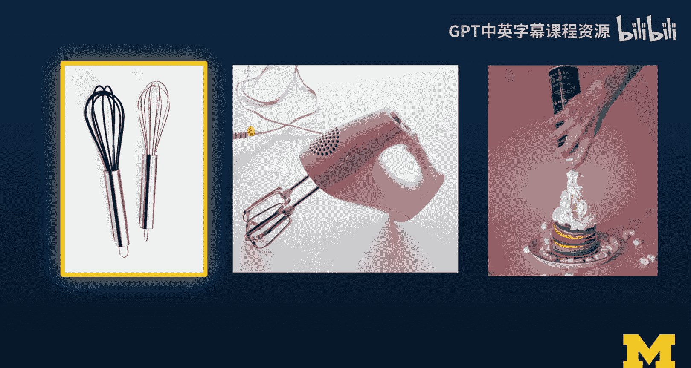
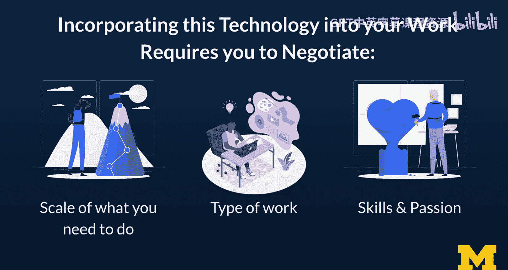
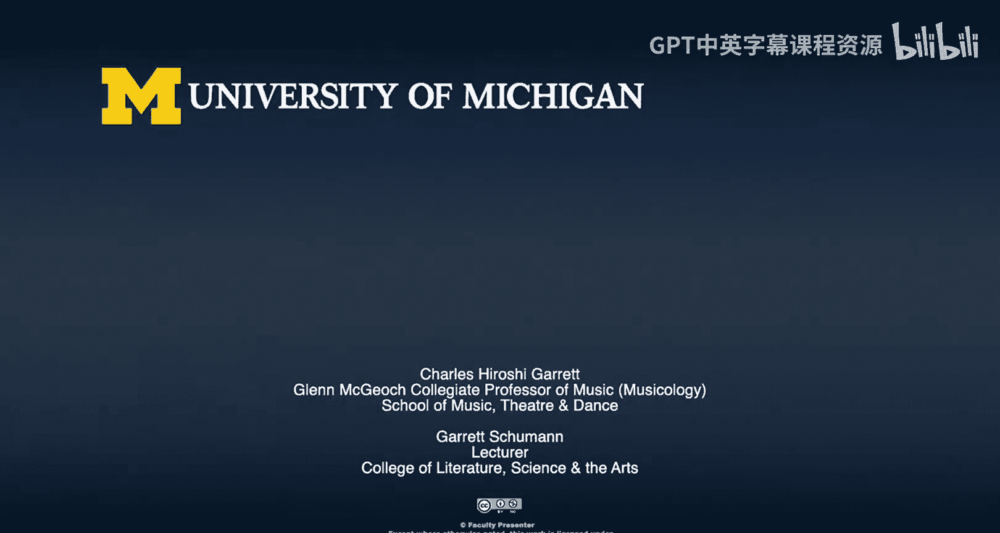

# AI用于创意工作：P39：技术对艺术实践的影响 🎨

在本节课中，我们将探讨生成式人工智能（Gen AI）及其他AI工具如何融入创意工作的历史与技术背景。我们将通过一个生动的比喻，理解不同技术选择对创意过程及成果的影响，并学习如何在创意实践中明智地运用AI技术。

当我们完成本课程，并开始将所学概念与技能进一步应用于生成式AI及其他人工智能工具时，必须将这项技术置于更广阔的历史实践背景中看待。诸如“筛选过程”等方法，以及本系列课程中接触到的理念和各位特邀专家的见解，都能帮助你在面对这项看似潜力无限的新技术时，打下坚实的基础。

我们带着这样的认知来到生成式AI取得突破的当下：人类将工具引入创意活动有着非常悠久的历史。考古学家发现了距今超过四万年的骨笛与象牙笛。历史上也有无数例子表明，新的技术发展会影响创意实践，即使这些技术最初并非为创意用途而设计。必须承认，新工具不可避免地会改变艺术实践和艺术成果，理想情况下，这会带来有益且可接受的权衡。

为了更直观地理解，让我们通过一个日常比喻来探讨技术与创意的关系。

## 一个关于选择的比喻：制作鲜奶油 🍰

想象你在自家厨房，需要一个食谱需要用到鲜奶油。你有三种选择：
1.  用手动打蛋器手工制作鲜奶油。
2.  用电动手持搅拌器搅打奶油。
3.  使用罐装喷射奶油。

以下是三种方法的关键区别：

*   **手动打蛋器**：速度最慢，最费力。但你对工具的控制力也最强。你能感受到奶油在充气过程中质地的变化，并能非常轻松、无缝地调整搅打的强度。
*   **电动手持搅拌器**：让你工作得更快，并在一定程度上控制过程，但控制方式与手动打蛋器不同。
*   **罐装喷射奶油**：除了打开和使用它的时机外，你对其没有任何控制。

在这个比喻中，如果家庭厨师是创意工作者，而鲜奶油是其创意工作的产出，那么我们首先应承认：**每种方法都需要某种工具**。你已经在使用技术来创造事物，但你可能努力根据你的优先事项和需求，选择使用正确的技术。

## 将比喻应用于生成式AI 🤖

当前围绕生成式AI的浪潮，可能会让你觉得驱动你创意工作的价值观几乎没有立足之地。将那些由海量数据驱动的图像、文本和音乐生成器，想象成**罐装喷射奶油**可能会有所帮助。这些即用型工具随时可供你立即使用，但你得到的产品并非定制化的，可能感觉是预先包装好的，缺乏真实感。或许你只以特定方式使用这类生成式AI工具，以确保其提供的局限性不会主导你创意项目的最终成果。

将这项技术融入你的工作需要你进行权衡，考量因素包括：你需要完成的工作规模、你提供或被要求完成的工作类型、你的技能以及你的热情所在。

延续烹饪的比喻：如果你能手工制作出异常精致的鲜奶油；如果你能根据奶油的充气状态娴熟地调整搅打速度；如果你能比任何人都更有想象力地定制风味——那么，支持性AI技术的最佳用武之地可能并不出现在创意过程本身，而在于**其他使你的创造力成为可能的工作中**。

## 掌控你与技术的关系 ⚖️

关键点不在于你必须做出这些选择，而在于**你有权选择你与这项技术的关系**。当前生成式AI工具时代的一个决定性特征是，它们看似具有统治力且势不可挡。但正如我们在整个系列中讨论的，这些产品并非魔法。在某些情况下，这些工具甚至无法提供等同于罐装喷射奶油的效果。但在另一些情况下，经过恰当的考量后，AI工具可能像电动手持搅拌器一样，其特定能力会带来好处，同时付出的代价（就个人风格而言）对你或你的客户来说并不十分明显。

你在本系列课程中学到的技能和概念，将帮助你在创意工作中使用AI时做出必要的判断。但在许多方面，**你的声音和你最关心的创意优先事项更为重要**。坚持这些价值观将有助于确保你掌控自己的创意实践与技术之间的关系。

## 总结 📝

本节课中，我们一起学习了如何历史地看待AI创意工具，并通过鲜奶油的比喻，理解了从完全手动控制到全自动工具的不同技术选择对创意过程与结果的影响。核心在于认识到：技术是工具，而创意工作者有权根据项目需求、个人技能与价值观，主动选择并协商与技术的关系，确保技术服务于创意，而非反之。