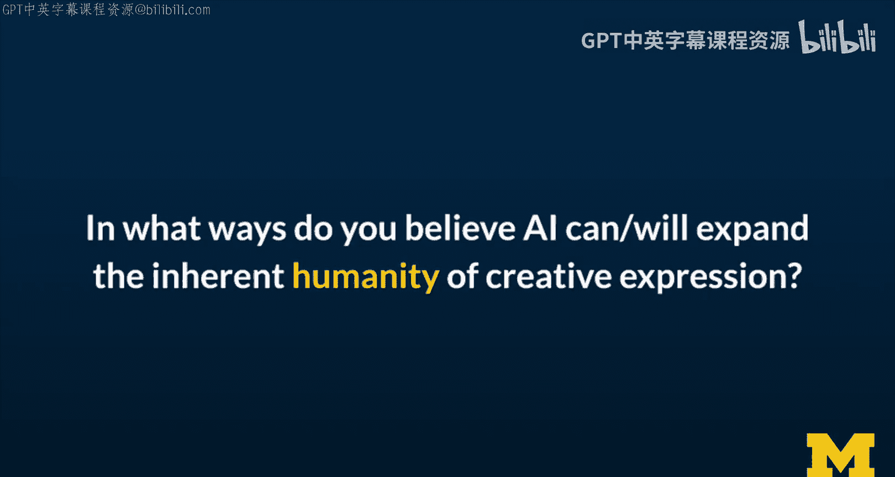
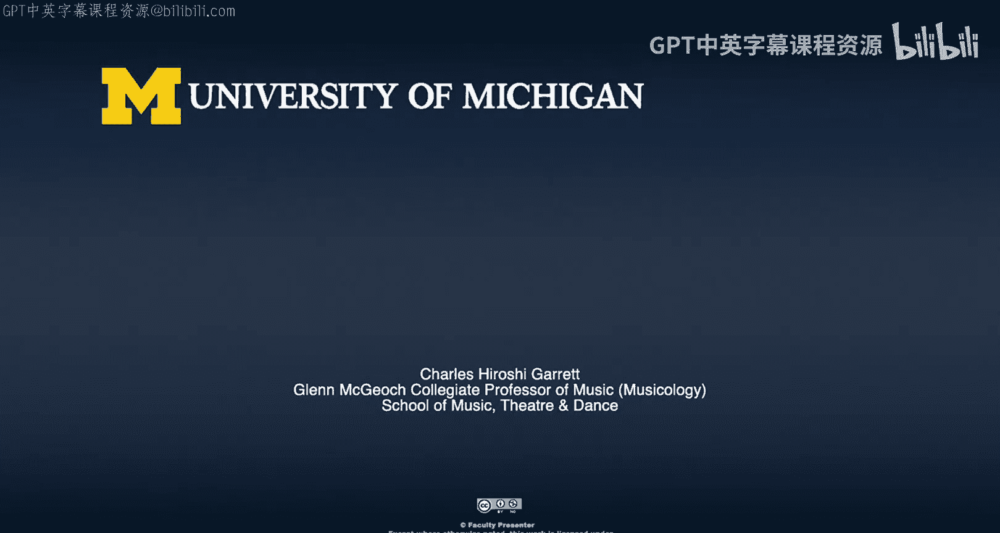

# AI用于创意工作：P40：领域之声：查尔斯·浩石·加勒特

在本节课中，我们将学习查尔斯·浩石·加勒特关于人工智能与创意表达的观点。我们将探讨AI如何影响创意工作，以及人类在其中的决定性作用。

## 人工智能与创意表达的人性本质

我坚信，人工智能有能力扩展创意表达中固有的人性。

但是，这取决于我们，即取决于人类，取决于我，也取决于你，来决定人工智能是否、以及将在何种程度上塑造创意表达。

## 人工智能对社会与职场的影响

上一节我们探讨了AI对创意表达的影响，本节中我们来看看AI对社会和职场的更广泛影响。

这个问题与我如何看待AI对社会的影响、以及对职场的影响等更广泛的问题相关。

有时人们会讨论并担忧AI是否会取代我们，AI是否会夺走我们的工作。这些担忧当然是合理的。

然而，事实上，关于AI是否会取代我们的决定，并非由失控的AI程序做出。

这些决定是由人做出的。人们有责任选择是否采用那些可以协助或取代人类活动的AI解决方案。

## 保持创意过程的主导权

以下是关于如何保持创意过程主导权的核心观点。

我希望这门课程提出的策略和解决方案，能帮助你牢牢掌握创意过程。

并且，如果你选择以此方式前进，AI将扩展你创意表达中固有的人性。

## 总结

本节课中我们一起学习了查尔斯·浩石·加勒特的核心观点。我们认识到，AI是扩展创意表达人性的工具，但最终的决定权和责任在于人类自身。关于AI是否取代人类工作的担忧，其答案也取决于人类的选择。关键在于，我们要主动采用策略，确保创意过程的主导权掌握在自己手中。