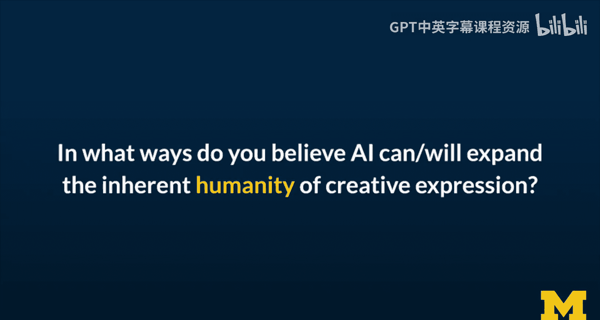
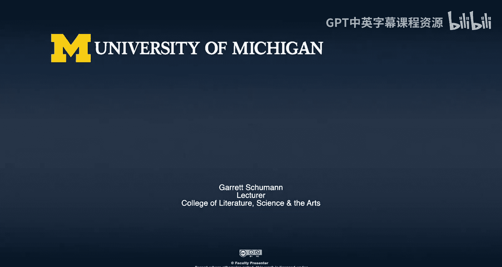

# AI用于创意工作:41：领域之声：加勒特·舒曼 🎵

在本节课中，我们将探讨如何利用高度个性化的AI来扩展作曲家的创作过程，并思考将个人创作本能转化为可交互软件形式的可能性。

---

在回答本系列课程的第一个问题时，我曾提到以下内容。

想象一下，我作为一名作曲家，拥有一个高度个性化的AI程序，它基于我创作过的所有音乐进行训练。

这将通过将我的头脑风暴过程外部化，并允许我与自己的创作倾向和偏好进行对话，从而以不可思议的方式扩展我的创作过程。这能避免将所有复杂的思考都局限在自己的脑海中。

---

在本课程中，我们已经遇到过一些沿此方向进行的初步实验案例。

我们也见过一些AI工具，它们能将个人的创造性表达从其身体中分离出来，例如Hollyplus等声音模型已经以这种形式存在。

但思考以下可能性是令人兴奋的：将个人的创作本能复现为一种软件形式，允许用户从一个全新的视角与自己的思维互动，这将是多么具有变革性。

---

本节课中，我们一起学习了利用个性化AI扩展创作流程的构想。我们探讨了AI如何通过外部化思维过程来辅助创作，并展望了将个人创作本能转化为可交互软件的变革潜力。