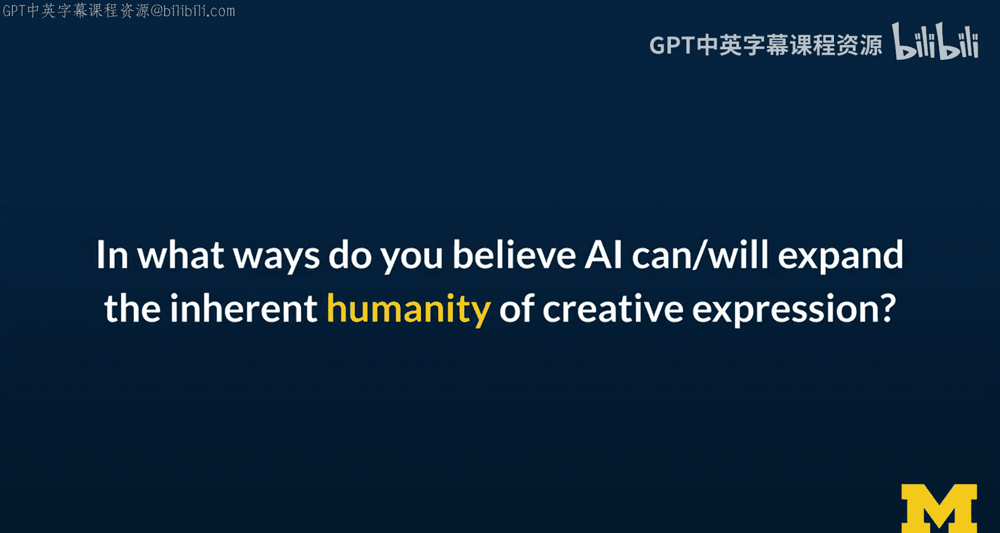
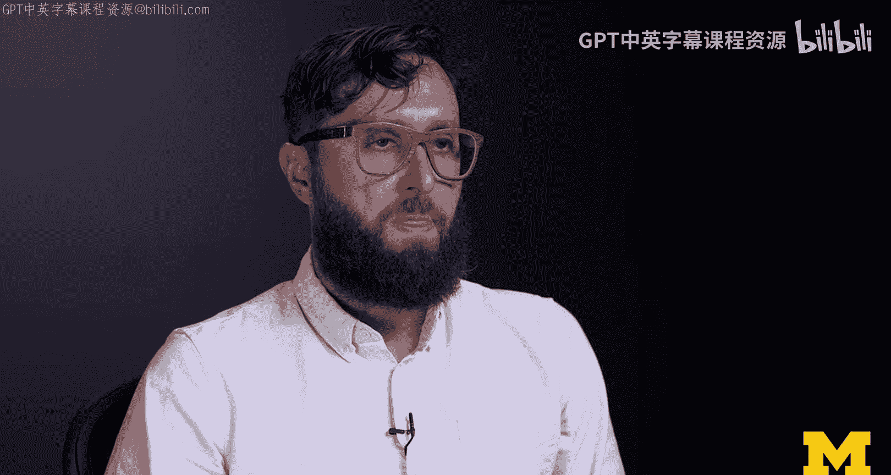
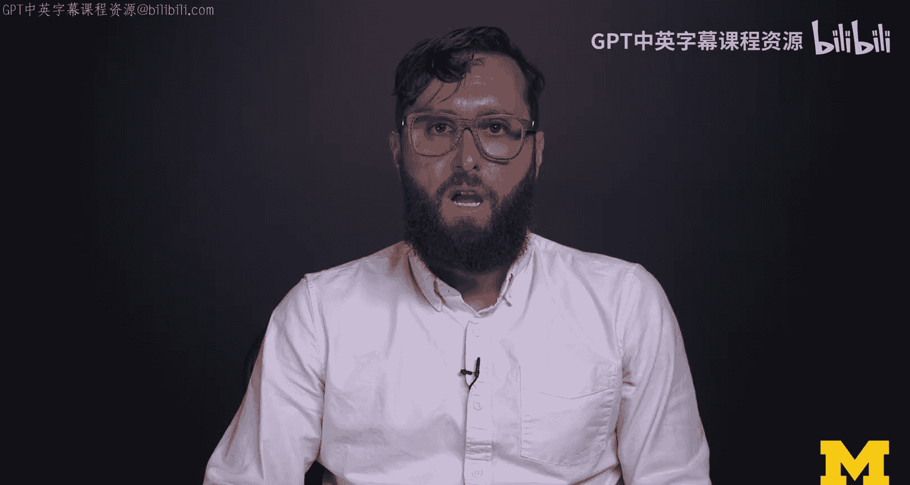
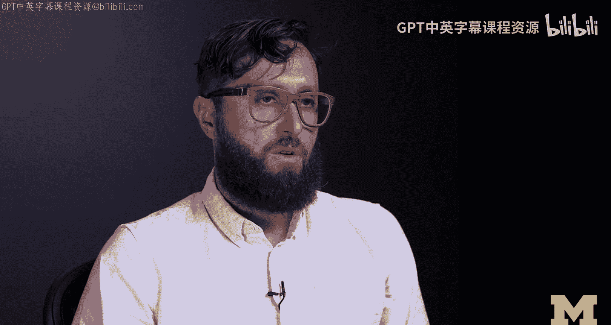
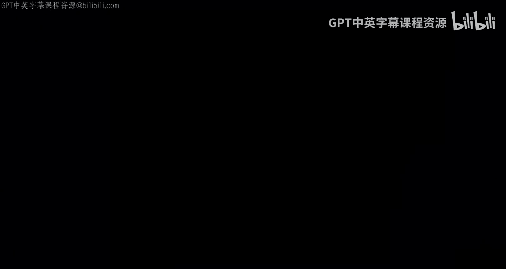
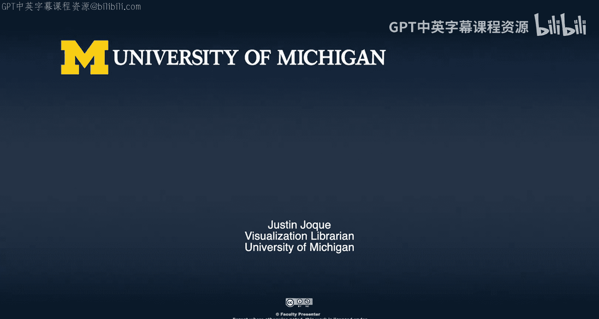

# AI用于创意工作:42：13_领域之声：贾斯汀·约克

## 概述 📋

在本节课中，我们将学习贾斯汀·约克关于人工智能在创意领域应用的见解。他将通过一个具体的算法实例，阐述AI如何被用于创建复杂的实时系统，以生成和修改创意内容，并探讨其从科学领域到艺术领域的跨界应用。

---

在我看来，目前人工智能领域最令人兴奋的进展，是创建出真正复杂的、通常是实时的系统，用于以其他方式不可能实现的方法来生成和修改创意内容。

我可以举一个简单的例子。它可能被称为机器学习，甚至只是一个算法，而非人工智能，但你仍然可以理解其核心思想。

以下是关于Auto-Tune算法的背景与应用：

*   Auto-Tune算法最初是为地震探测的信号处理而开发的。
*   后来有人意识到，它可以用来将歌手的音高调整到正确的音符上。
*   我最近读到，它现在也被用于心脏起搏器中，以检测心率的变化。

这个算法的应用轨迹，从地球到我们的耳朵，再到我们的心脏，展示了技术跨领域迁移的潜力。

当然，即使是Auto-Tune也曾被用来制作听起来单调、相似的音乐。但它同样以极具创意的方式被使用，创造出独特的声音和风格。

其可能性在于它对声音进行的实时处理，艺术家们可以利用这种处理来增强和改变他们自己的声音或其他声音。

---

## 总结 ✨

本节课中，我们一起学习了贾斯汀·约克的观点。他通过Auto-Tune算法的例子，说明了最初为科学目的（如地震探测）开发的技术，如何能够被创新性地应用于艺术创作（如音乐调音）甚至医疗领域（如心脏起搏器）。这揭示了人工智能与算法在驱动跨领域创意突破方面的强大潜力。