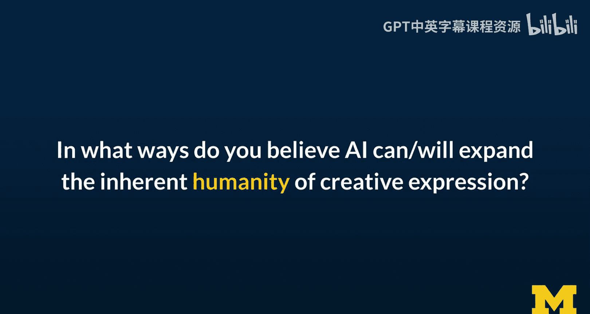
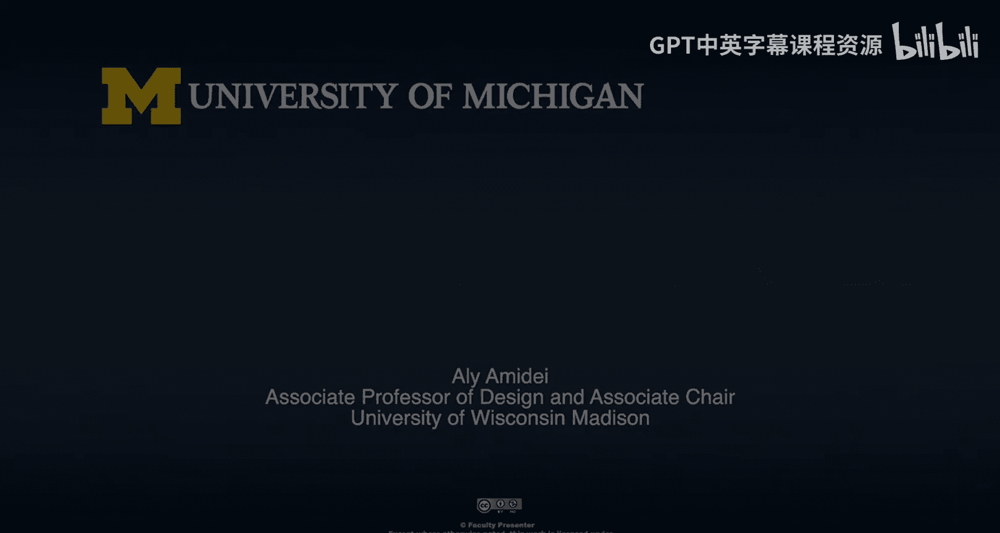

# AI用于创意工作:43：14_领域之声：艾丽·阿米迪 🎨

在本节课中，我们将学习艾丽·阿米迪关于人工智能如何扩展人类创造力的观点。我们将探讨AI作为创意工具的角色，以及它如何通过提升效率、释放创意空间来促进艺术创作。

---

上一节我们讨论了AI在创意领域的潜力，本节中我们来看看艾丽·阿米迪的具体见解。

我认为AI将扩展人类性和创意表达。

AI只是我们用来扩展创造力的另一个工具。

即使在我使用它的短短时间里，它也在帮助提高效率，并为我释放出更多时间和创意脑力空间，以便进行实验和完成工作。

能够进行实验和犯错的时间，才是真正令人兴奋的艺术创作可能发生的地方。

---

以下是艾丽·阿米迪观点的核心总结：
*   AI是**扩展创造力**的工具。
*   AI能**提升效率**，节省时间。
*   节省出的时间可用于**实验和试错**。
*   **实验和试错**是激发精彩艺术创作的关键。

---

本节课中我们一起学习了艾丽·阿米迪的观点：人工智能并非替代人类，而是一个强大的辅助工具。它通过处理效率性任务，为创作者腾出宝贵的“创意脑力空间”和时间，使得专注于实验、探索甚至试错成为可能，而这正是艺术创作中最富活力的部分。拥抱AI，意味着为人类的创造力开辟更广阔的疆域。