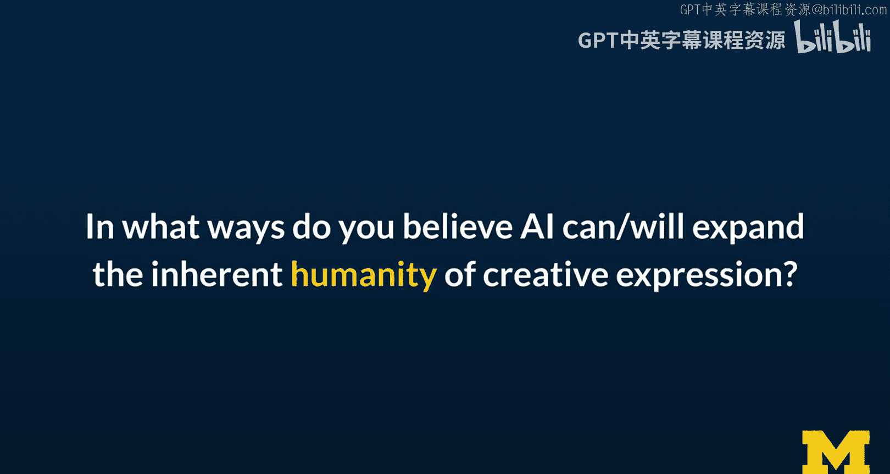
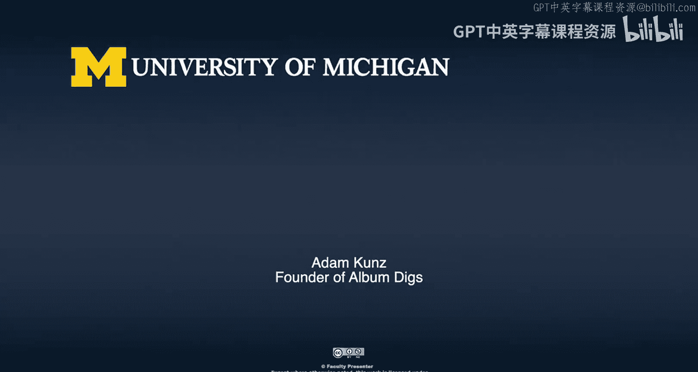

# AI用于创意工作:44：15_领域之声：亚当·昆兹

## 概述
在本节课中，我们将学习亚当·昆兹关于AI如何赋能个人创作者的观点。我们将探讨AI如何帮助创作者实现其原始创意愿景，并分析社交媒体与AI结合如何改变了内容创作与分发的传统模式。

## 核心观点解析

上一节我们介绍了AI在创意领域的潜力，本节中我们来看看亚当·昆兹如何具体阐述AI对个人创作者的影响。

亚当·昆兹认为，AI技术与社交媒体的结合，使得个人创作者能够前所未有地实现其创意愿景。这一观点与之前讨论的其他两个答案一脉相承。他指出，我们现在能够创作出质量更高的内容，并且能以过去无法实现的方式进行分发。

## 传统创作流程的局限

在深入探讨新机遇前，有必要理解传统创作流程的局限性。传统上，创意表达的人性化部分常常受到企业参与的阻碍。

以下是传统分发模式的一个典型例子：
*   **以电视剧概念为例**：个人想出一个电视剧创意。
*   **分发障碍**：个人创作者通常无法直接将这个创意传达给广大观众。
*   **妥协过程**：创意需要经过制作公司、工作室、电视网或流媒体平台等多重环节。在此过程中，创意可能会因为市场潜力、他人意见或企业议程而被多次修改。

## AI与社交媒体带来的变革

理解了传统模式的瓶颈后，我们来看看AI与社交媒体如何共同构建新的解决方案。

现在，通过社交媒体，个人可以立即将内容资产分发给更广泛的受众。然而，在过去，即使有好的想法，个人也难以独立制作出高质量的内容。

以下是新工作流程的关键步骤：
1.  **使用AI进行创作**：作为个人贡献者或小团队，利用AI工具制作精良、有趣的资产。
2.  **利用社交媒体分发**：立即通过社交媒体在线将这些内容分发给更大的群体。

通过这一流程，个人创作者现在能够实现自己最初的、完整的创意愿景，而在此之前，这个过程会受到严重阻碍。

## 总结
本节课中我们一起学习了亚当·昆兹的核心观点：**AI工具 + 社交媒体平台 = 个人创意愿景的直接实现**。AI解决了高质量内容创作的门槛问题，而社交媒体解决了直接面向大众的分发问题。这两者的结合，使得个人创作者能够绕过传统企业化流程中的诸多妥协，真正释放其创意表达的人性化与独特性。