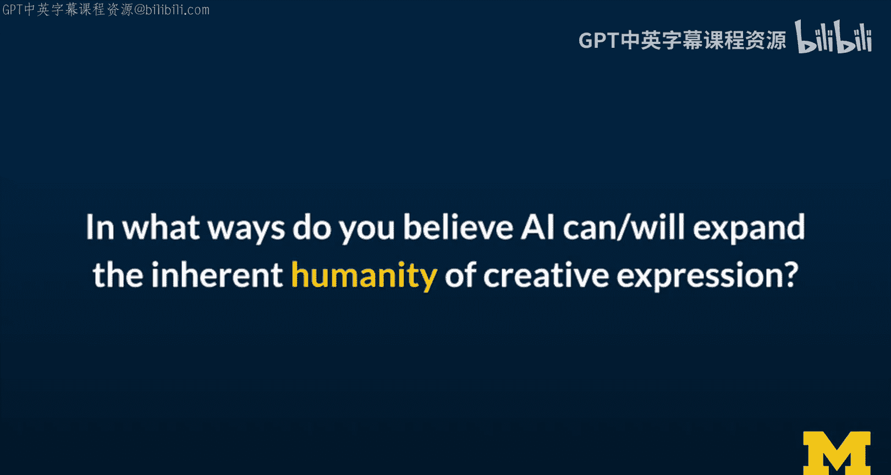
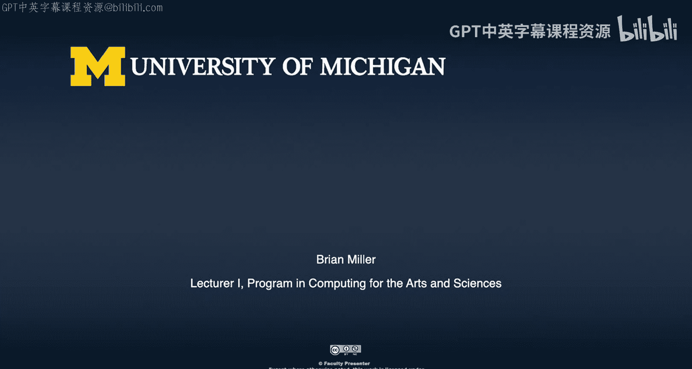

# AI用于创意工作:45：16_领域之声：布莱恩·米勒

在本节课中，我们将学习布莱恩·米勒关于人工智能与艺术创作关系的核心观点。我们将探讨技术革新如何影响艺术的生产与复制方式，并分析AI作为新工具为艺术家带来的机遇与挑战。

## 🎨 技术革新与艺术生产的历史

新技术颠覆艺术生产和复制方式的历史源远流长。

印刷机、摄影术以及计算机本身都属于这类技术。

## 🛠️ 艺术家与新工具的互动

艺术家总能找到引人入胜的方式来运用新出现的工具。

我毫不怀疑，人工智能的情况也将类似。

## 🔄 艺术创作与历史影响

大多数艺术形式在某种程度上都与借鉴前人的影响有关。

从某种意义上说，这正是机器学习工具所做的事情，因为它们建立在包含大量过往作品的数据集之上。

因此，我认为这其中存在巨大潜力。

## ⚖️ 自动化带来的双重影响

但与此同时，我提到的所有技术也都是自动化的形式。

因此，除了带来新的可能性，它们也可能限制艺术家可获得的工作机会和收入。

## 💡 人工智能增强人类创造力的条件

所以在我看来，要让AI增强而非抑制人类创造力，一个必要条件是我们必须维持甚至扩大艺术家从事其创作的机会。

---

本节课中，我们一起学习了布莱恩·米勒对AI与艺术关系的见解。我们回顾了技术如何历史性地影响艺术，探讨了艺术家适应新工具的必然性，并认识到AI作为基于历史数据的学习工具与艺术创作本质的契合点。同时，我们也必须正视自动化技术可能对艺术从业者造成的经济冲击。核心结论是：**确保并扩大艺术家的创作机会，是AI发挥增强人类创造力作用的必要前提**。