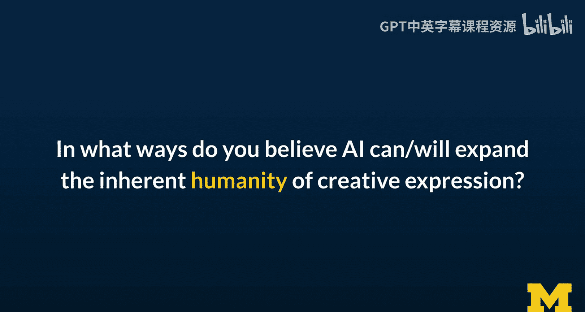
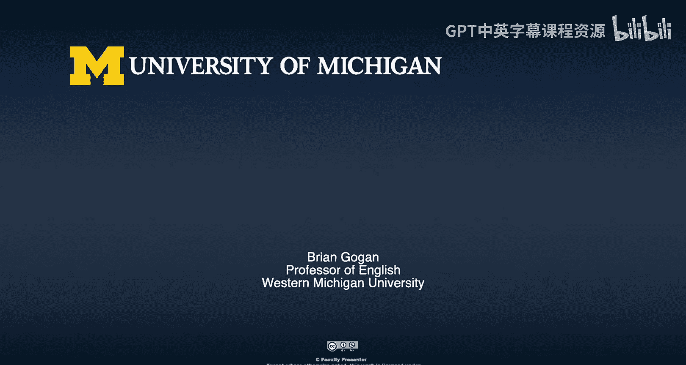

# AI用于创意工作:46：领域之声：布莱恩·高根

## 🎯 概述
在本节课中，我们将学习人工智能如何扩展我们的创作手段，并在此过程中提升人类的意图性。我们将探讨AI在打破表达限制和促进表达民主化方面的潜力，以及有效使用AI所需的关键技能。

---

## 🤖 AI如何扩展创作手段
AI正在扩展我们的创作手段库，打破了过去限制表达类型和模式的边界。

从这个角度看，AI有潜力实现表达的民主化。例如，如果你不熟悉某种写作类型，或者你觉得自己不擅长写作，AI可能会为你提供途径，让你以以前不可能的方式表达自己。

---

## 🧠 AI如何提升人类意图性
上一节我们介绍了AI扩展创作手段的能力，本节中我们来看看AI如何提升人类的意图性。

与此同时，AI正在提升人类的意图性。它迫使我们更好地沟通我们的表达模式和表达目标，而这些方面在很大程度上曾被忽视。

为了有效使用AI，人类不仅需要意识到自己的表达目标，还必须能够以精细的、与表达模式和类型相关的细节水平来沟通这些目标。

---

## 📝 有效使用AI的关键
以下是有效使用AI所需具备的关键能力：

1.  **明确表达目标**：清楚地知道自己希望通过创作实现什么。
2.  **精细沟通能力**：能够向AI详细描述你的意图，包括风格、语气、格式等细节。
3.  **理解表达模式**：了解不同媒介（如文本、图像、音乐）的表达特点。
4.  **连接目标与手段**：将你的创作目标与AI工具的具体功能联系起来。

---

## 🏁 总结
本节课中我们一起学习了AI在创意工作中的双重作用。一方面，它通过打破技术壁垒，**扩展了创作手段**，使更多人能够进行多样化的表达。另一方面，它**提升了人类的意图性**，要求我们更清晰、更细致地思考和沟通自己的创作目标。有效利用AI的关键在于培养明确的目标意识和精细的沟通能力。