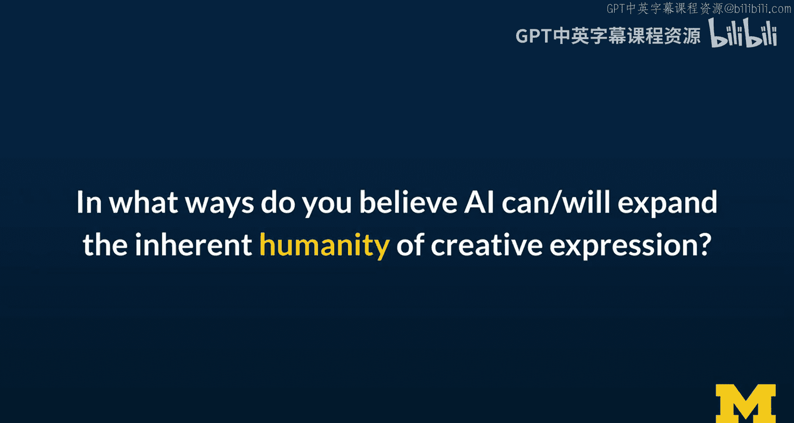

# AI用于创意工作:47：领域之声：凯莉·霍彭詹斯

在本节课中，我们将学习凯莉·霍彭詹斯关于AI与人类创造力关系的核心观点。她强调了人类在AI创意工作中的根本性作用，并探讨了如何在与AI的合作中保持人性的中心地位。

## 人类创造力的根本性起源

上一节我们介绍了AI在创意领域的应用，本节中我们来看看凯莉·霍彭詹斯对AI创造力本质的解读。

我认为，AI的创造力从根本上源于人类。即使技术有时会掩盖这一点，但除了需要人类的提示外，AI的运作也离不开庞大的人类创意数据库作为支撑。这些数据可能来自书籍、音乐、社交媒体帖子，或任何我们创造的内容。

## 被忽视的人类劳动

不仅如此，我们还不应忘记AI程序员以及为AI系统标注和清理数据的工人的劳动，他们的贡献常常被严重忽视。

## 在AI艺术中寻找人性

我的希望是，尽管AI艺术具有新颖性和魅力，但我们仍要记得在其中寻找人性，并在我们与AI的合作中，将人类的智慧和创造力置于中心位置。

## 赋予AI产出更深层的意义

AI或许能产出逼真的人类表达仿制品，但赋予它们更深层的意义和共鸣，则取决于我们。

以下是凯莉观点的核心总结：
*   **人类是源头**：所有AI创意都根植于人类已有的创造和数据。
*   **劳动被低估**：AI的发展依赖于大量幕后人类劳动者的贡献。
*   **人性是核心**：在与AI协作时，应始终以人类的创造力和智慧为主导。
*   **意义由人赋予**：AI产出需要人类来注入深度和共鸣。

本节课中我们一起学习了凯莉·霍彭詹斯的观点，她提醒我们，在拥抱AI创意工具的同时，必须认识到并珍视其中不可或缺的人类元素与劳动。真正的创意协作，应是技术辅助下的人类智慧表达。