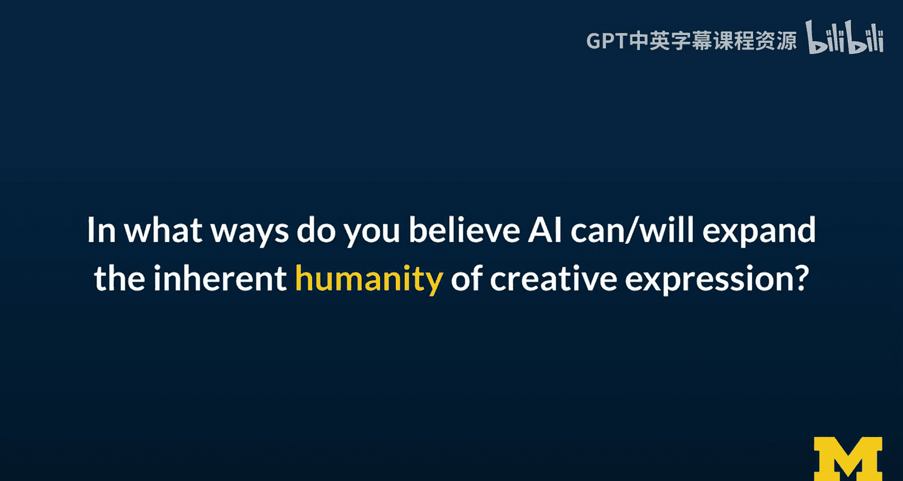
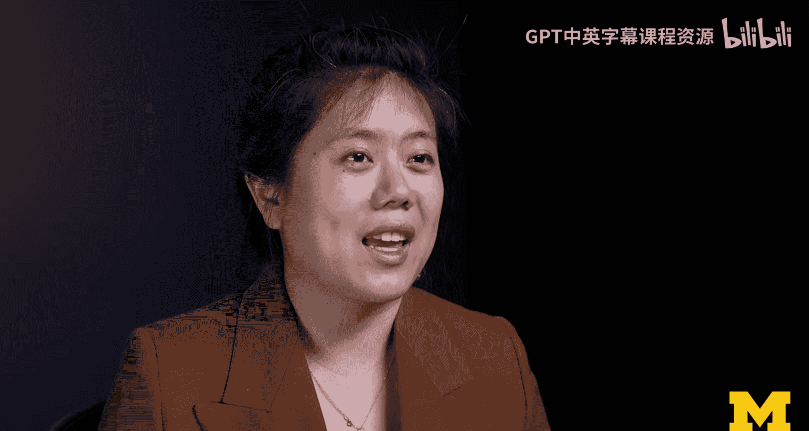
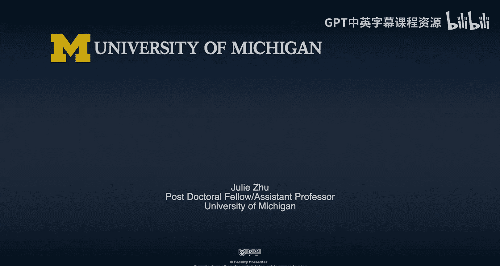

# AI用于创意工作：P48：19_领域之声：朱莉·朱 🎨

## 概述
在本节课中，我们将学习艺术家朱莉·朱关于AI与人类创造力关系的核心观点。我们将探讨AI处理数据与人类的不同之处，以及艺术家应如何利用AI作为工具，而非被其能力所限制。

---

AI处理数据的方式与人类不同，这意味着它在某些方面更擅长，而在另一些方面则有所不足。

因此，我对艺术家们抱有希望，希望他们能够坚定地立足于自己想要创作的内容，让他们的想象力去驱动机器能完成的工作。

---

上一节我们提到了AI与人类能力的差异，本节中我们来看看艺术家应如何定位自己与AI的关系。

艺术家不应仅仅迎合机器所擅长的领域。

---

## 总结
本节课中我们一起学习了朱莉·朱的核心观点：AI与人类看待数据的方式存在根本差异，各有优劣。艺术家应坚持自身的创作意图，用想象力引领AI工具，而不是被AI的特长所束缚。这强调了在创意工作中，人的主体性和创造性思维的核心地位。