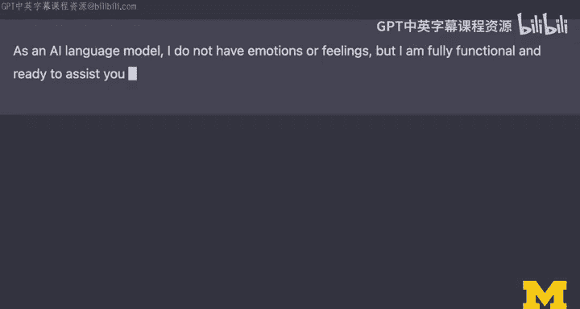

# ChatGPT 示教｜ChatGPT Teach-Out：P4：ChatGPT的感知准确性 🔍

在本节课中，我们将探讨ChatGPT生成文本的流畅性与感知准确性之间的关系，并分析这种关系如何影响我们对信息可靠性的判断。

---

我是Michael Wellman，密歇根大学计算机科学与工程系的教授兼系主任。我从事人工智能研究多年，我的工作主要研究经济学与人工智能的交叉领域，包括人工智能如何运用经济学原理，以及理解人工智能在经济背景下的应用及其经济影响。

我们通常习惯于根据一份知识产品（如文档或文本）的呈现是否专业、语言是否流畅连贯、内容是否切题来评估其质量。

因为ChatGPT-3在自动生成文本的能力上实现了显著的飞跃，能够达到非常好的连贯性和流畅度，我们很可能基于这些我们惯用的判断标准，感知其内容是准确可靠的。在一个需要投入大量时间、教育和研究才能创造出连贯、流畅且有学识的文本的世界里，这些判断方式曾是可靠的。

然而，当人工智能可以廉价地完成这项工作时，这个等式就被颠覆了。我们可能不再拥有文本表面的流畅度等因素与其可靠性和准确性之间的那种关联。

试图维护声誉的企业、组织或个人，可能会对使用ChatGPT或类似技术发布大量材料持谨慎态度，因为他们无法确保这些材料的准确性或质量。

事实上，我认为声誉是我们遏制滥用行为的最佳机制之一。我们更需要担心的是那些没有声誉的实体，例如匿名攻击者、网络喷子或来源不明的第三方。他们没有需要维护的声誉，因此更可能利用这些方法来达到他们的目的。

我认为这也意味着，我们可能需要投入更多资源来建设追踪信息来源、认证材料出处的技术基础设施。这样我们才能确保信息与一个拥有声誉、且在意维护该声誉的实体相关联，而不是仅仅声称其来源可信。

如今，对于在互联网上遇到的任何信息，或任何你不确定来源的信息，都必须非常谨慎和警惕。因为它可能是为了误导而恶意人工创建的，也可能是通过不可靠、不准确的方法生成的。任何一种情况都可能带来不良后果。因此，这意味着你需要对信息持保留态度，我们所有人都必须稍微调整我们的信息过滤器。

---

本节课中，我们一起学习了ChatGPT生成文本的流畅性如何影响我们对准确性的感知，探讨了声誉机制在信息验证中的作用，并认识到在人工智能时代，我们需要更加谨慎地评估信息来源，并可能依赖新的技术基础设施来确保信息的可靠性。