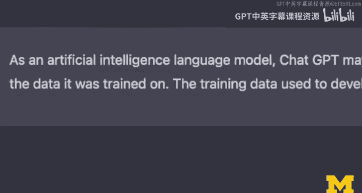

# ChatGPT 示教：P6：ChatGPT拟人化输出的利弊

## 概述
在本节课中，我们将探讨ChatGPT生成类人化输出的价值与潜在问题。我们将分析这种特性如何吸引用户，以及它可能带来的挑战，特别是在教育、个人沟通和信息可信度方面。

## 类人化输出的价值
ChatGPT的一大价值在于其类人化的回应能力。这种特性吸引了大量用户。用户可以输入任何查询，例如“如何在周日制作华夫饼”，ChatGPT不仅会以互联网上常见的说明形式回答，其过程更像是一个人在逐步指导你。对于文章写作也是如此，你可以要求它写一篇文章，而它的成果读起来就像学生写的一样。这正是人们喜欢用它来辅助写作的原因。

## 类人化输出带来的问题
然而，这种类人化特性也引发了许多问题。特别是在教育环境中，由于AI生成的内容听起来完全像人写的，抄袭变得非常容易。教师们很难判断一份作业是AI还是学生完成的。为此，OpenAI实际上已经发布了一个额外的工具，用于识别内容是否由ChatGPT撰写。这至少是教师可以在课堂中采用以防止此类情况发生的一种手段。

类人化回应可能产生问题的另一个原因是，当人们发送本应是个性化的信息，却事后发现它实际上由AI撰写时。例如，有人在推特上分享他用ChatGPT为孩子写了一封来自圣诞老人的信。这引发了一个思考：现在你并不是在亲自为孩子撰写那条充满个人情感的信息。可以想象，如果有人用AI给母亲写生日祝福，而母亲发现这些本该是亲手写的信息来自AI机器人而非写信人本人，她可能不会特别高兴。我认为这些是未来可能变得有些棘手的领域。虽然可以想象人们会逐渐习惯收到AI撰写的信息，但使用者可能需要在运用这些工具时更加坦率地说明情况。

## 信息可信度与偏见风险
类人化回应可能引发问题的另一个领域是，人们可能开始相信ChatGPT所说的一切都是真实且正确的。如果你访问其网站，会发现它给出了警告，声明其算法并非100%完美，有时可能会提供错误信息。但很多人会跳过这些初始信息，直接输入他们想听的内容。如果ChatGPT提供了错误信息，特别是在潜在的高风险情境下，人们可能会接受错误信息，并且并不真正了解其真实性或原因。

许多AI算法的构建基于主流群体的想法和大多数人的输入，这导致ChatGPT给出的回应可能在多方面存在偏见。因此，学会识别何时存在偏见、何时偏见较少，是一项重要的技能，而我们中的许多人可能并不具备。我自己也肯定无法总是判断一个答案是否是最佳答案。但由于它通常只给出一种回应，这种回应是基于其数据库中收集的众多信息综合而成的，人们可能会倾向于认为那一个回应就是最佳或最真实的回应，而事实可能并非如此。

## 总结
本节课我们一起学习了ChatGPT类人化输出的双重影响。我们看到了它如何通过提供自然、易懂的互动提升用户体验，特别是在指导和写作方面。同时，我们也深入探讨了由此引发的挑战，包括学术诚信问题、个人沟通真实性的疑虑，以及对信息准确性与算法偏见的担忧。理解这些利弊有助于我们更负责任、更批判性地使用这项强大的技术。