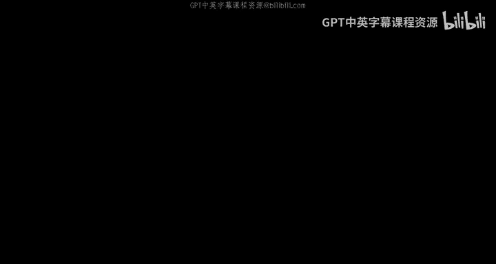
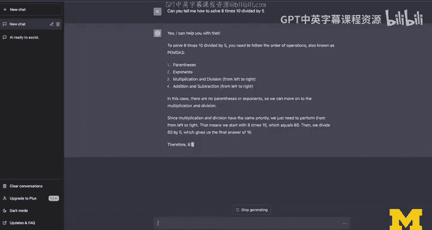

# ChatGPT 示教：8：选修：ChatGPT 示例 - 简单数学题 🧮

在本节课中，我们将通过一个具体的例子，学习如何使用 ChatGPT 来解决基础的数学问题。我们将看到 ChatGPT 如何遵循数学运算顺序，并清晰地展示解题步骤。

大家好，我是 Sam，我是 Moisa。今天我们将通过四个不同的示例来展示如何使用 ChatGPT。

首先，我们将使用 ChatGPT 来解一道数学方程式。

我将询问 ChatGPT 是否能告诉我如何计算 **8 × 10 ÷ 5**。

它正在思考。好的，ChatGPT 不仅给出了答案，还按照 **PEMDAS** 运算顺序（即括号、指数、乘除、加减）分解了计算步骤。

随后，它给出了最终答案。

答案是 **16**。

---

本节课中，我们一起学习了如何向 ChatGPT 提出一个简单的数学问题。我们看到，ChatGPT 能够遵循正确的数学运算法则（PEMDAS），并逐步展示计算过程，最终得出正确答案。这展示了 ChatGPT 在处理结构化、有明确规则的任务时的实用性。