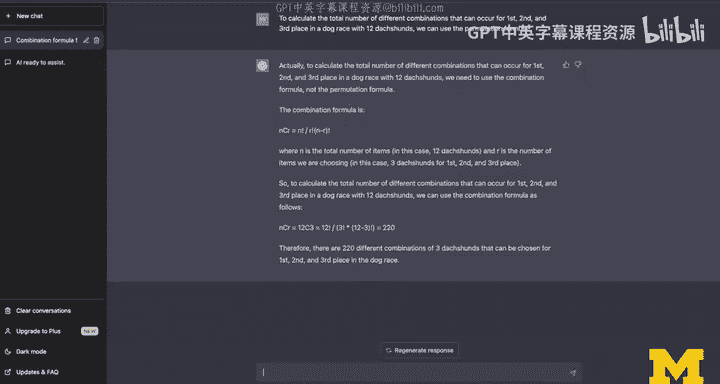

# ChatGPT 示教｜ChatGPT Teach-Out：P9：选修：ChatGPT示例-复杂数学题

在本节课中，我们将通过一个具体的数学问题示例，来观察ChatGPT如何处理复杂的排列组合计算。我们将看到它如何理解问题、选择公式，并最终给出解答。

## 问题引入

现在，我们将尝试让ChatGPT解决一个关于排列的问题示例。

## 问题陈述

为了计算一场有12只腊肠犬参加的赛狗比赛中，获得第一、第二和第三名的不同组合总数，我们可以使用排列公式。

## ChatGPT的思考与解答过程

ChatGPT正在思考。随后，ChatGPT给出了回答。

实际上，要计算一场有12只腊肠犬参加的赛狗比赛中，获得第一、第二和第三名的不同组合总数，我们需要使用**组合公式**，而不是排列公式。

组合公式是：
**nCr = n! / [r! * (n - r)!]**

其中：
*   **n** 是物品的总数（在本例中为12只腊肠犬）。
*   **r** 是我们选择的物品数量（在本例中是为第一、第二和第三名选择3只腊肠犬）。

因此，要计算这场赛狗比赛中前三名的不同组合总数，我们可以按如下方式使用组合公式：

**12C3 = 12! / [3! * (12 - 3)!] = 220**

所以，在这场赛狗比赛中，共有 **220** 种不同的三只腊肠犬组合可以被选为第一、第二和第三名。

## 总结

本节课中，我们一起学习了ChatGPT如何应用组合数学公式解决一个具体的赛狗比赛排名问题。我们看到，它首先识别出问题本质是组合而非排列，然后正确引用了组合数公式 **nCr**，并逐步代入数字（n=12, r=3）进行计算，最终得出了220种可能组合的答案。这个例子展示了ChatGPT在解决有明确数学框架的问题时的逻辑推理能力。